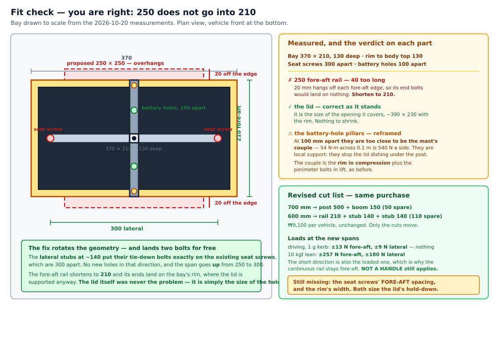

# 2. Vehicle Prep & Mechanical

**Goal:** prepare the chassis and mount the steering actuator and encoders mechanically.

Disassemble the necessary trim, identify the steering column and drive-motor shaft,
and fit the steering gearmotor, the absolute steering-angle sensor, and the drive-shaft
encoder. Keep the modifications minimally invasive and reversible.

- **Prerequisites:** Section 1 complete; chassis selected.
- **Specification:** [design/vehicle.md](../design/vehicle.md), [design/dbw.md](../design/dbw.md)
- **Expected outcome:** actuator and sensors mechanically mounted; stock steering still
  reassemblable.

> [!WARNING]
> **Draft — not yet validated on hardware**
>
> No MRider vehicle has been disassembled yet. **There are no teardown photos, no bracket
> dimensions, and no torque figures in this page, because none have been measured.** Every
> such value is marked *(measure during bring-up)*. This page gives you the procedure and
> the record sheets; you produce the numbers.

---

## 2.1 Before you take anything apart

**Photograph everything.** Every trim panel, every connector, every cable route, before it
moves. The reversibility requirement means you must be able to put this vehicle back to
factory-stock, and the parent-remote harness routing is not documented by the manufacturer.

Run the [vehicle.md §3 verification checklist](../design/vehicle.md) on the unit you
actually bought — the candidate models in the design doc were evaluated from listings, not
in person. Specifically confirm:

| Check | Why it matters | Result |
|---|---|---|
| Battery is genuinely 12 V | The whole power tree assumes it, and [ADR D-R](../design/vehicle.md#adr-d-r-reversal-to-the-12-v-single-seater-2026-08-08) pinned the class | *(measure during bring-up)* |
| Two independent rear drive motors | [Throttle path](../design/dbw.md#7-throttle-path) parallels them onto Sabertooth M2 | *(measure during bring-up)* |
| Steering column is accessible without cutting | Reversibility principle | *(measure during bring-up)* |
| Column has a stock steering motor, or is hand-turned only | Determines whether the steering tap intercepts an existing motor or adds one | *(measure during bring-up)* |
| Paralleled drive-motor **stall current** vs. 32 A/channel | Sabertooth rating limit ([dbw.md §7](../design/dbw.md#7-throttle-path)) | *(measure during bring-up)* |
| Front wheel travel is ≈ ±22.5° | The pinned steering range ([dbw.md §12](../design/dbw.md#12-numeric-interface-contract)) | *(measure during bring-up)* |

> [!CAUTION]
> **Disconnect the battery before disassembly**
>
> The traction pack is live at the motor terminals even with the vehicle "off" on many
> ride-on models. Pull the pack or the main fuse first.

## 2.2 Teardown

Work in this order and bag-and-tag fasteners by panel.

1. **Remove the seat and body trim** covering the rear motor bay and the steering column.
   Ride-on bodies are typically self-tapping screws into plastic bosses — they strip easily,
   so go slow and do not over-torque on reassembly.
2. **Identify and photograph the stock harness.** You need three interception points, and
   you want to see them before anything is cut or unplugged:
    - the **throttle** leads to the rear motors,
    - the **steering** leads (if a stock steering motor exists),
    - the **12 V pack** output.
3. **Expose the steering column** from the wheel down to the linkage. Note the column
   diameter, its total lock-to-lock rotation, and whether there is a usable flat or
   D-profile for a coupler set screw.
4. **Expose one rear drive-motor shaft.** Only one shaft is instrumented — see
   [ADR C](../design/dbw.md#8-adr-c-drive-distance-encoding) — so pick the more accessible
   one and note which side, because your odometry inherits that side's behavior in turns.

**Record sheet — teardown measurements**

| Measurement | Units | Value | Method |
|---|---|---|---|
| Column diameter | mm | *(measure during bring-up)* | Calipers |
| Column lock-to-lock rotation | ° | *(measure during bring-up)* | Angle gauge on the wheel |
| Road-wheel travel, center → full lock, left | ° | *(measure during bring-up)* | Angle gauge on the tire |
| Road-wheel travel, center → full lock, right | ° | *(measure during bring-up)* | Angle gauge on the tire |
| Column-to-road-wheel ratio | — | *(measure during bring-up)* | Derived from the two rows above |
| Drive-motor shaft diameter | mm | *(measure during bring-up)* | Calipers |
| Instrumented side | L / R | *(measure during bring-up)* | — |
| Wheelbase (rear axle → front axle) | m | *(measure during bring-up)* | Tape |
| Track (wheel separation) | m | *(measure during bring-up)* | Tape |
| Loaded wheel rolling circumference | m | *(measure during bring-up)* | Mark tire, roll one revolution |

The last three rows feed the Ackermann parameters in
[software.md §3.2](../design/software.md#32-ackermann-kinematic-parameters), which are
currently B-MROVER placeholders — treat **every** dimension there as a placeholder until you
have filled this table.

## 2.3 Column travel decides your angle sensor

You ordered a sensor in step 1 based on an estimate. Confirm it now, before mounting.

- **Column lock-to-lock ≤ ~300°** → the single-turn potentiometer is correct. Coupled 1:1 to
  the column, its absolute range maps monotonically across the whole travel with margin.
- **Column lock-to-lock > ~330°** → you are inside the pot's end-stop/dead-band risk, or past
  one turn entirely. Either take the sensor off a reduced take-off shaft, or switch to the
  multi-turn magnetic option — the escape hatch in
  [dbw.md §6](../design/dbw.md#6-adr-angle-sensor-technology-magnetic-encoder-vs-potentiometer).

> [!NOTE]
> **The pot's dead-band must sit outside the working range**
>
> A single-turn pot has a mechanical/electrical dead zone at the ends of its sweep. Mount
> it so that the **±22.5° road-wheel working range lands near the middle** of the pot's
> travel, not near either end. You verify this during zeroing in
> [step 6](06-bench-test.md), but you have to get the mounting clocking approximately right
> now — rotating a bonded coupler later is unpleasant.

## 2.4 Mount the steering gearmotor

The gearmotor drives the column through the existing steering linkage and is driven by
**Sabertooth channel 1 (M1)**. The Teensy commands it as a *signed effort* — the output of the
position loop — never as an angle
([dbw.md §2.3](../design/dbw.md#23-why-the-sabertooth-receives-an-effort-command)).

1. **Decide the coupling point.** Either directly on the column (simplest, needs a coupler
   sized to the column diameter) or on the tie-rod arm (more mechanical advantage, more
   bracket work). Whichever you pick, the sensor and the motor must see a **rigid,
   backlash-free** path to the road wheels or the position loop will hunt.
2. **Fabricate or print the motor bracket.** It must resist the *stall* torque of the motor,
   not its rated torque — a position loop against a limit will apply full effort until the
   Teensy's stall detector clamps it. Reuse the mrover 3D-print approach
   (`config/3D_design/v3/`) as a starting point for enclosures.
3. **Fit the coupler** with set screws onto a flat or D-profile if one exists. If the column
   is perfectly round, use a clamping-style coupler — set screws on a round shaft will slip,
   and a slipped steering coupler means your absolute reference silently walks away from
   center.
4. **Check for interference through full travel** — turn lock to lock by hand and confirm
   nothing fouls the body, the linkage, or the wiring.

**Record sheet — steering actuator**

| Item | Value |
|---|---|
| Measured peak force `F` at rim, center → lock, stationary, full load | *(measure during bring-up)* N |
| Lever radius `r` | *(measure during bring-up)* m |
| Computed `τ_column = F × r` | *(measure during bring-up)* N·m |
| Motor rated torque (through coupling ratio) | *(measure during bring-up)* N·m |
| Margin achieved (target ≥ 2×) | *(measure during bring-up)* |
| Coupling point | column / tie-rod arm |
| Motor model + gear ratio | *(record)* |
| Bracket source | printed / fabricated — *(record STL or drawing)* |

If you have not yet done the torque measurement, the procedure is
[dbw.md §2.2](../design/dbw.md#22-torque-measurement-procedure-before-sizing-the-gearmotor) —
do it **at full load on the target operating surface**, because tire scrub on carpet and on
asphalt differ enough to change the motor choice.

## 2.5 Mount the absolute angle sensor

This sensor is the authoritative angle source for the entire system
([ADR B](../design/dbw.md#5-adr-b-steering-angle-encoding)). Everything downstream —
the position loop, odometry, the behavior-cloning steering labels — inherits its mounting
quality.

1. **Couple it 1:1 to the column** (or to a take-off that sees ≤ one turn).
2. **Clock it so the working range is centered** in the sensor's sweep (§2.3).
3. **Mount the body rigidly.** A sensor body that can rotate under vibration produces a slow,
   invisible calibration drift — the exact failure mode the absolute sensor was chosen to
   avoid.
4. **Strain-relieve the wiring.** For the pot fallback, feed it from the Teensy's *regulated* rail so the
   reading is ratiometric and supply drift cancels
   ([dbw.md §6 consequences](../design/dbw.md#6-adr-angle-sensor-technology-magnetic-encoder-vs-potentiometer)).

The gearmotor's own incremental encoder, if it has one, mounts with the motor and is
auxiliary — it provides velocity and stall detection only.

## 2.6 Mount the drive-shaft encoder

> [!WARNING]
> **This section used to describe the mrover shaft-adapter method. You cannot do it on this
> vehicle, and following it will waste a teardown.** It called for a 3.15 mm → 5 mm adapter onto
> the drive-motor shaft with the encoder bracketed to the motor mount. This vehicle's motor has a
> **2 mm shaft carrying a pinion straight into a sealed gearbox** — there is no shaft to couple to
> and no face to bracket against. That is exactly why
> [§1.2.3 branches A and B](01-bom-sourcing.md#6-drive-encoder-what-to-actually-buy) were closed and
> **Branch C** taken. *Corrected 2026-10-06.*

Measure at the **gearbox output hub** instead — 1:1 with the wheel, which is better than the motor
shaft was going to be. The buildable form is specified in full at
[§1.2.3](01-bom-sourcing.md#6-drive-encoder-what-to-actually-buy); the mechanical work here is:

1. **Pull the wheel.** The carrier is a one-piece ring and goes on over the hub.
2. **Print the fit mule first** (`PART = "gauge"` in `cad/drive_encoder_carrier.scad`), fit it,
   refit the wheel and **turn one revolution**. Nothing may touch. Do not populate a carrier with
   magnets until a mule has passed on that vehicle.
3. **Fit the carrier**, rotating it one lobe so the three grub screws drop into lobe gaps rather
   than onto crests, and tighten them in rotation so the ring centres itself.
4. **Bracket the two Hall latches to something that does not turn**, with both sensors in one
   printed part so their **6.80 mm** spacing is fixed by construction rather than by assembly.
5. **Route the encoder cable away from the motor leads.** Encoder lines next to a PWM'd motor pick
   up noise that reads as phantom ticks.

**Concentricity still matters, and the mount now supplies it** rather than asking the builder for
it: the carrier is centred by three screws on a round hub, and the bracket clamps the gearbox
housing nose, which is concentric with the axle. A carrier that runs out produces periodic tick
errors that alias into odometry — the same failure the old shaft-adapter note warned about, from a
different cause.

**Direction comes from quadrature, so the two sensors are not optional** and neither is the
**latch** type — [§1.2.3](01-bom-sourcing.md#6-drive-encoder-what-to-actually-buy) explains why a
Hall *switch* cannot do this job.

> [!NOTE]
> **You are instrumenting one motor of a paralleled pair**
>
> This is a known, documented limitation, not a mistake. Motor-shaft measurement inherits
> gearbox backlash, wheel slip, and differential wheel speed in turns. The EKF fuses it
> with the IMU to bound drift, and step 6's roll-out calibration bounds the scale error.
> See [ADR C consequences](../design/dbw.md#8-adr-c-drive-distance-encoding) — this is
> worth understanding now, because it is why nobody should expect raw wheel odometry to
> close a loop.

## 2.7 Mount the sensor mast and compute

Camera and LiDAR mounting geometry comes from
[sensors.md §5](../design/sensors.md#5-mounting-mast-concept). Two mechanical constraints
matter at this stage:

- **Rigidity.** Extrinsics calibrated in step 6 are only valid while the mast holds its
  geometry. A mast that flexes under acceleration invalidates the camera↔LiDAR projection.
- **Reachability.** You will re-seat USB connectors more often than you expect during
  bring-up. Do not bury them.

The laptop rides on its own battery and is not wired into the 12 V system in v1
([safety.md §5](../design/safety.md#5-power-rail-isolation-and-brownout-protection)) —
mechanically, it just needs a secure, ventilated place to sit.

### 2.7.1 What this stage actually builds

> [!IMPORTANT]
> **The seat is a lid over the battery bay. Build a better lid.**
>
> 
>
> [vehicle.md §3](../design/vehicle.md) records that this chassis has **no flat deck** — the seat is
> the only flat area, it comes out, and an **equipment plate** takes its place. What it does not say
> is what the seat was sitting *on*, and this section guessed twice before the teardown photograph
> of 2026-10-19 settled it.
>
> **Lift the seat and the traction battery and the stock controller are sitting in an open bay whose
> walls finish in a continuous flat rim.** The contour that looked like a moulded plinth belonged to
> the seat pan, not to the vehicle.
>
> **So the equipment plate is simply that bay's lid — and that is both simpler and stronger.** One
> rectangle, one cut, one measurement, and the four individually-measured printed standoffs
> disappear, because the rim is already one flat plane.
>
> **The structural reason is the better one.** A plate carried on four moulded bosses takes the
> whole mast moment as **pull-out on two of them**, which is the failure this chassis invites. A
> plate **bearing on a continuous rim** takes one side of that moment as **compression along a
> plastic edge — which is where plastic is strong** — and only the lifting side reaches a fastener
> at all. Simpler and stronger at the same time is rare; take it.
>
> **Keep the 250 mm base rail.** The rim fixes the anchoring; the rail stops the post foot crushing
> a local patch of 12 mm plywood, and it is already part of the 900 mm cut.
>
> **Three rules, from what the bay turned out to contain.** *(D8, D9 and D10, answered 2026-10-19.)*
>
> 1. **The lid stops AT the rim on every edge — no overhang.** There is an **external charge port
>    on the wall between the bay and the footwell**, so the bay never has to be opened to charge —
>    *as long as nothing covers that port*. Overhang the footwell edge and the charge port ends up
>    buried under a plate with a mast bolted to it. The same applies on the floor: **do not park the
>    MDDS30 in the plug's approach.**
> 2. **Put the vent opening directly over the controller.** The bay is now a thermal enclosure and
>    needs venting anyway — and the **controller's top is flat and flush with the rim**, which would
>    otherwise mean the lid lands on it. A controller is an electronic part, not a structural one.
>    **One cut solves both**, and it puts the venting exactly where the heat is made. The battery
>    has spare depth above it and needs nothing. **Keep the base rail over the battery side**, so no
>    load path reaches the controller at all.
> 3. **Build the loom with connectors, not splices.** There is **no breaker or switch inside the
>    bay**, so with the charge port external the bay needs no routine opening and **the mast on the
>    lid is confirmed**. This is now good practice rather than a requirement — but
>    [§2.8](#28-confirm-reversibility) already forbids cut stock wiring, so it costs nothing.
>
> **The footwell keeps one job: the MDDS30.** 102 × 97 × 42 mm, 260 g, wants open air, and is
> awkward to enclose anywhere — while the footwell is flat, low and otherwise empty.

Five parts, in this order. **Nothing is cut or printed before
[V4](../order-log.md) is filled in** — the drive encoder cost four wasted
prints and 20 g of filament by designing to a hub diameter nobody had measured across.

| Order | Part | Made from | Gated on |
|---:|---|---|---|
| 1 | **Bay lid** — the equipment plate | 12 mm birch plywood, rim to rim, **vent opening over the controller** | V4 **D3** |
| 2 | **Mast + base cross + 4 pillars** | 2020 T-slot profile on the lid; pillars printed PETG | V4 **D11**, **D12** |
| 3 | **LiDAR mount** | printed PETG, clamps to the 2020 T-slot | V4 **S** |
| 4 | **Camera mount** | printed PETG, clamps to the 2020 T-slot, ~10–15° down | V4 **S** |
| 5 | **Two enclosures** | printed PETG, heat-set M3 inserts from [#14](../order-log.md) | V4 **E**, plus #7 and #8 in hand |

**The mast is extrusion, not a print.** A 0.65 m printed tube delaminates along its layer lines
under exactly the bending load a mast sees, and that flex lands straight in the camera↔LiDAR
extrinsics the bullet above calls load-bearing. The T-slot earns its place twice over: sensor height
becomes adjustable **without reprinting a bracket**, which matters over sixteen weeks.

**The plate is plywood, not aluminium or print.** A 30–40 cm span is past most printer beds, and a
split plate puts a glue joint directly under the mast base. Plywood also takes the **vent slots**
the bay now needs with a jigsaw rather than a milling setup. Plywood is re-drillable on the bench
with a cordless drill, which is what a cohort of thirteen moving the layout actually needs, and it
damps better than aluminium — relevant because vibration is an IMU and camera problem here, not a
comfort one.

**Two enclosures, not one** — power (contactor, relay MUX, fuses, XT60, logic battery, UBECs) and
logic (Teensy, RC signal MUX, receiver). The rail isolation in
[safety.md §5](../design/safety.md#5-power-rail-isolation-and-brownout-protection) is currently a
claim in a document; two boxes make it something you can see without a meter, and they keep a 30 A
PWM harness out of the box students open every week.

> [!WARNING]
> **The motor driver goes in neither box.**
>
> The MDDS30 dissipates into a heatsink. Enclose it and the heatsink does nothing. It mounts in
> **open air on the plate**, under a vented guard that stops a dropped spanner reaching the
> terminals — a guard, not a case.

### 2.7.2 The layout and the cut plan

**A 700 mm and a 600 mm length of T-slot profile per vehicle. Three cuts, ₩9,100.**

| Piece | Length | From | Job |
|---|---:|---|---|
| **Post** | 500 mm | the 700 | vertical; carries everything |
| **Camera boom** | 150 mm | the 700 | horizontal, forward, at ~380 mm |
| **Fore-aft rail** | **165 mm** | the 600 | **continuous**; the post stands on it, **T-slot up** |
| **Lateral stubs ×2** | **125 mm** | the 600 | **butted against the rail's left and right faces** at mid-length |

> [!IMPORTANT]
> **Re-derived for the 320 × 215 lid — do not cut to the older 190/140 figures**
>
> Those were sized when the seat screws were believed to be a **300 × 190 rectangle**. They are not:
> there are **two fixings, both at one edge**, at (10, 25) and (310, 25). So the base is set by the
> **lid's edges** instead, at **25 mm of edge distance for every bolt** in 12 mm plywood:
>
> - lateral: bolts at **±135** → span **270** → stub = (270 − 20) ÷ 2 = **125**
> - fore-aft: bolts at **±82.5** → rail = **165**
>
> **±82.5 lands the rail's ends on the same line as the two seat screws**, which is luck rather
> than design, but take it. **415 mm of the 600 is used; 185 spare.**

That leaves **180 mm spare per vehicle** — 50 off the 700 and 130 off the 600, enough for a second
stub if a cut goes wrong.

> [!IMPORTANT]
> **Fit check against the measured bay — the first numbers did not fit**
>
> 
>
> **Measured 2026-10-20: the bay is 370 × 210 × 130 deep**, the body rim sits **130** above it, the
> **seat screws are 300 apart laterally**, and the **spare battery holes 100 apart**.
>
> **A 250 mm fore-aft rail does not fit a 210 mm bay** — 20 mm hangs off each edge and the end bolts
> land on nothing. **Rail 210, stubs 140: a 210 × 300 base.**
>
> **The rotation pays twice.** The lateral span goes **up** from 250 to 300, and at 140 the stubs
> put their tie-down bolts **exactly on the existing seat screws** — no new holes in that direction.
> The rail's ends then land on the bay rim, where the lid is supported anyway. **The purchase does
> not change**; only the cuts move.
>
> **The lid was never oversized.** It is the size of the opening it covers, ~390 × 230 with the rim.
>
> **At these spans:** a 1 g kerb strike is **±13 N fore-aft, ±9 N lateral** — nothing. A 10 kgf lean
> is **±257 N and ±180 N**. The short direction is also the loaded one, which is why the continuous
> rail stays fore-aft — and why **NOT A HANDLE** still earns its label.

> [!CAUTION]
> **Buy only from the listing titled `DF2020 … 프로파일`. The same seller also lists `앵글 DAB 2020`.**
>
> The second is an **L-angle**, not a T-slot extrusion. It is cheaper per millimetre, carries the
> same `DF2020-xxxmm` part numbers, and appears in the same search results — and it is **useless
> here**: no T-slot means no T-nuts, no sliding brackets, and no way to clamp the boom.
>
> **This caught us.** The first sourcing pass quoted ₩6,460 for 1000 mm and ₩1,690 for 200 mm and
> built an argument on the "non-linear price ladder" those implied. Both were the angle. The ladder
> was not irregular; it was **two different products read as one**.
>
> The profile lengths actually listed are **50 · 80 · 100 · 300 · 600 · 700 · 900 mm**. The 200, 400,
> 500 and 1000 mm entries are **angle only**, which is why the cut list above uses 700 + 600.

Aluminium 2020 cuts with a hacksaw and a mitre box. **File each cut square** — a post that meets
the rail out of square puts the whole mast out of plumb, and the camera pitch is then wrong by
whatever the error is.

> [!IMPORTANT]
> **The base is a cross, not a rail — because one rail is stiff fore-aft and floppy sideways**
>
> 
>
> A single rail ties the post to the lid at two points **250 mm apart fore-and-aft** — a proper
> base. Sideways it ties it to nothing: the post is held only by the **~20 mm arms of its corner
> brackets**, which against a 500 mm post is a **25 : 1 lever**.
>
> **The fix is two 115 mm stubs butted against the rail's left and right faces at mid-length.** All
> three pieces stay **coplanar** at 20 mm, so the post still stands on the rail and the two extra
> corner brackets land on the stubs' top slots exactly as the fore-aft pair land on the rail's. The
> base becomes **250 × 250 mm, four tie-downs, four brackets at the foot.**
>
> **115 is `(250 − 20) ÷ 2`** — the span, less the rail's own 20 mm width, halved.
>
> **One 250 and two 115s, not two 250s. That is not a shortfall in the cut list.** Two continuous
> 20 × 20 bars **cannot occupy the same 20 mm layer where they cross** — they would have to be
> stacked, which lifts the post 20 mm and strands the lower pair of brackets 20 mm below the post's
> foot. **Exactly one of the two directions has to be split**, which is why the cut list reads
> `250 · 115 · 115`.
>
> **So the base is symmetric in SPAN but not in CONSTRUCTION, and the softer direction is chosen
> rather than inherited.** Both directions reach their tie-downs 125 mm from the post axis, so the
> lever arms match. But fore-aft the post stands on **unbroken metal**, while sideways the load
> passes through **two bracket joints**. The brackets are strong enough — 216 N through a pair of M5
> is nothing — but a bolted joint is never quite as stiff as a continuous beam.
>
> **The continuous member goes fore-aft because that is where the loads are:** braking and kerb
> strikes act front-to-back, and the camera boom overhangs forward, so its mass is a *standing*
> fore-aft moment. Cornering is the only lateral case, and this vehicle corners at walking pace.
>
> **Four 115 mm arms would be perfectly symmetric — and strictly worse**, because then all four
> joints are brackets. This arrangement makes two of them unbroken metal for the same part count
> and the same price.
>
> **Symmetry is the point, not elegance.** This mast exists to hold the camera↔LiDAR geometry
> still, and **vibration is omnidirectional** — a ride-on drivetrain buzzes in every axis at once.
> A base stiff in one plane and soft in the other does not halve the problem, it **hides** it: the
> image smears more in one direction than the other, which reads as a lens or calibration fault
> rather than as a loose mast. That is a miserable thing to debug in week eleven.
>
> The whole fix costs **₩8,550 across three vehicles.**

**Eight corner brackets per vehicle.** Four at the post foot — **front, rear, left and right** —
two tying each lateral stub to the fore-aft rail, and two at the boom joint, above and below, which
is what stops the camera drooping and twisting. The rail and the stubs need no brackets to the lid:
they bolt **down through the plywood into T-nuts** in their upward slots, four tie-downs in all,
which is both stronger and easier to move later. The LiDAR needs none either — a printed cap slides
onto the post's top end and carries its bolt pattern.

> [!IMPORTANT]
> **Stand the mast on the four spare battery-fixing holes**
>
> 
>
> *(An earlier revision of this section claimed the bay had two fore-aft supports. **It does not** —
> that was misread from a photograph. What it has is better.)*
>
> **Three screw holes are moulded into each side of the battery recess, and the retaining strap uses
> only one of them per side. Four are spare**, and they form a rectangle straddling the battery.
>
> **These are the only points inside the bay engineered to hold something against vehicle motion**,
> and they sit where the mast actually stands. So use them: **printed PETG pillars rise from the
> spare holes to the underside of the lid, and the base rail is through-bolted** — one bolt from the
> top runs rail → lid → pillar → boss.
>
> **But they are local support, not the mast's couple — corrected 2026-10-20.** The spare holes
> measure **100 mm apart**, and a 54 N·m moment across 0.1 m is **540 N a side**, which would strip
> a moulded boss. What the pillars actually buy is that **the lid cannot dish under the post** and
> the post gets a hard footing straight onto chassis. **The couple that resists the mast is still
> the rim in compression plus the perimeter bolts in lift** — which is what §2.7.1's lid-on-a-rim
> argument said before the pillars were ever proposed. Claiming the load path ran through them was
> wrong, and the measurement is what showed it.
>
> **D12 — depth from the rim plane to each boss face**: the pillar heights, and they need not be
> equal. Measure all four.
>
> **Do not disturb the strap's own screw, and check the battery can still come out.** A pillar that
> blocks the battery's lift-out path has traded one problem for a worse one.
>
> **Cover the vent opening with a printed louvre, not a bare hole.** This vehicle goes outdoors, and
> the opening sits directly over the stock controller.

> [!IMPORTANT]
> **The LiDAR goes on TOP of the post, and the camera below it on the boom — the reverse of
> [sensors.md §5](../design/sensors.md#5-mounting-mast-concept)'s ordering**
>
> That section puts the camera at the top and the LiDAR below it. **It also gives the reason — the
> body and mast tube should "occlude as little as possible" — and the reason beats the ordering.**
>
> A post running past the side of a LiDAR subtends a **permanent blind sector of roughly 20°**: a
> 20 mm post at ~55 mm from the scan centre. It is in every scan, every map and every costmap, and
> it points backwards, which is where you most want to see while reversing. Put the post **under**
> the scan plane instead and the occlusion is **zero** — the mast simply ends below the sensor.
>
> The price is camera height: **~390 mm instead of ~550 mm.** That is acceptable because the
> camera's height only has to be **fixed and recorded**, not maximised — §5's own warning is that a
> policy trained at one height does not transfer, which is an argument for writing the number down,
> not for making it large. At 390 mm and 12° down the optical axis meets the ground at ~1.8 m, so
> the 2–8 m band §5 asks for is still well inside the frame.
>
> **Record the final heights in [calibration.md](../design/calibration.md)** before the first
> behavior-cloning dataset is captured.

> [!WARNING]
> **The seat bolts thread into body plastic — confirmed 2026-10-19. Label the mast NOT A HANDLE.**
>
> Run the numbers rather than guessing. 0.5 kg of sensors at 0.555 m hitting a kerb at 1 g is
> **2.7 N·m**; across the 250 mm base rail that is **±11 N, about 1 kgf per end** — a moulded boss
> shrugs it off. One adult leaning **10 kgf** on the mast top is **54 N·m**, which is **±216 N or
> 22 kgf of pull-out per end**, and that is what tears a boss out of a moulding.
>
> **Driving is not the hazard. Handling is.** So the response is three cheap changes rather than a
> heavier mast — the **250 mm base rail** (a couple, not a point load), a **plate that extends past
> the seat bolt pattern** so it bears on the tub shell in compression, and **large backing washers**
> under the plastic. Then the rule that follows from the second number: never lift, push, drag or
> park the vehicle by the mast, and put a label on it saying so where a student will read it.

### 2.7.3 The lid

**The lid is a plain rectangle: 320 × 215 mm, 12 mm plywood.** The 370 × 210 measured earlier
included the body's **curved raised ends**; excluding those, a 320 × 215 rectangle drops straight in
and covers the opening. No template, no tracing — a saw cut.

**Cut four, not three.** Thirteen students, sixteen weeks, and one lid will be ruined. Four stack in
a 320 × 860 column of a 600 × 1200 board, so 280 × 1200 of offcut survives for enclosure backing and
test pieces.

> **If a cut comes out a millimetre proud, sand it.** A millimetre undersize is harmless — the rim
> is 10–20 mm wide, so the lid still bears. **Oversize is the only error that stops it dropping in.**

> [!WARNING]
> **The vehicle gives only TWO fixings, and both are on one edge**
>
> They sit at **(10, 25)** and **(310, 25)** — 300 apart, along a single edge. That is **half a
> hold-down**, and it matters because of how a lid on a rim actually works: it needs **compression
> on one side and tension on the other**. The rim supplies compression everywhere. **Tension needs a
> fastener**, and there are two, both at one end.
>
> Lean the mast **away** from them and the screws take it. Lean it **toward** them and the far edge
> **hinges up with nothing there.**
>
> **The fix costs nothing: the two spare battery bosses become the second anchor pair.** The rail
> takes **four bolts** — its **ends** into the lid, 165 apart, which is the couple that resists the
> mast; and its **middle pair** down through the lid into printed PETG pillars standing on those
> bosses, which is what stops the hinge. That finally gives the bosses a job their 100 mm spacing
> can actually do: **holding a lid down, not resisting a moment.**

> [!IMPORTANT]
> **Orientation is load-bearing: fit the lid with the two screws at the REAR**
>
> The camera boom overhangs forward, so the mast carries a **permanent forward-tipping moment**.
> Forward lean presses the front edge onto the rim and **lifts the rear** — which is exactly where
> the two screws are. Fitted the other way round, that standing load rides on the pillars all day,
> every day, instead of on steel-threaded fixings the vehicle already provides.

**Base, re-fitted to the lid: rail 165, stubs 125 — a 165 × 270 base**, which keeps **25 mm of edge
distance** for every bolt in 12 mm plywood. Penny washers under all of them.

**Mast centred, both ways**, and the reasons still agree: laterally centred keeps the LiDAR on the
vehicle centreline rather than as a lateral offset in every transform forever; fore-aft centred puts
the rail over the battery bosses so the pillars have something to stand on; and it is clear of the
controller at the right rear where the vent must go.

> [!NOTE]
> **Birch rather than plain plywood, and the reason is edge distance**
>
> The hold-down screws sit **10 mm from the lid's edge** — the vehicle chose that, not us. **무절
> birch has no voids**; a plain veneer sheet can easily put one directly under a bolt, and a bolt
> bearing on a void is a bolt that pulls through. At 10 mm there is no margin to spend.

### 2.7.4 Before the first cut

- [ ] [V4 **D**](../order-log.md) — deck geometry, **and whether the seat bolts thread into metal or plastic**
- [ ] [V4 **S**](../order-log.md) — LiDAR and camera bodies; both parts are already in hand
- [ ] [V4 **E**](../order-log.md) — every item destined for the two boxes, measured **and weighed**
- [ ] Build **vehicle 1 only**, fit it, drive it, then repeat for 2 and 3

## 2.8 Confirm reversibility

Before moving to electrical, satisfy yourself that this is still a stock vehicle underneath:

- [ ] No stock harness wire has been **cut** — all interception is at inline connectors
- [ ] All removed trim and fasteners are bagged, tagged, and photographed
- [ ] The stock steering path still functions mechanically if the gearmotor is unbolted
- [ ] You can describe, out loud, how to return this vehicle to factory condition

## 2.9 Gate to step 3

- [ ] Teardown record sheet complete — all *(measure during bring-up)* rows filled
- [ ] Column travel measured; angle-sensor technology confirmed against it
- [ ] Steering gearmotor mounted; ≥2× torque margin confirmed against measured `τ_column`
- [ ] Absolute angle sensor coupled, clocked centered, rigidly mounted, strain-relieved
- [ ] Drive-shaft encoder mounted concentric, cable routed away from motor leads
- [ ] Full steering travel checked for interference, lock to lock
- [ ] Wheelbase, track, and loaded rolling circumference recorded for
      [software.md §3.2](../design/software.md#32-ackermann-kinematic-parameters)
- [ ] Reversibility checklist (§2.8) passes

---

**Previous:** [1. BOM & sourcing](01-bom-sourcing.md) · **Next:** [3. Electrical & wiring](03-electrical.md)
