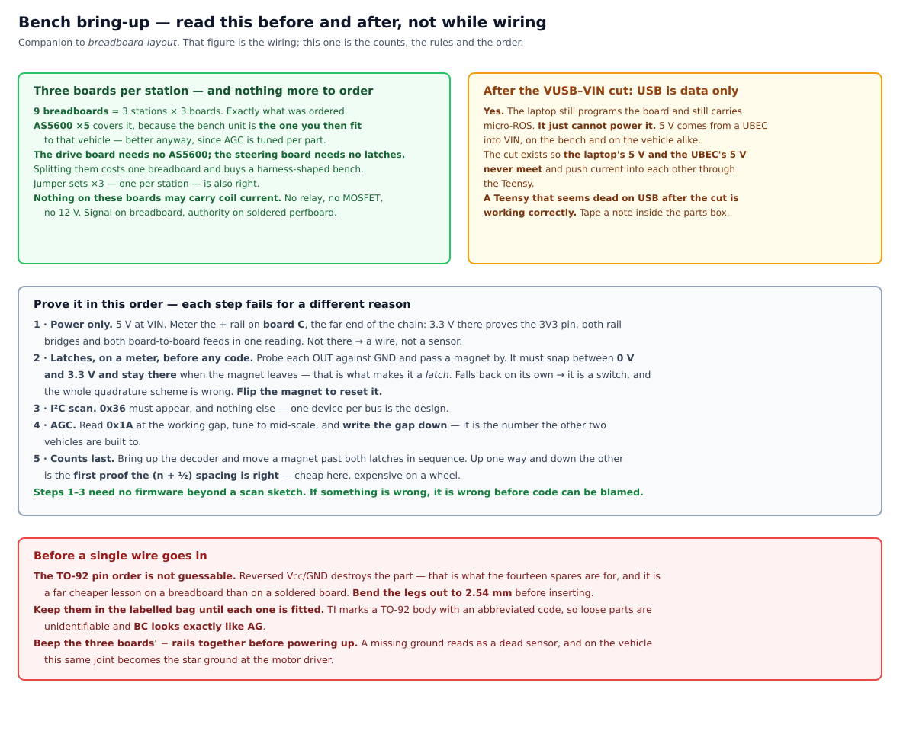

# 3. Electrical & Wiring

**Goal:** build the power and signal harness, including the authority MUX and E-stop.

Wire the traction rail, the isolated logic rail, the motor driver, the Teensy,
the relay-MUX (STOCK vs. DBW), the hardware RC signal MUX, and the hardware E-stop. Verify
rail isolation and default-to-stock behavior before energizing anything downstream.

- **Prerequisites:** Section 2 complete.
- **Specification:** [design/dbw.md](../design/dbw.md), [design/safety.md](../design/safety.md)
- **Expected outcome:** harness continuity-checked; relay defaults to STOCK; E-stop cuts
  traction power only.

> [!WARNING]
> **Draft — not yet validated on hardware**
>
> This wiring plan is derived from the
> [architecture.md power tree](../design/architecture.md#5-power-tree-and-safetyauthority-chain)
> and [safety.md](../design/safety.md). It has **not** been built. Fuse values, wire gauges,
> and relay contact ratings depend on the stall currents you measured in step 2 and are
> marked *(measure during bring-up)*.

> [!CAUTION]
> **This is the step where mistakes become dangerous**
>
> Everything before this was mechanical. From here the vehicle can move under power. Wire
> the E-stop and the MUX **first**, verify default-to-STOCK **before** energizing the
> motor driver, and keep the vehicle wheels-off until step 7.

---

## 3.1 The two rails

MRider has exactly two power rails, and the split is safety-critical.

```
Chassis traction pack
  │
  └──▶ E-stop contactor (cuts TRACTION only) ──▶ Relay MUX ──┬──▶ STOCK: parent-remote receiver + ESC
                                                             └──▶ DBW:   Motor driver B+
                                                                          ├─ M1 → steering gearmotor
                                                                          └─ M2 → paralleled drive motors

12 V logic battery ─┬─▶ UBEC A ─▶ 5 V ─▶ Teensy 4.1 VIN   (and nothing else)
                    │                         └─▶ Teensy 3.3 V pin ─┬─▶ AS5600 (I²C)
                    │                                               └─▶ 2 × Hall latch + pull-ups
                    ├─▶ UBEC B ─▶ 5 V ─┬─▶ RC receiver
                    │                  ├─▶ hardware RC signal MUX
                    │                  └─▶ motor driver signal logic
                    └─▶ 12 V direct ───┬─▶ relay MUX coils
                                       └─▶ E-stop contactor coil

Laptop ──▶ its own internal battery (NOT wired to traction in v1)
```


> [!IMPORTANT]
> **Two things that diagram fixes, both of which this page used to get wrong**
>
> 
>
> **1. There is no 3.3 V rail.** This page used to say the angle sensor takes *"3.3 V from the logic
> rail"* — but **the logic rail is 5 V.** The 3.3 V comes from the **Teensy's own regulator**, which
> is correct and also a budget: everything on it shares the Teensy's 3.3 V pin, so the AS5600, both
> Hall latches and their pull-ups all draw from one source. None of them is hungry, but it has to be
> counted rather than assumed.
>
> **2. The two UBECs are split by AUTHORITY LAYER, not by current.** **UBEC A carries the Teensy
> alone. UBEC B carries the receiver, the signal MUX and the driver's signal logic.** The reason is
> the whole justification for [D3](../design/dbw.md#112-hardware-rc-signal-mux-the-d3-condition):
> the hardware override exists to survive the Teensy. **Put both on one regulator and a single UBEC
> failure takes out the override and the thing it overrides at the same time.** Split this way, a
> UBEC A failure leaves the receiver, the MUX and the driver alive — flip `SEL` to slave and drive
> it off the field by hand.

| Rail | Feeds | Dies when |
|---|---|---|
| **Traction / motor** | Driver B+, M1 (steering gearmotor), M2 (drive motors) | E-stop pressed, MUX drops, pack disconnected |
| **Isolated logic** | Teensy, angle sensor, RC receiver, signal MUX, motor driver signal logic, MUX coil driver | Logic battery disconnected only |

> [!CAUTION]
> **The logic rail is now a separate battery, not a tap off the pack**
>
> The superseded design got logic isolation from the Pixhawk's PM02 power module. **That
> part is deleted**, so the isolation must be built explicitly — a dedicated 12 V battery and
> DC-DC, from day one, not as a retrofit
> ([safety.md §5](../design/safety.md#5-power-rail-isolation-and-brownout-protection)).
>
> This matters more than it did before. The Teensy holds the **entire** safety supervisor —
> the position loop, throttle shaping, the staleness watchdog, RC serial decode, arming. A reset
> mid-drive loses every firmware-layer protection at once (FMEA row 4, severity 5). There is
> no second controller to survive it.

> [!NOTE]
> **The steering gearmotor is on the traction rail — deliberately**
>
> [safety.md §4.1](../design/safety.md#4-steering-motor-power-rail-assignment-and-power-loss-behavior-pinned)
> pins this. The consequence is that **E-stop de-energizes the steering motor and the
> column freewheels**. That is the intended, analyzed behavior — acceptable at ≤ walking
> speed with an operator alongside. Putting the steering motor on the logic rail would risk
> browning out the Teensy on a steering stall, and would leave a live actuator after an
> emergency stop. Do not "improve" this.

**Brownout isolation is the point of the split.** Motor stalls sag the traction rail. The
logic rail must not follow. Use adequate hold-up capacitance and put the undervoltage monitor
on the **logic** rail.

## 3.2 Per-rail fuse and gauge table

Fuse for the **stall** current, not the nominal draw, and size wire for the fuse.

> [!IMPORTANT]
> **Put each fuse at its battery, not at its load — and pick the holder style from that**
>
> A fuse protects everything **downstream** of it, and nothing upstream. Keep that unprotected stub
> as short as the hardware allows: **at the traction pack** for the 25 A, **at the logic pack** for
> the 5 A. On this vehicle the stub is a few centimetres of insulated lead between the stock
> connector and the fuse, which is what the rule is asking for.
>
> That placement decides the holder style, which is otherwise a coin toss:
>
> | | best where | why |
> |---|---|---|
> | **Panel/spade holder** | screwed to a plate or enclosure wall at the battery | **Fixed, findable, labelable.** You choose the wire gauge and crimp your own spades, and you can unplug without cutting |
> | **Inline pigtail** | a run with nothing to mount to, or an exposed location | Waterproof cap, no mounting. But it dangles in the harness, and its wire gauge is whatever the vendor used |
>
> **Prefer the panel type.** Thirteen students will debug three vehicles, and **a fuse nobody can
> find is a fuse nobody checks** — a blown one then reads as a dead controller. Use the inline type
> only where there is genuinely nothing to screw a holder to, or where the spot is exposed to
> weather.
>
> **If the panel type is short of stock, take inline for all three rather than mixing.** Three
> vehicles that differ from each other cost more than the style does: a lab instruction that is
> true of one vehicle and false of another is worse than either style. And the thing the panel
> mount was really buying — *findability* — is better bought directly: **label the holder, and
> record its location** on the per-vehicle calibration sheet.

| Rail / branch | What protects it | Wire | Fuse? |
|---|---|---|:---:|
| **Traction pack → E-stop → MUX → driver B+** | **25 A blade fuse, at the pack** | AWG 14 | **yes — 1** |
| Driver M2 → paralleled drive motors | the driver's current limit, set to **20 A** | AWG 14 | no |
| Driver M1 → steering gearmotor | same current limit | AWG 14 | no |
| **Logic pack → UBEC inputs + MUX coils** | **5 A blade fuse, at the pack** | AWG 18 | **yes — 1** |
| UBEC → Teensy, sensor, RC RX, signal MUX | the UBEC's own 3 A limit | AWG 20 | no |

**Two fuses per vehicle, one at each battery.** Not one per row.

> [!NOTE]
> **Why the branches are not individually fused**
>
> An earlier revision of this table asked for a fuse on every row and sized none of them, because
> nothing had been measured yet. With the gauges settled, most of those rows do not want one.
>
> **A branch needs its own fuse only when its wire is thinner than what the upstream fuse
> protects.** The traction side is 2.5 mm² end to end, so the 25 A fuse at the pack protects all of
> it; a second fuse downstream would guard nothing the first does not.
>
> **And on the motor branches a fuse would be actively worse.** The driver's current limit is
> already the mitigation [FMEA row 6](../design/safety.md#7-fmea-lightweight) relies on, and it
> **clamps and recovers**. A fuse in the same place **blows and stays blown** — a steering stall
> during a lab would end with dead steering and a field repair, where the current limit ends with
> the motor sitting there warm.
>
> Fuses earn their place at the **batteries**, against the fault a current limit cannot see: a short
> anywhere in the harness **MRider adds**.
>
> That is the realistic scenario, and it is duller than it sounds. The vehicle's own terminals are
> insulated and connectorised, so there is nothing to drop a spanner across. What there *is*, is
> several metres of new wiring routed by **thirteen students** through a chassis they are drilling,
> bolting and re-opening across a semester — pinched under a panel, chafed on a bracket edge, or
> landed on the wrong terminal. A pack of this chemistry will push hundreds of amps into any of
> those, and the driver's current limit sits downstream and never sees it.

> [!CAUTION]
> **Verify paralleled drive-motor stall current against 32 A/channel**
>
> This is [FMEA row 7](../design/safety.md#7-fmea-lightweight) and an explicit cross-check
> in [dbw.md §13](../design/dbw.md#13-cross-checks-and-open-follow-ups). If the two
> paralleled rear motors can exceed 32 A stalled, you must either current-limit in the
> driver's configuration or select lower-draw motors. Measure it — a locked-rotor test
> with a clamp meter and a current-limited supply — do not assume.

## 3.3 The three taps

Reversibility comes from three keyed inline connectors that intercept the stock harness
without cutting it ([dbw.md §11.5](../design/dbw.md#115-3-tap-connector-spec-minimally-invasive)).

| Tap | Intercepts | MUX side | Notes |
|---|---|---|---|
| **Throttle tap** | stock throttle motor leads | NC → stock ECU, NO → driver M2 | paralleled rear motors |
| **Steering tap** | stock steering motor leads | NC → stock ECU, NO → driver M1 | MRider adds the gearmotor if the column had none. **Note the M1/M2 assignment is inverted vs. mrover** — intentional, see [dbw.md §2.1](../design/dbw.md#21-actuator) (finding F6) |
| **Power tap** | chassis traction pack | feeds the motor driver's B+ only | fused. The logic rail is a **separate battery** (§3.1), not tapped from here. **Tap at the battery, upstream of the stock inline protector** — see the caution below |

> [!CAUTION]
> **Take the power tap upstream of the stock inline device, not downstream**
>
> The 2026 vehicle carries a **10 A** protector in the battery `+` line to the stock ECU, with
> **no manual reset** — an auto-resetting thermal breaker. Tapping downstream of it would put a
> device that **re-closes by itself** inside the DBW traction path: traction could return
> unannounced, minutes after a thermal trip, with no operator action. Nothing else in this design
> re-energizes itself, and the [failsafe matrix](../design/safety.md#2-failsafe-matrix) has no row
> for it.
>
> Tapping at the battery leaves that device in the **stock** branch, where it is the factory
> protection and where a parent is watching. MRider's own fusing (§3.2) then protects the DBW
> branch, sized to measured stall current — which is what that table is for.

### Wire gauge — match the stock harness for the taps, size the new runs yourself

The throttle and steering taps carry **the stock currents through the stock motors**. The loads do
not change, so **matching the conductor area of the stock harness is correct by construction** —
the manufacturer sized it for these motors, this pack, and this duty, and had it certified.

> [!NOTE]
> **Do not measure the stock harness. Use 1.5 mm² and move on.**
>
> An earlier revision of this page had you strip the insulation, count strands, measure strand
> diameter, and compute the area — because the 2026 harness marking
> (`ZR-RVV-300/300V-XF3061-2007`) gives type and voltage class but **no cross-section**.
>
> That procedure was disproportionate to the currents involved. The stock ECU is rated **20 A
> max** and sits behind a **10 A** device, and the motor driver's channel limit is **30 A**. At
> those currents over the ~1 m runs on this vehicle:
>
> | Conductor | drop at 10 A | drop at 30 A |
> |---|---:|---:|
> | 1.0 mm² | 0.35 V (2.9 %) | 1.05 V (8.8 %) |
> | **1.5 mm²** | **0.23 V (1.9 %)** | **0.70 V (5.8 %)** |
>
> **Use AWG 14 (≈2.1 mm²) silicone on the traction side** and **AWG 18–20 (≈0.5–0.8 mm²)** for
> logic and signal. Two numbers, no measurement. Both units are given because the design records
> mm² and Korean listings sell by AWG — and **AWG counts down as the wire gets thicker**.
>
> *Corrected 2026-10-02.* This box previously said 1.5 mm², which the table above justifies on
> **voltage drop** — and drop was never the binding constraint. **Ampacity is:** 1.5 mm² is ≈16 AWG,
> good for 18–22 A in chassis wiring, and it sits behind a **25 A** fuse. The wire would overheat
> before the fuse acted, which inverts the thing a fuse is for. 2.5 mm² (≈14 AWG, 25–32 A) puts the
> fuse back below the wire.
>
> Silicone rather than PVC for the reason the BOM already gives ([§1.5](01-bom-sourcing.md)):
> finer strands where the harness moves, and 180–200 °C against PVC's 70 °C.

**One place does differ from stock**, and it is worth a sentence rather than a procedure:

```
pack ──▶ power tap ──▶ E-stop contactor ──▶ relay MUX ──▶ driver B+
```

The stock ECU is capped at 20 A and sits behind a 10 A device; the motor driver will deliver **30 A
continuous** into a stalled pair if you let it. So this branch can carry more than the stock harness
ever did — which is an argument for setting the **driver's current limit** deliberately and fusing
this branch, not for a thicker wire than 1.5 mm².

Use **keyed** connectors — not generic bullets. During bring-up you will unplug and re-plug
these many times, and a reversed steering tap means the position loop runs away from its
setpoint instead of toward it.

## 3.4 Wire the E-stop and MUX first

Build the authority chain before anything can be commanded.

**E-stop.** A latching mushroom-head contactor, hardwired in the **traction** power path —
not a software command. It must work when the laptop and the Teensy have both hung. It does
two things at once:

1. cuts traction power, and
2. drops the MUX coil, reverting authority to STOCK.

> [!IMPORTANT]
> **The contactor coil runs off the LOGIC battery, not the traction pack**
>
> The obvious choice is the traction pack — the thing the contactor is cutting. **It is the wrong
> one, and the reason is brownout.** Under a stall the pack sags; if the coil hangs off it, the sag
> drops the contactor, which cuts traction, which **removes the load and restores the voltage**,
> which re-closes it. **That is a chatter loop, and it is worst exactly when the vehicle is in
> trouble** — which is also when [§5 brownout](../design/safety.md#5-power-rail-isolation-and-brownout-protection)
> is already watching.
>
> The logic battery does not sag with motor load, so the contactor holds or drops cleanly.
>
> **State the cost rather than hide it: with no logic battery the vehicle is dead, not a stock
> toy.** The contactor is upstream of the relay MUX, so an unpowered coil means no traction at all
> even though the MUX has correctly fallen back to STOCK. For a vehicle thirteen students handle
> that reads as a feature — **it cannot be driven with the DBW system unpowered.** Returning it to
> factory condition means unbolting the contactor, which is one connector and is already what
> [§2.8](02-mechanical.md#28-confirm-reversibility) describes.

> [!WARNING]
> **Put the button's two NC contacts on DIFFERENT contact blocks — one each**
>
> The `MRE-RR2R` ships as a head plus **loose stacked contact blocks**, so which contact sits on
> which block is **your assembly decision, not the vendor's.** Confirmed on arrival 2026-10-20.
>
> The two tasks above are carried by the two NC contacts. **Put both on the same block and a single
> loose terminal screw, or one cracked block, takes out both at once** — a common-cause failure in
> the one device whose whole job is not to have one. Split across blocks, a block failure still
> leaves one function intact.
>
> Label each block's terminals on the body in permanent marker as you assemble. You will be wiring
> this weeks later, and a guess here is not a guess you find out about on the bench.

**Relay MUX — four 5-pin SPDT relays per vehicle, not two DPDT.** Two poles per motor circuit × two motor circuits. *(The design was written as "two DPDT"; [#7](../order-log.md) bought twelve 5-pin SPDT for three vehicles, which is the same function in the parts that are actually on the shelf. The count is what somebody wires, so the count is what this page states.)*

- **NC (normally closed) contacts** → stock controller drives the motors. This is the state
  when the coil is de-energized, which is the **default**.
- **NO (normally open) contacts** → the motor driver drives the motors. Coil energized = DBW mode.
- **Flyback diode across every coil**, oriented correctly. A relay coil without a flyback
  diode will eventually kill the transistor driving it, and that failure can leave the MUX
  in an indeterminate state.
- Drive the coils from the **logic** rail through a logic-level MOSFET/transistor, so any
  logic-rail collapse drops the coil.

> [!NOTE]
> **Default de-energized = STOCK is the whole safety story**
>
> Every failure direction leads back to the factory-controlled vehicle: E-stop, logic
> brownout, a pulled connector, a dead Teensy. If you wire the relays inverted — energize for
> STOCK — you invert the entire failsafe analysis in
> [safety.md](../design/safety.md). Check this twice.

## 3.5 Signal wiring

The motor driver runs in **independent R/C (PWM) mode**. Both signal lines come from the Teensy,
and **both pass through the hardware RC signal MUX** on the way
([dbw.md §4](../design/dbw.md#4-adr-sabertooth-control-mode-independent-rc-pwm-teensy-as-both-masters)).
Set the DIP switches for R/C mode before wiring. **The switch map differs between boards** —
the configuration for the board actually purchased is recorded with it in the
[Order Log](../order-log.md), including which switch enables the signal-loss stop. Set it from
there and from the board's own manual, not from another board's table.

| Driver input | Normal source | Override source | Motor output |
|---|---|---|---|
| S1 | Teensy PWM (via MUX) | RC receiver (via MUX) | M1 — steering gearmotor |
| S2 | Teensy PWM (via MUX) | RC receiver (via MUX) | M2 — drive motors, paralleled |

> [!NOTE]
> **Why not packetized serial?**
>
> Single-master packetized serial was briefly adopted — it gives exact, high-rate commands
> and would close the actuation-rate question outright. It was **reverted** because every
> available RC signal multiplexer switches *servo pulses*, and none can select between a
> serial stream and RC PWM. Packetized serial and the RC signal MUX are mutually exclusive,
> and the MUX is the condition D3 was adopted on. See
> [dbw.md §4](../design/dbw.md#4-adr-sabertooth-control-mode-independent-rc-pwm-teensy-as-both-masters).
>
> The consolation: in R/C mode the driver's **signal-loss timeout is inherent** — motors
> stop when pulses stop, with nothing to configure.

**Signal connections to make:**

| From | To | Notes |
|---|---|---|
| Teensy PWM out ×2 | RC signal MUX **master** inputs | Servo-style pulses — steering and throttle |
| Absolute angle sensor — **AS5600** | Teensy **I²C** (SDA/SCL) | **3.3 V from the Teensy's own pin, not from the logic rail** — the logic rail is 5 V and the AS5600 is a 3.3 V part. Address is fixed at `0x36`, which is fine because the drive side went to Hall latches, leaving one per bus |
| Drive encoder A/B — **2 × DRV5013 Hall latch** | Teensy **hardware quadrature decoder** pins | Not software interrupts — the Teensy has 4 dedicated QDC channels. **The latches are OPEN-DRAIN: each output needs a pull-up to 3.3 V.** Without them the decoder sees a line that never rises, which looks exactly like a dead sensor |
| ~~Steering motor encoder A/B~~ | — | **There is none.** The stock steering gearmotor has no shaft encoder ([dbw.md §2.1](../design/dbw.md#21-actuator)), so the auxiliary incremental channel ADR B specifies does not exist on this vehicle and stall detection moves to the absolute sensor |
| RC receiver **RC serial (i-BUS)** | Teensy hardware serial RX | Layer A override (closed-loop). **The Teensy 4.1 is NOT 5 V tolerant — meter the i-BUS idle level before it touches a serial pin.** The receiver runs on 5 V; if its signal swings to 5 V it needs a divider or a level shifter. One wire, one meter, one minute, and the alternative is a dead pin on a board that is soldered in |
| RC receiver **MUX channel** | Hardware RC signal MUX select | Layer B override — see below |
| RC receiver PWM out ×2 | RC signal MUX **slave** inputs | Emergency path |
| Signal MUX outputs ×2 | Motor driver **S1** and **S2** | Whichever source the MUX selects |
| Teensy **USB** | Laptop | micro-ROS — carries **command *and* feedback** |

> [!CAUTION]
> **Give the Teensy USB a direct laptop port, not a hub**
>
> This single link carries the steering setpoint as well as the feedback. A dropout removes
> the setpoint and drops the vehicle to `ESTOP`
> ([failsafe row 2](../design/safety.md#2-failsafe-matrix)). That is the safe behavior, but a
> flaky cable or a marginal hub becomes a vehicle that stops repeatedly. Use a good cable and
> a direct port, and log 30 minutes of session stability at
> [bring-up Stage 0](../design/safety.md#6-bring-up-protocol-staged-wheels-off-first).

### 3.5.2 Sensor runs — both are long, both pass a motor, neither is 5 V


**Four conductors each, and the sensors take their 3.3 V from the Teensy's own pin.**

| | Drive | Steering |
|---|---|---|
| Part | 2 × `DRV5013` Hall latch | `AS5600` |
| Mount | printed bracket clamping the **gearbox housing nose**, sensing radially | chassis bracket facing the **magnet cap on the kingpin bolt** |
| Conductors | **3.3 V · GND · A · B** | **3.3 V · GND · SDA · SCL** |
| At the Teensy | two pins of **one hardware QDC** | I²C, address fixed `0x36`, **one device on the bus** |
| Must add | **10 kΩ pull-up on A and on B** | **4.7 kΩ pull-ups**, parallel to the breakout's own |

> [!WARNING]
> **The latch output is open-drain. Without a pull-up the line never rises — and that does not look
> like a missing resistor, it looks like a dead sensor.**
>
> Put both pull-ups **at the Teensy**, not at the sensor. Add **1 nF from each output to ground**
> there as well — **not 100 nF**: with 10 kΩ that is a 1 ms corner, and a count at walking pace is
> only about 11 ms, so it would round the edges the quadrature decoder depends on. **1 nF gives
> 10 µs** — enough to kill PWM pickup, fast enough to keep the edge square.
>
> **What the 1 nF is actually for.** A 10 kΩ pull-up on an open-drain output is a **high-impedance
> node**, and this one runs a metre alongside leads carrying PWM'd motor current. Capacitive
> coupling puts spikes on it, and **the quadrature decoder cannot tell a spike from an edge** — it
> counts it. The counts then drift in a way that looks like wheel slip or a mechanical fault, which
> is the expensive way to find a missing ₩4 capacitor. **Any 0.5–1.5 nF part does the job**, so
> tolerance and voltage rating are irrelevant; fit them from the start rather than waiting to see.

**Cable treatment, and all three are free.** **Twist each signal with a ground return** — A with
GND, B with GND, SDA with GND, SCL with GND — because the return path is what makes a long logic
run quiet, and a loose bundle beside a motor lead is an antenna. **Route away from the motor leads**
and cross at 90° where they must meet. **Ground at the star point only**: the sensor grounds go back
to the driver's star, not to a convenient chassis screw.

> [!TIP]
> **I²C is the link that will misbehave first — and the escape hatch is inside the chip**
>
> I²C was designed as a *board-level* bus. This run is about a metre, from a front kingpin to a box
> in the bay, past a motor. **Run it at 100 kHz, not 400.**
>
> If it proves flaky, the AS5600's **`OUT` pin can be configured as a PWM output** instead of
> analog: one wire, timing-based, and far more robust over a metre of cable — **a corrupted bit
> becomes a slightly wrong angle rather than a hung bus.**
>
> **Bench it on I²C and keep PWM in reserve.** Switching it over is an I²C register write, so the
> bus has to work on the desk first. You need it exactly once — to turn itself off.

#### Terminal-block and breadboard count — worked out rather than estimated

**Terminal blocks, per vehicle. Count WAYS, not blocks.**

| Board | Connection | Ways |
|---|---|---:|
| Signal | Drive sensor — 3.3 V · GND · A · B | 2 × 2-pin |
| Signal | Steering sensor — 3.3 V · GND · SDA · SCL | 2 × 2-pin |
| Signal | 5 V power in | 1 × 2-pin |
| Relay | Gate + GND from the Teensy | 1 × 2-pin |
| Relay | 12 V + GND in | 1 × 2-pin |
| Relay | Four relay coils, a pair each | 4 × 2-pin |
| | **Per vehicle** | **11 × 2-pin** |
| | **Fleet** | **33 × 2-pin** |

> **The 3-pin is the less useful part, which is the opposite of what the first estimate assumed.**
> Both sensor cables carry **four** conductors, and four does not fit a 3-way — so they take two
> 2-pin blocks each. **3-pin only earns its place where three wires genuinely travel together**,
> and on this build that is the servo-style runs to the signal MUX, which use pin headers instead.
>
> **The PWM outputs and the i-BUS line do not get terminal blocks at all** — they are servo
> connectors and belong on 3-pin headers, which is what the receiver and the Pololu MUX already
> expect.

**Breadboards: two half-size per bench station, and none ever goes on a vehicle.**

| Where | What sits on it |
|---|---|
| **Teensy end** | The Teensy, the two 10 kΩ pull-ups, the two 1 nF, the 4.7 kΩ I²C pair |
| **Sensor end** | Both TO-92 Hall latches and the AS5600 breakout, so magnets can be waved and rotated **away from the Teensy** |

> **One board is enough at the Teensy end.** A half-size board is 30 columns and a Teensy 4.1
> occupies 24 — but **each pin column still has four free holes**, which is where the pull-ups,
> capacitors and jumpers go. *An earlier note here said to clip two together; that was
> over-cautious and the second board is better spent at the sensor end.*
>
> **A third board per station is worth it if drive and steering are to be bench-tested in
> parallel** rather than one after the other. With thirteen students on three stations, that is
> usually what happens.

### 3.5.3 Build the circuit twice, and not for the reason it sounds like

**Yes, use a solderless breadboard — on the bench.** This page warned against breadboard *on the
vehicle* and said nothing about the bench, which are different claims and only one of them is true.

**On the bench it earns its place:** prove the pull-ups and the QDC counts before anything is
soldered, find the AS5600 on the bus and tune its AGC with the magnet in a vice, and **try pin
assignments freely** — they are not fixed yet, and changing a soldered board costs an evening where
changing a breadboard costs nothing.

**What it must never carry, even on the bench: relay coil current and the MOSFET gate pulldown.**
600 mA through spring clips is at their limit, and an intermittent contact on that pulldown floats
the gate — which chatters the relays between STOCK and DBW. **So bench the *signal* side on a
breadboard and the *authority* side on the perfboard you will actually fit.** Build that one first.

#### The bench layout, hole by hole


*Drawn to the board actually ordered — `SZH-BBAD-005`, **30 columns × 10 rows + four rails = 400
tie points**. Rows A–E go unused; a half-size board has far more holes than this needs.*

> [!NOTE]
> **Both Hall latches are on the SAME hub — one wheel is instrumented, not two**
>
> The pair sits **6.80 mm apart on one carrier**, a quarter cycle out of step. **That is what gives
> direction.** A single latch counts edges but cannot tell forward from reverse, and a vehicle that
> cannot tell those apart has no odometry worth having.
>
> **`A` and `B` are two sensors on one wheel, not one sensor on each of two.**

**Board A holds three component pairs and nothing else:** `2 × 10 kΩ` from the pin-0 and pin-1
columns up to the `+` rail, `2 × 1 nF` from the same columns down to `−`, and `2 × 4.7 kΩ` from the
pin-18 and pin-19 columns to `+`. **The 3.3 V comes from the Teensy's own 3V3 pin** — there is no
other 3.3 V source in this build, and everything on it shares that one pin's budget.

> [!CAUTION]
> **Fit the two rail bridges, or the pull-ups do nothing**
>
> A breadboard's **upper and lower rail pairs are separate strips.** The Teensy's `3V3` and `GND`
> pins are on its lower edge and therefore feed only the **lower** rails — but the 10 kΩ pull-ups
> sit in the upper half and reach for the **upper** `+` rail, which has no source at all.
>
> **Two jumpers fix it:** upper `+` to lower `+`, upper `−` to lower `−`. Without them the latch
> outputs float, and **a floating open-drain output reads exactly like a dead sensor** — the same
> failure the pull-ups exist to prevent.
>
> *Caught in review on 2026-10-27; the first version of this figure had the bridges missing.*

**Three boards, not two — drive and steering get their own.** They become **two harnesses at two
ends of the vehicle**, a rear hub and a front kingpin, so splitting them on the bench means each
board transfers to its own section of perfboard. It also lets two people work in parallel, one
waving a magnet past the latches and one rotating one in front of the AS5600.

**Nothing extra had to be bought for it:** **nine breadboards is three stations × three boards**,
which is what the order carries, and **five AS5600s covers it because the bench unit is the one you
then fit to that vehicle** — which is better practice anyway, since AGC is tuned per part.

> [!CAUTION]
> **The TO-92 pin order is not guessable, and reversed `V`<tspan></tspan>`CC`/`GND` destroys the part**
>
> The figure draws legs 1-2-3 as **VCC · GND · OUT**, which is the common arrangement — **read the
> `DRV5013` datasheet and confirm it before inserting anything.** That is what the fourteen spares
> are for, and it is a cheaper lesson here than on a soldered board.
>
> **Keep them in their labelled bag until each one is fitted.** TI marks a TO-92 body with an
> abbreviated code, so loose parts are unidentifiable and `BC` looks exactly like `AG`. And **bend
> the legs out to 2.54 mm** — they leave the package closer together than a breadboard pitch.



**Prove it in this order, because each step fails for a different reason.**

1. **Power only.** 5 V at `VIN`, then meter the `+` rail **on board B**: 3.3 V. Not there → the
   fault is a jumper, not a sensor.
2. **Latches, with a meter, before any code.** Probe each `OUT` against GND and pass a magnet by.
   It must snap between **0 V and 3.3 V and stay there** when the magnet leaves — *that is what
   makes it a latch*. If it falls back on its own you have a switch, and the whole quadrature
   scheme is wrong. **Flip the magnet to reset it.**
3. **I²C scan.** `0x36` must appear, and nothing else — one device per bus is the design.
4. **AGC.** Read `0x1A` at the working gap, tune to mid-scale, and **write the gap down**: it is
   the number the other two vehicles are built to.
5. **Counts last.** Only now bring up the decoder and move a magnet past both latches in sequence.
   Counting up one way and down the other is the **first proof the `(n + ½)` spacing is right**,
   and it is cheap here and expensive on a wheel.

**Steps 1–3 need no firmware beyond a scan sketch.** If something is wrong, it is wrong before any
code can be blamed for it.

> [!IMPORTANT]
> **Cut `VUSB`–`VIN` before the first bench session that involves a UBEC**
>
> After the cut the laptop **still programs the board and still carries micro-ROS — it just cannot
> power it.** 5 V comes from a UBEC into `VIN`, on the bench and on the vehicle alike, which is the
> point: the cut exists so the laptop's 5 V and the UBEC's 5 V never meet and push current into each
> other through the Teensy. *"We'll do it later"* is how they meet.
>
> **A Teensy that seems dead on USB after the cut is working correctly.** Tape a note inside the
> parts box — somebody will meet this at eleven at night.
>
> **Beep the two boards' `−` rails together before powering up.** A missing ground reads as a dead
> sensor, and on the vehicle this same joint becomes the star at the motor driver.

#### 3.5.4 Transferring to perfboard — three boards become one


> [!IMPORTANT]
> **The three bench boards do not become three perfboards. Two of them disappear.**
>
> The bench had three boards for one reason — **you have to be able to wave a magnet at a sensor.**
> The vehicle has no such need: the latches sit on a printed bracket at the hub and the AS5600 on a
> chassis bracket at the kingpin, each on the end of a **1 m cable whose four wires land on a
> terminal of the signal board.** There is nothing to put on a board at either end.
>
> | Bench | Vehicle |
> |---|---|
> | Board A — Teensy | **Signal perfboard**, `GA2 80 × 80`, in the logic box |
> | Board B — Hall latches | *no board* — a bracket at the hub, on a cable |
> | Board C — AS5600 | *no board* — a bracket at the kingpin, on a cable |
> | *(never breadboarded)* | **Relay-driver perfboard**, `GA6 50 × 80`, in the power box |

**Build order, and the first step is not a component.**

1. **Female headers first**, with the Teensy plugged into them to hold them square. Tack two
   corners, check it sits flat, then do the rest.
2. **Run the 3.3 V and GND buses as continuous bare wire.** A breadboard gives you the rail; on
   perfboard **an island that never got joined is the classic fault** — and it is the same mistake
   the missing rail bridges were.
3. **Passives, each beside the pin it serves.** A 1 nF at the far end of a 60 mm track is doing
   much less than one at the pin.
4. **Terminals at the edges**, oriented so each cable leaves towards where it is going.
5. **Continuity and short checks.** 6. **Only now fit the Teensy.**

**Point-to-point with insulated wire, soldered both ends.** Long solder-bridge runs between
adjacent pads crack on a vehicle that vibrates.

> [!CAUTION]
> **The 3.3 V bus is dead until the Teensy is plugged in — and you should still test the board
> without it**
>
> The bus is fed by the **Teensy's own 3V3 pin through the socket**, so a board powered up with the
> Teensy out reads 0 V and **looks broken**. *Same shape as the `VUSB` cut: a correct board that
> looks dead. Both belong on the note taped inside the parts box.*
>
> **Test it with the Teensy out anyway, for shorts.** Meter 3.3 V bus ↔ GND and 5 V ↔ GND. A solder
> bridge found then costs nothing; found later it is being driven by the Teensy's own regulator.

> [!NOTE]
> **Add a 100 nF across each Hall latch's own `VCC` and `GND`, at the bracket**
>
> TI's `DRV5013` datasheet asks for a bypass capacitor close to the device, and **a sensor on the
> end of a metre of cable beside a PWM'd motor is exactly the case it exists for.** Six are needed,
> two per vehicle.
>
> **Soldered at the bracket, not at the board end** — a capacitor at the far end of the cable does
> nothing for the sensor's own supply.
>
> **The 1 nF already bought is not a substitute.** 1 nF across the *signal* line filters pickup;
> 100 nF across the *supply* is a local reservoir. Different jobs, both wanted.

#### Why these capacitors, and why they sit where they sit


**A capacitor is always the same thing — a low-impedance path for fast changes.** What it *does* is
decided entirely by **what you put it across**, and this build uses three.

| | Across | Must sit | Without it |
|---|---|---|---|
| **1000 µF** | the whole logic rail | anywhere on the rail | a current step sags the rail and the Teensy resets |
| **100 nF** | **one sensor's own supply** | **at the bracket** | the latch's supply dips as it switches — a metre of wire cannot deliver fast |
| **1 nF** | **one signal line** | **at the Teensy** | a motor-edge spike lands on a 10 kΩ node and the decoder **counts it** |

**Only the 1 nF is about the signal.** The 100 nF is about the *supply*, and improves the signal
only indirectly — by keeping the part that generates it properly fed. **That distinction is not
academic: it is what decides which end of the cable each one is soldered to.**

> [!NOTE]
> **The circuit works without either of the small two — they are insurance, not function**
>
> What they buy is that the failure they prevent is **one of the hardest to diagnose on this
> vehicle**: a count that is slightly wrong, only while the motor is running, and that looks exactly
> like tyre slip.
>
> **Fit them from the start. Do not wait to see whether they are needed** — by then you are
> debugging a vehicle instead of a bench.
>
> **Specify `0.1 µF / 50 V / 104` and nothing further** — tolerance, dielectric and brand are all
> irrelevant here. The one thing that matters is that it is a **ceramic**: a 마일러 (polyester film)
> part turns up in the same search at a similar price and is the wrong family.

**Four things the breadboard could not teach.** **Pin assignment freezes here** — on a breadboard
you move a wire, on perfboard you desolder, so **finalise the pins at the bench and write them into
[04-firmware](04-firmware.md) before soldering anything.** **Strain relief:** cable movement must
pull on a tie or a bracket, never on a terminal — *this is what kills hand-built boards, not the
soldering but the five hundred tugs a loom gets.* **One ground wire off this board**, to the star
at the motor driver; a second path is a loop and a loop is
[FMEA row 5](../design/safety.md#7-fmea-lightweight). And **standoffs, not loose** — perfboard
flexes, and a flexing board works a socketed Teensy loose.

> [!WARNING]
> **The relay-driver board has no bench version, and that was deliberate**
>
> It carries 600 mA of coil current and the MOSFET gate pulldown, and **neither may ever sit in a
> spring clip.** So it goes from schematic straight onto perfboard — **solder the 10 kΩ gate
> pulldown first, before the MOSFET**, because a floating gate chatters the relays between STOCK
> and DBW. **Then meter gate-to-GND for 10 kΩ before a single coil is connected.**
>
> *De-energise-to-safe is a property of that one resistor. Test it on its own, with nothing else
> able to confuse the reading.*

**Three rules for the board that goes in.**

1. **The Teensy sits in female headers, not soldered down.** Thirteen students, one bricked
   bootloader, ₩74,250 a board.
2. **Every off-board wire lands on a screw terminal.** A sensor then swaps without a soldering iron,
   and cable movement pulls on a terminal instead of on a solder joint — which is how joints crack.
3. **Pull-ups and the 1 nF live on the board beside the Teensy** — not at the sensor end, not
   spliced into the middle of a loom.

**Two boards, not one:** the signal board in the logic box and the relay-driver board in the power
box, which is the same split as the enclosures and for the same reason.

> [!CAUTION]
> **The assembly consumables were specified in one document and bought in neither**
>
> [§1.2.4](01-bom-sourcing.md#7-8-11-12-14-what-to-actually-buy) calls for perfboard, screw
> terminals and an enclosure for the relay-driver board. **[#7](../order-log.md) bought relays,
> MOSFETs, resistors and diodes and stopped there.** Nothing here is expensive and all of it stops
> work on the day it is missed:
>
> **One 디바이스마트 order covers all of it**, which matters more than any single part number: six
> Coupang sellers would be six carriages on ₩50,000 of goods, and [#6a](../order-log.md) already
> proved this route at ₩2,700 with no fees.
>
> | | |
> |---|---|
> | **만능기판** | 거상인 **`[GA2] 80 × 80 양면` ₩4,300** (signal board — a Teensy 4.1 is 61 mm long, so 50 × 80 is tight once terminals are on) and **`[GA6] 50 × 80 양면` ₩3,500** (relay driver). **Four of each** — a perfboard is the part a student ruins |
> | **Terminal blocks** | EM Tech **`2EDGK+2EDGRC-5.08`**, 2-pin ₩600 / 3-pin ₩900. **Pluggable, not plain screw** — the harness unplugs whole, so a sensor or a box comes out without a screwdriver inside the bay. **Count below: 11 × 2-pin per vehicle, and 3-pin is the *less* useful of the two** |
> | **Headers** | CONNFLY **`핀헤더소켓 Single 1x40 Straight (2.54mm)` ₩530**. A Teensy 4.1 is **24 pins a side**, so one strip cuts a row with 16 to spare — **two per Teensy**. *Not the `적층형` at ₩1,000: its 9.1 mm legs are for stacking shields and only raise the board in the box* |
> | **Bench** | `브레드보드` + `점퍼케이블 세트`. **Two half-size boards per bench station** — one at the Teensy, one at the sensor end. See the count below |
> | **Splicing** | **`NT-DIY 열수축튜브 328세트` ₩3,900.** The [#8a](../order-log.md) splice joins **0.75 mm² (OD ~2.5 mm) to AWG 14 silicone (OD ~4 mm)**, so the tube must shrink from **≥ 6 mm to under 2.5 mm**; 8 sizes bracket that |
> | **Passives** | **`DONGIL HV(E) Ceramic 1000pF` ₩40 / 10** — 1000 pF *is* 1 nF, and it is **through-hole**. The chip parts a search returns are SMD and unusable on perfboard. **4.7 kΩ is already in the 30-value kit** |

### 3.5.1 Hardware RC signal MUX — wire this, it is not optional

> [!CAUTION]
> **This is the condition on which the architecture was adopted**
>
> D3 concentrates the steering loop, throttle, override, and arming on one MCU. The
> justification for accepting that is that override is a **wiring property**, not a firmware
> property ([safety.md §1.2](../design/safety.md#12-live-override-inside-dbw-mode-two-layers)).
> A build without this MUX has no independent override and does not match the safety analysis
> the design was approved against.

The MUX sits **between the Teensy and the motor driver**, selecting which source reaches the
motor driver:

```
Teensy output ──▶ MUX input A ─┐
                               ├──▶ MUX output ──▶ Motor driver
RC receiver   ──▶ MUX input B ─┘
                     ▲
RC channel ──────────┘  (select: A = normal, B = emergency)
```

- Power the MUX from the **logic rail**, so it survives an E-stop and a traction brownout.
- Choose the **failsafe direction deliberately**: on RC signal loss the MUX should fall back to
  a defined state, and you must know which. Set the receiver's failsafe values before wiring.
- Verify at [Stage 2](../design/safety.md#6-bring-up-protocol-staged-wheels-off-first) **with
  the Teensy deliberately halted** — held in reset or unplugged. A safety claim you have not
  tested with the component dead is not a safety claim.

> [!CAUTION]
> **Star-ground at the motor driver**
>
> Tie the signal grounds of the Teensy, the RC receiver, the signal MUX, and the motor driver
> to a **single** point at the motor driver. This is
> [FMEA row 5](../design/safety.md#7-fmea-lightweight) — a ground loop between logic and a
> motor power stage produces erratic motor commands that are extremely hard to diagnose later,
> because they look like a firmware bug.

## 3.6 Continuity and isolation checks — before any power

Battery **disconnected**, multimeter in continuity mode.

- [ ] No continuity between traction rail and logic rail anywhere except the intended DC-DC input
- [ ] No continuity between driver M1 and M2 outputs
- [ ] MUX NC contacts connect stock ECU → motors with the coil de-energized
- [ ] MUX NO contacts connect the motor driver → motors only with the coil energized
- [ ] E-stop, when latched in, opens the traction path **and** the coil circuit
- [ ] Every flyback diode is present and correctly oriented (diode-test across each coil)
- [ ] Signal grounds meet at exactly one point
- [ ] All three taps are keyed and cannot be plugged in reversed
- [ ] Every fuse holder is populated with the value from §3.2

## 3.7 Relay-MUX bench test procedure

Perform this on a **bench supply with a current limit**, with the motor outputs connected to
either nothing or a dummy load — **not** to the vehicle's motors, and with the vehicle
wheels off the ground regardless.

1. **Cold state.** Apply logic power only. Confirm with a meter that the MUX contacts are in
   the **STOCK** position. Nothing energized the coil, so nothing should have moved.
2. **Deliberate mode switch.** Energize the coil. Confirm contacts transfer to the DBW
   position, and that they transfer back when de-energized.
3. **Logic-loss revert.** With the coil energized, cut the logic rail. Confirm the coil drops
   and the contacts return to STOCK. This is [failsafe matrix row 4](../design/safety.md#2-failsafe-matrix).
4. **E-stop revert.** With the coil energized, press the E-stop. Confirm both traction power
   is cut **and** the coil drops to STOCK. This is
   [failsafe matrix row 5](../design/safety.md#2-failsafe-matrix).
5. **Latch behavior.** Confirm the E-stop stays latched — nothing re-energizes until it is
   manually reset.
6. **Repeat 10×.** Relay contacts that work once are not the same as relay contacts that work
   reliably. Watch for chatter or slow transfer.

**Record sheet — MUX bench test**

| Test | Expected | Observed | Pass |
|---|---|---|---|
| Power-up default state | STOCK | *(record)* | ☐ |
| Coil energize → DBW | contacts transfer | *(record)* | ☐ |
| Coil de-energize → STOCK | contacts return | *(record)* | ☐ |
| Logic-rail loss with coil energized | reverts to STOCK | *(record)* | ☐ |
| E-stop with coil energized | traction cut **and** STOCK | *(record)* | ☐ |
| E-stop latches until manual reset | latched | *(record)* | ☐ |
| 10× repeat, no chatter | consistent | *(record)* | ☐ |

> [!NOTE]
> **Relay welding is the one failure the MUX cannot self-protect against**
>
> [FMEA row 8](../design/safety.md#7-fmea-lightweight) rates a welded-closed MUX relay as
> severity 5 — you cannot revert to STOCK, and DBW is stuck live. The mitigation is that
> the **E-stop cuts traction power independently of the MUX**, so it remains authoritative
> even then. This is why the E-stop must be in the power path and not merely commanding the
> coil. Use an adequately rated contactor and check the contacts during every bring-up.

## 3.8 First power-on of the traction rail

Only after §3.6 and §3.7 pass.

1. Wheels off the ground, vehicle on stands.
2. Connect the pack. Do **not** energize the MUX coil — the vehicle should be in STOCK mode.
3. Confirm the stock parent remote still drives the vehicle normally. If it does not, your
   taps are wrong, and you have learned that before involving the motor driver.
4. Confirm the logic rail is up and stable, and that the Teensy powers on and enumerates over USB.
5. Measure the logic rail while someone forces a stock steering stall. **The logic rail must
   not sag.** If it does, your isolation is inadequate — add hold-up capacitance before
   continuing.

**Record sheet — rail measurements**

| Measurement | Value |
|---|---|
| Traction rail, at rest | *(measure during bring-up)* V |
| Traction rail, under drive-motor stall | *(measure during bring-up)* V |
| Logic rail, at rest | *(measure during bring-up)* V |
| Logic rail, during traction stall | *(measure during bring-up)* V |
| Logic-rail sag under stall | *(measure during bring-up)* V — target: negligible |
| Undervoltage monitor trip point | *(record setting)* V |

## 3.9 Gate to step 4

- [ ] Two-rail split built; steering gearmotor confirmed on the **traction** rail
- [ ] Fuse table complete with measured values; every holder populated
- [ ] Paralleled drive-motor stall current measured and confirmed < 32 A/channel
- [ ] Three keyed taps installed; no stock wire cut
- [ ] E-stop hardwired in the traction path, latching, drops the MUX coil
- [ ] MUX defaults to STOCK de-energized; verified 10× without chatter
- [ ] All flyback diodes present and correctly oriented
- [ ] Signal grounds star-tied at the motor driver
- [ ] Continuity/isolation checklist (§3.6) passes
- [ ] Stock parent remote still drives the vehicle through the taps
- [ ] Logic rail does not sag under traction stall
- [ ] **Logic rail is its own battery**, not tapped from the traction pack (§3.1)
- [ ] Motor driver DIP switches set for **independent R/C (PWM) mode**, per the
      [Order Log](../order-log.md) entry for the board fitted
- [ ] **Hardware RC signal MUX installed and powered from the logic rail** (§3.5.1) — its
      Stage 2 test with the Teensy halted is the condition D3 was adopted on
- [ ] RC receiver failsafe values set, and the MUX's failsafe direction known and written down
- [ ] Teensy USB on a **direct laptop port**, not a hub

---

**Previous:** [2. Vehicle prep & mechanical](02-mechanical.md) · **Next:** [4. Firmware bring-up](04-firmware.md)
