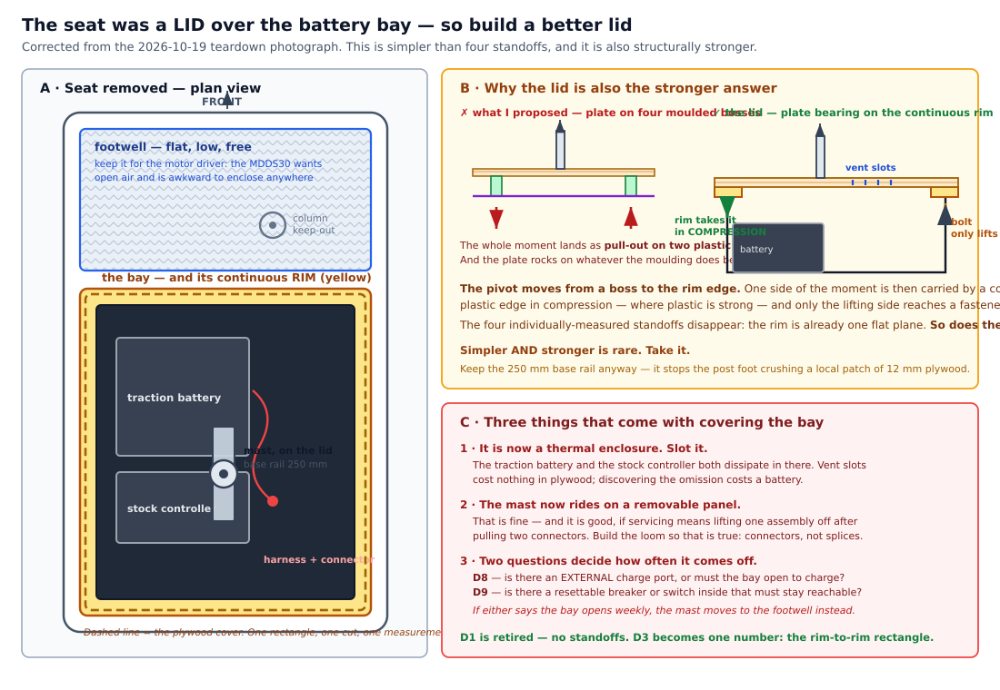

# Order Log

**A working record, meant to be edited.** Fill it in as you place orders and as parts arrive.
Unlike the [BOM](design/bom.md), which is a *specification*, this page is the *history* of
what was actually bought, from whom, for how much, and what was substituted.

Keep it honest even when it is unflattering — a substitution that seemed harmless and later
caused a rebuild is exactly the entry the next person needs.

- **What to buy and why:** [design/bom.md](design/bom.md) — the specification
- **Where to buy it, and what to verify:** [build/01 §1.2.1](build/01-bom-sourcing.md#121-sourcing-in-korea-verified-2026-09-15) — vendors, prices, the date each was read
- **What was approved:** [Purchase Request](purchase-request-2026-fall.md) — **frozen** at 2026-09-28; divergences are in its [Amendments](purchase-request-2026-fall.md#amendments-since-approval) section
- **This page:** what was **actually ordered, paid and received.** The live record — edit it freely

> [!IMPORTANT]
> **Which document changes, and which does not**
>
> The purchase request is evidence of what the university agreed to fund. Editing its tables as
> procurement proceeds would destroy the only record of that, so it is **frozen** and every
> divergence is listed in its Amendments section instead.
>
> **This page is the opposite** — it is meant to be edited, every day if need be, and it is the
> authority for what was actually bought. When the two disagree, this page is what happened and the
> request is what was promised. The gap between them is the reconciliation, and it is the useful
> part.
>
> **Vendor links live here**, not in the request. Several have been corrected since approval — one
> pointed at a receiver rather than a transmitter-and-receiver set — and a frozen document cannot
> carry corrections.

> [!NOTE]
> **Currency**
>
> BOM estimates are **USD, August 2026**. Record the **amount you actually paid in the
> currency you paid it in**, and put the USD equivalent in brackets so the totals still
> reconcile — e.g. `₩229,000 ($165)`.

---

## How to use this log

Each line item moves through three states. **Edit the tables below as it happens** — the columns are
the record, and a script reads them.

```bash
python3 scripts/order_status.py
```

Either edit the tables directly, or let the script do it — it writes the same cells and cannot
shift a column:

```bash
# ordered 3 vehicles, charged ₩687,000        (--date defaults to today)
python3 scripts/order_status.py --order 1 --paid 687000

# the boxes arrived
python3 scripts/order_status.py --arrive 1 --date 2026-10-05

# opened them, ran the Verify check, all three are good
python3 scripts/order_status.py --secure 1 --count 3
```

| When | Do this |
|---|---|
| You place an order | `--order <#> --paid <KRW>` |
| The box arrives | `--arrive <#>` |
| You have opened it and **run the check in the Verify column** | `--secure <#> --count <n>` |

It refuses to secure more units than were ordered, rejects a date that is not `YYYY-MM-DD`, and
errors on a line item that does not exist. Partial deliveries are expected — `--secure 1 --count 2`
today and `--count 3` next week is the normal path.

`order_status.py` totals what has been paid, projects the rest, compares both against the approved
request, and lists two things you cannot see by eye: what was **ordered and has not arrived**, and
what **arrived but is not yet secured**. Record each unit individually where it matters — three
vehicles arriving on three different days is the normal case, not an exception.

---

## Status at a glance

**Approved 2026-09-28** — see [Purchase Request](purchase-request-2026-fall.md). **3 sets.**
Run `python3 scripts/order_status.py` for the live totals and what is outstanding.

| Batch | Card | What | Per set | × 3 sets |
|---|---|---|---:|---:|
| **1** | **A** | Tier 1, orderable now — 12 items | 973,930 | **2,921,790** |
| **1G** | **A** | Tier 1, gated on vehicle measurements — #4, #5, #13 | 95,000 | **285,000** |
| **2** | **B** | Tier 2 perception — #17, #18 | 82,800 | **248,400** |
| — | — | #16 2D LiDAR — **already in hand, not purchased** | 0 | **0** |
| | | **Total to pay** | **1,151,730** | **₩3,455,190** |

> [!TIP]
> **The LiDAR already being in hand fixes the headroom problem**
>
> The approved request assumed #16 would be bought: 3 × ₩155,430 = **₩466,290**. It is already
> held, so that money is never spent.
>
> Headroom against the ₩4,000,000 ceiling therefore goes from **₩78,520 (2.0%)** to
> **₩544,810 (13.6%)**. The warning attached to the approval — that a 10% overrun on the
> estimated items would breach the ceiling — no longer applies. There is now room for the
> estimated items to land high, for shipping and duties, and for a stripped gear.
>
> **This does not authorise spending it.** It is contingency, and the approved figure is still
> ₩3,921,480.

### The three states, and why "arrived" is not enough

> [!NOTE]
> **A fourth marker: `—` in the Secured column means *not an acquisition***
>
> Two rows are not things anyone receives in a box. The [Shipping row](#) is a running cost, and
> [#4](#) is a **contingency** — funded so the option exists, bought only if a named gate fails.
> Left as `0/3`, both read as three unverified units sitting on a shelf, which is wrong in both
> directions: nothing is on order and nothing is expected to be. **`—` says the three states do
> not apply to this row**, and the tooling skips it rather than nagging about it.
> **A contingency still carries its price estimate** — counting it as zero would understate the
> projection, which is the one failure `order_status.py` exists to prevent.

| State | Means | Recorded as |
|---|---|---|
| **Ordered** (주문) | Paid for, vendor has the order | date in `Ordered` |
| **Arrived** (도착) | The box is physically here | date in `Arrived` |
| **Secured** (확보) | Opened, **checked against the Verify column**, and it is the right part in the right quantity | `n/3` |

Arrival is not acquisition. The listing this project's sourcing started from carries a
**2x25 SKU on a 2x32 description** — if the wrong board ships, the box still arrives on time. The
`Secured` count is what separates "a package came" from "I have three working parts", and it is a
**count**, not a tick, because a partial delivery is the normal case.

---

## Batch 1 — Tier 1, card A, order now

Nothing here waits on a measurement. **Order the vehicle first regardless** — Batch 1G cannot be
specified until it arrives, so it is the long pole.

Prices are the verified figures from
[§1.2.1](build/01-bom-sourcing.md#121-sourcing-in-korea-verified-2026-09-15). Record what you
*actually* paid in `Paid ₩` — that is the column the reconciliation uses.

| # | Item | Qty | Vendor | Unit ₩ | Ordered | Arrived | Secured | Paid ₩ | Verify on arrival |
|---|------|----:|--------|-------:|:-------:|:-------:|:-------:|-------:|-------------------|
| 1 | Vehicle — 12 V single-seat ride-on | 3 | 쿠팡 | 229,000 | 2026-09-29 | 2026-09-30 | 3/3 | 687,000 | Record model + serial per unit. **Stock steering gearmotor present** — see V1 **Maker's spec sheet, recorded 2026-10-13:** 12 V **dual** motor · traction pack **12 V 4.5 Ah** with a 12 V charger · kerb weight **11 kg**, max load **25 kg** · runtime **1–2 h** · 3-step speed · 과전류 방지장치 (the stock 10 A fuse) · 98 × 56 × 47 cm. **The 4.5 Ah and the 1–2 h together put the toy's average draw at 2–4 A**, which is what the stock 10 A fuse is sized for and leaves the motor driver's 32 A/channel generous. It says nothing about **stall**, which is still unmeasured.|
| 2 | Teensy 4.1 **[이더넷] DEV-16771** | 3 | 디바이스마트 | 74,250 | 2026-09-29 | 2026-10-08 | 3/3 | 222,750 | ₩67,500 ex-VAT → **₩74,250 incl**. **4.1, not 4.0** — count the pins **Secured 2026-10-08:** confirmed **4.1**, not 4.0. **The `VUSB`–`VIN` pads are still joined from the factory on all three** — cut them before Stage 0, or an externally powered board back-feeds the laptop's USB port. That is a build step, not a receiving one. |
| 3 | **Cytron SmartDriveDuo-30 (MDDS30)** — M1 steering, M2 drive *(replaces Sabertooth 2x32)* | **4** | [디바이스마트 13186549](https://www.devicemart.co.kr/goods/view?no=13186549) 해외구매 | 143,440 | 2026-09-29 | 2026-10-08 | 4/4 | 573,760 | ₩130,400 ex-VAT → **₩143,440 incl**. **4 units — 3 + 1 spare.** **`SW1:SW2=00` RC · `SW3:SW4=11` independent · `SW6=0` timeout ON** — verify SW6 on every board; `SW6=1` disables the stop **Secured 2026-10-08:** genuinely `MDDS30`, not a relabelled 2x25/2x32, and **every switch OFF as shipped** — so `SW1:SW2=00` and `SW6=0` are already right. **`SW3` and `SW4` must be turned ON** before use; that is a build step, not a receiving one. Re-confirm `SW6` board-by-board as each is fitted. |
| 7 | Relay MUX — 4× SPDT **70 A** + `IRLZ44N` + passives | 3 | [디바이스마트 14822426](https://www.devicemart.co.kr/goods/view?no=14822426) · 쿠팡 | 57,300 | 2026-10-01 | 2026-10-02 | 3/3 | 171,900 | **12× 5핀 SPDT 80 A @₩12,100** (socket incl.) = 145,200. Bulk, shared across all three: [`IRLZ44N` ×5](https://www.coupang.com/vp/products/9570142606?vendorItemId=95507737241) ₩9,100 · [resistor kit 30 values ×600](https://www.coupang.com/vp/products/9515705626?vendorItemId=95313302183) ₩9,900 · [`1N4007` ×200](https://www.coupang.com/vp/products/8583456225?vendorItemId=91607125807) ₩7,700 = 26,700. **10 kΩ gate pulldown + 100 Ω series** come out of the kit. **Arrived 2026-10-02: the three Coupang bulk items only** — `IRLZ44N`, resistor kit, `1N4007`. The **12 relays + sockets from 디바이스마트 are still outstanding**, which is why this is not secured. *(A 2026-10-08 edit briefly recorded this parcel as lost and the row as nothing-in-hand. It was not lost; the entry was reverted the same day. Nothing was re-ordered and no money moved.)* On arrival check the relay **blade width** against the socket, and that the coil is **12 V, 80 Ω** **2026-10-20: the missing 디바이스마트 half is dispatched, and it is sharing a parcel with [#8a](#).** 롯데택배 `317139414550` carries **12/12 of the 80 A 5-pin** for this row and **3/3 of the 40 A 4-pin** for #8a. **This row and #8a therefore arrive together and should be checked together.** **2026-10-20 — the Coupang half checks out: the resistor kit does contain 10 kΩ and 100 Ω.** That was the real risk in this row, because the design pulls the **gate pulldown (10 k)** and the **series resistor (100 Ω)** straight out of a *"30 values"* assortment that had no obligation to carry either. It does, so nothing has to be ordered before the relays land. **Still 0/3: the twelve relays are in transit on `317139414550` with [#8a](#), and this row secures when that parcel is checked.** **ARRIVED 2026-10-20 — the shared waybill landed and it closes both halves.** `317139414550` carried [#7](#)'s twelve 80 A 5-pin and [#8a](#)'s three 40 A 4-pin together, as the dispatch detail said it would. **Freight ₩3,200, 착불 — and paid personally, not on the project card.** *Recorded in the [Shipping row](#) as incurred but excluded from the paid total, so both figures stay true: the total is what the card paid, and the note is what the parcel actually cost.* **Not secured. Three checks, and the third is the one nobody has named.** **(1) Read the ratings off the RELAY BODY, not the listing.** Contact rating and **coil voltage (must be 12 V)**. This project has been bitten by a listing title twice — a 2x25 SKU on a 2x32 page, and an M3 × 8 that said nothing about its point. **(2) Confirm the pin numbers are moulded on**: `30 · 87 · 85 · 86` on the 4-pin, plus `87a` on the 5-pin. [§3.4](build/03-electrical.md) wires by those numbers. **(3) GAUGE THE PIGTAILS.** These are 방수 relays supplied with wired sockets, and **a socket's wire is often far thinner than its contacts are rated for.** The traction path is **AWG 14 behind a 25 A fuse**; if the pigtail is 16 or 18 AWG then **the bottleneck is the wire, not the 80 A contact**, and the fuse that protects the branch no longer protects the weakest part of it. Measure or read the insulation print, and if it is thin, **cut the pigtail short and splice to AWG 14 at the first joint.** **SECURED 2026-10-26 — and the body settles a question three listings could not.** Marked **`KKA B8 · COIL:12VDC · 70A/14VDC · 40A/28VDC · 0121Z23`**, with `30 · 87 · 87a · 85 · 86` moulded on. **So it is 70 A, not the 80 A in the title and not the 40 A in the shared boilerplate** — *neither number on the page was right, and it halves at 28 V, which is why a single figure was never going to settle it.* **[§1.2.4](build/01-bom-sourcing.md#7-8-11-12-14-what-to-actually-buy) parked this as unanswerable from any listing; one photograph of the moulding answered it. Read the part, not the page.** **The design is unaffected:** 70 A inductive-derated is **35–42 A against the 20 A drive-channel limit, 1.75–2.1×**. The row title and the derate table are corrected to 70 A. **Pigtails are `RV-90` with the contact wires (blue / red / yellow) visibly heavier than the coil pair** — the right arrangement, and the opposite of [#8a](#). | **12× 5핀 SPDT 80 A @₩12,100** (socket incl.) = 145,200. Bulk, shared across all three: [`IRLZ44N` ×5](https://www.coupang.com/vp/products/9570142606?vendorItemId=95507737241) ₩9,100 · [resistor kit 30 values ×600](https://www.coupang.com/vp/products/9515705626?vendorItemId=95313302183) ₩9,900 · [`1N4007` ×200](https://www.coupang.com/vp/products/8583456225?vendorItemId=91607125807) ₩7,700 = 26,700. **10 kΩ gate pulldown + 100 Ω series** come out of the kit. **NOTHING FROM #7 IS IN HAND.** *Corrected 2026-10-08.* This row recorded an arrival on 2026-10-02 that did not happen: the Coupang parcel — `IRLZ44N`, resistor kit, `1N4007` — was **marked delivered and never received**, ₩26,700 of it, and is being **re-ordered**. The **12 relays + sockets from 디바이스마트 are still outstanding** on their own account. **The ₩26,700 is still carried as paid once**; if the lost parcel is refunded this stays right, and if it is not, the re-order adds ₩26,700 to the projected total against ₩398,424 of headroom. Record which when it settles. On relay arrival check the **blade width** against the socket, and that the coil is **12 V, 80 Ω** 
| 80 | **#8a** E-stop contactor — 4핀 SPST-NO 40 A | 3 | [디바이스마트 14822420](https://www.devicemart.co.kr/goods/view?no=14822420) | 11,000 | 2026-10-01 | 2026-10-20 | 3/3 | 33,000 | Bracket + socket incl. Wired `30→87`, `87a` n/a. **Spec:** [§1.2.4](build/01-bom-sourcing.md#7-8-11-12-14-what-to-actually-buy) **IDENTIFIED 2026-10-20 — and it is NOT a separate late shipment.** The 디바이스마트 발송내역 shows **`KKA-B4 방수 릴레이 12V 40A 4핀 [TYE-RL076]`, 3 of 3 dispatched** — that is this row — on the **same 롯데택배 waybill `317139414550`** as **`…80A 5핀 [TYE-RL082]`, 12 of 12**, which is [#7](#)'s relays. **One parcel carries both lines.** So the previous entry calling #8a *"the oldest outstanding line"* was reading two rows where there is one shipment: #7's 디바이스마트 half has been missing for exactly as long, for exactly the same reason, and **both arrive the moment that waybill lands.** *The log's per-line structure hid that, which is worth noting — a line item is not a parcel, and chasing #8a alone would have been chasing half a box.* **Quantities are right on both: 발송 = 주문.** The part is a 4-pin automotive relay — pins `30 · 87 · 85 · 86`, SPST-NO — which is the specified form; #7's 5-pin carries the extra `87a`. **The waybill is 선/착불, so there may be freight due on arrival** — check it and add it to the [Shipping row](#) rather than letting it vanish into a courier receipt. **ARRIVED 2026-10-20 — the shared waybill landed and it closes both halves.** `317139414550` carried [#7](#)'s twelve 80 A 5-pin and [#8a](#)'s three 40 A 4-pin together, as the dispatch detail said it would. **Freight ₩3,200, 착불 — and paid personally, not on the project card.** *Recorded in the [Shipping row](#) as incurred but excluded from the paid total, so both figures stay true: the total is what the card paid, and the note is what the parcel actually cost.* **Not secured. Three checks, and the third is the one nobody has named.** **(1) Read the ratings off the RELAY BODY, not the listing.** Contact rating and **coil voltage (must be 12 V)**. This project has been bitten by a listing title twice — a 2x25 SKU on a 2x32 page, and an M3 × 8 that said nothing about its point. **(2) Confirm the pin numbers are moulded on**: `30 · 87 · 85 · 86` on the 4-pin, plus `87a` on the 5-pin. [§3.4](build/03-electrical.md) wires by those numbers. **(3) GAUGE THE PIGTAILS.** These are 방수 relays supplied with wired sockets, and **a socket's wire is often far thinner than its contacts are rated for.** The traction path is **AWG 14 behind a 25 A fuse**; if the pigtail is 16 or 18 AWG then **the bottleneck is the wire, not the 80 A contact**, and the fuse that protects the branch no longer protects the weakest part of it. Measure or read the insulation print, and if it is thin, **cut the pigtail short and splice to AWG 14 at the first joint.** **SECURED 2026-10-26 — the delivered part is exactly what was ordered.** Marked **`KKA V4 · 012-1H-12 · NO 40A 14VDC`** with `30 · 87` and the coil across `85 · 86` moulded on; `012` is the 12 V coil and `1H` is form A, SPST-NO. The listing's description was right about this one. **The resistive-break argument in [§1.2.4](build/01-bom-sourcing.md#7-8-11-12-14-what-to-actually-buy) stands**: this contact sits in **B+ upstream of the H-bridge**, so the motor's stored energy is on the far side of the bridge and the break is essentially resistive — 40 A against a 20 A limit is a straight 2×. **BUT ITS PIGTAIL IS NOT, AND THAT IS NOW THE LIMIT ON THIS ROW.** The 4-pin harness is **0.75 mm², which is about AWG 18** — good for perhaps 5–10 A in a chassis loom. **It is sitting in a branch fused at 25 A behind AWG 14.** The relay is rated 40 A and its own wire is not rated for a quarter of that; *the weakest part of the branch would be a wire the fuse was never sized to protect.* **Fix before fitting: re-terminate `30` and `87` in AWG 14** — a 6.3 mm blade crimp takes 2.5 mm² — **or, if the terminals will not accept it, cut the 0.75 mm² back to the shortest stub that can be crimped and splice there.** *Note the contrast with [#7](#), whose `RV-90` harness puts heavy wire on the contacts and thin wire on the coil. Same seller, same family, opposite decision — which is why the check is per-part and not per-vendor.* |
| 81 | **#8b** E-stop button — 한국미스미 `MRE-RR2R` | 3 | [한국미스미 MRE-RR2R](https://kr.misumi-ec.com/vona2/detail/222005924703/?ProductCode=MRE-RR2R) | 11,924 | 2026-10-01 | 2026-10-20 | 3/3 | 35,772 | Ø22, **푸시 록 턴 리셋**, **2a2b**, 적색, IP65, snap-action. The third code character must be **`2`** — `1` is 1a1b and carries only one NC. **Verify on arrival: the two b접점 sit on *different* stacked blocks**, one each **ARRIVED 2026-10-20 — three units, nineteen days.** Body marking reads **`MRE-RR2R`**, which is the part ordered: **the `2` is the whole point** — `MRE-RR1R` is 1a1b and carries only one NC. **Not yet secured, and this is the highest-consequence check in the build.** The contact blocks arrived as **loose stacked units rather than pre-assembled**, which turns the verification into an **assembly decision**: *you choose which contact sits on which block.* **Put the two NC (b접점) on DIFFERENT blocks, one each — never both on the same one.** The E-stop's two NC contacts are what break the two motor conductors ([safety.md §2](design/safety.md#2-failsafe-matrix)); with both on one block, a single loose terminal screw or one cracked block takes out **both** breaks at once — a common-cause failure in the one device whose entire job is to not have one. Split across blocks, a block failure still leaves one conductor broken. **Then ring out every contact with a meter before fitting**, pressed and released, and confirm the NC pair opens on press. *Marking says 2a2b; a meter says 2a2b.* **#8a, the contactor, is now the oldest outstanding line** — ordered the same day and still not here. **SECURED 2026-10-20 — continuity and latching both confirmed.** 2a2b present, contacts transition cleanly pressed and released, and the push-lock / turn-reset latch holds. **The block-split rule moved to where it will actually be read:** the blocks arrive loose, so *which NC sits on which block* is decided at **wiring** time, weeks after this check — it is now a warning in [§3.4](build/03-electrical.md#34-wire-the-e-stop-and-mux-first) rather than buried in an arrival note nobody opens twice. *An arrival check cannot verify an assembly that has not happened yet; recording it as though it could would have been the quiet kind of wrong.* |
| 9 | Pololu #2806 RC servo MUX | 3 | 디바이스마트 | 31,680 | 2026-09-29 | 2026-10-08 | 3/3 | 95,040 | ₩28,800 ex-VAT → **₩31,680 incl**. `FAILMODE` jumper present **Secured 2026-10-08:** `FAILMODE` jumper present. |
| 10 | RC TX/RX — FS-i6 transmitter + **FS-iA6B** receiver | 3 | [팰콘샵 100004832](https://www.falconshop.co.kr/shop/goods/goods_view.php?goodsno=100004832) KC인증 | 139,160 | 2026-09-29 | 2026-10-01 | 3/3 | 417,480 | ₩142,000 list, **₩417,480 paid for 3** (≈2% off). **Receiver confirmed iA6B on 2026-10-01** — i-BUS port present on the board, all 3 sets. **Mode 2** — see the note below |
| 110 | **#11a** Logic battery + charger | 3 | [디바이스마트 16071444](https://www.devicemart.co.kr/goods/view?no=16071444) · [16071454](https://www.devicemart.co.kr/goods/view?no=16071454) | 66,000 | 2026-10-02 | 2026-10-07 | 3/3 | 198,000 | SantaLi `SLB1206` 12.8 V 6 Ah LiFePO₄ **₩50,160** + `SLC 1202` 14.6 V 2 A **₩15,840**, both **VAT added — the listing quoted ₩45,600 / ₩14,400 ex-VAT**. 740 g; BMS integral (OCP 60 A, UVD 9.2 V). **Firmware UV threshold 11.5 V.** The maker pairs `1202` with 6–12 Ah, `1204` with 12–18 Ah **Secured 2026-10-08:** pack reads LiFePO₄ **12.8 V 6 Ah**, matching `SLB1206`. Check the charger label reads `SLC 1202` 14.6 V 2 A and say so if it does not — the 4 A `SLC 1204` was deliberately not chosen. |
| 111 | **#11b** UBEC 5 V 3 A ×2/set | 3 | [디바이스마트 1078321](https://www.devicemart.co.kr/goods/view?no=1078321) | 23,518 | 2026-10-02 | 2026-10-08 | 3/3 | 70,554 | **6 units @ ₩10,690 ex-VAT = ₩64,140 → ₩70,554 incl.** Input **7–40 V**, chosen over `ada-1385` (6–16 V), which sits at 91 % of rating while the pack charges at 14.6 V. **Confirm the 5 V output is fixed** — some UBECs carry a 5 V / 6 V jumper **The specified UBEC is what arrived** (7–40 V in, 5 V 3 A continuous, 18 g). **Its PCB is silkscreened `LM2596 DC-DC  HW-411`, and that is the regulator CHIP, not a different module** — this UBEC is built around an LM2596, as most 7–40 V ones are. *A 2026-10-08 entry read that marking as a substitution by a generic LM2596 board and recorded one; it was withdrawn the same day. Nothing was substituted and nothing else is in stock.* **Inventory: 6 UBECs**, 2 per vehicle across three and **zero spares** — the only Batch 1 line carrying none, and the one component a student sets by hand before anything downstream of it survives. Buy two spares. **Not secured until the output is measured:** the board carries a small trimmer, so confirm **5 V** on the pack alone before any Teensy is connected, re-check at 14.6 V with the charger on, lock the trimmer, and record the measured volts per unit here. Wiring: input is **bare red/black leads** needing termination at the pack; output is a **servo plug** — one goes straight into the RC receiver, the other gets adapted to the Teensy's `VIN`/`GND`. The board marks `IN+`, `OUT+`, `OUT-` and an arrow for flow direction. **SECURED 2026-10-20 — 5.11 V out from the 12 V LiFePO₄ pack.** Inside the 5.0 ± 0.15 V band, and comfortably inside every load on the rail: the **Teensy 4.1 VIN takes 3.6–5.5 V**, the Pololu MUX and the receiver both more. **No unit was found set to 6 V**, which was the destructive case this check existed for. *A buck converter sits slightly high unloaded and settles under load, so 5.11 no-load is the expected shape rather than a drift.* **The log carries one figure for six units** — if a second board ever reads differently, this is the line that did not record the spread. **Still buy two spares:** six fitted across three vehicles with none in reserve, on the one component a student sets by hand before anything downstream survives. |
| 112 | **#11c** Hold-up + fuse — **closed, absorbed into #12** | 3 | 쿠팡 | 0 | 2026-10-02 | 2026-10-03 | 3/3 | 0 | **₩0 by construction, not by cancellation.** The 1000 µF 25 V capacitors and the 5 A fuses were bought on the #12 Coupang order and are counted there. Splitting the receipt to populate this row would make the log disagree with the invoice. Divider resistors come from the #7 kit **Secured 2026-10-08:** capacitors read **1000 µF 25 V**, which is the part the corrected spec asks for — a 16 V part sits at 91 % while the pack charges at 14.6 V. | **Capacitors arrived 2026-10-03** on the #12 shipment, as designed.
| 900 | **Shipping** — running total, not per set | 1 | — | 36,500 | 2026-10-02 | . | — | 36,500 | Battery ₩3,500 · charger ₩3,500 · UBEC ₩4,400 *(flat, any quantity)*. **#12's ₩3,000 was refunded with a cancelled line**, so that order carries none. Kept off the part rows so `paid = unit × qty` stays a meaningful check — folding carriage in would make it misfire on every shipped row and train the reader to ignore the one thing that has caught two VAT errors. **Closed 2026-10-02: the earlier 디바이스마트 orders show ₩0 carriage**, so nothing is missing from before. UBEC carriage to be re-confirmed from the final charge **+₩2,700 on 2026-10-12** — the #6a Hall-latch order. **+₩6,000 on 2026-10-13** — the #14/#6d 쿠팡 order. **+₩3,000 on 2026-10-19** — the #5 AS5600 쿠팡 order. **+₩6,000 on 2026-10-20** — the #14b mast order (₩3,000 to the profile seller, ₩3,000 to the bracket seller; the T-nut set was 판매자로켓 무료배송). **The plywood is 착불 and is NOT in this figure yet** — add it when the parcel lands. **2026-10-20: ₩3,200 착불 on the #7/#8a parcel — PAID PERSONALLY, not on the project card, so it is NOT in the figure above.** Recorded here anyway: the total has to stay what the card paid, but **the next cohort budgeting carriage needs the real number**, and a cost that was absorbed quietly is a cost that gets under-budgeted next time. **True carriage to date is ₩32,300.** The plywood's 착불 is still outstanding. **+₩3,000 on 2026-10-26** — the 사각너트 order; the M5 × 20 bolts shipped free. **The plywood's 착불 is still the one carriage figure missing from this row.** **+₩4,400 on 2026-10-27** — the #12b 디바이스마트 order. |
| 12 | Wiring / connectors / fuses | 3 | 쿠팡 | 63,180 | 2026-10-02 | 2026-10-07 | 3/3 | 189,540 | **AWG 14 silicone red+black 10 m each** · AWG 20 UL1007 ×2 (32 m, 4-colour) · AWG 22 UL1015 ×3 · **ATO 대형 10종 50개** · **12 AWG holder ×8 + 12 fuses** · **18 AWG holder ×3** · **1000 µF 25 V ×10** · **XT60 ×10 pairs**. ₩205,820 less a ₩15,800 discount, **less ₩480 for 12× MINI 5 A fuses cancelled 2026-10-02** — ordered in error, they are MINI size and these holders are standard. **The ₩3,000 carriage was refunded with them**, so this order carries none. **Confirm the 10종 set includes 5 A** — with the MINI pack gone there is no fallback **Secured 2026-10-08:** wire lengths and colours all sufficient, and the **ATO 10종 set contains 5 × 5 A** — which closes the open question, because the MINI pack was cancelled and there was no other way to fuse the logic rail. **Three are fitted, so two spares across three vehicles for a whole semester.** Fuses are consumables and a blown one with no replacement stops a lab: top up the 5 A separately. | **Arrived in two parts:** fuse holders, AWG 14, AWG 22, XT60 pairs and the capacitors on **2026-10-03**; AWG 20 and the ATO fuse set on **2026-10-07**. Counts match the order on both.
| 122 | **#12b** Electronics assembly consumables — perfboard, terminals, headers | 3 | [디바이스마트](https://www.devicemart.co.kr/) | 41,466 | 2026-10-27 | . | 0/3 | 124,399 | **Opened 2026-10-26, and the gap is a process one rather than an oversight.** [§1.2.4](build/01-bom-sourcing.md#7-8-11-12-14-what-to-actually-buy) has specified **perfboard (만능기판), 5 mm screw terminal blocks and a printed enclosure** for the relay-driver board since it was written. **[#7](#) bought relays, MOSFETs, resistors and diodes and stopped there.** *The parts were specified in one document and procured in neither, which is exactly the seam the "every part is bought" claim fell through two entries ago.* **What this line buys:** **만능기판 ×6+** (two boards per vehicle — signal in the logic box, relay driver in the power box) · **screw terminal blocks, 5 mm, 2- and 3-way, ~8 per vehicle** · **female headers 2.54 mm, two 24-way rows per Teensy** — *the Teensy must be socketed, not soldered: thirteen students, one bricked bootloader, ₩74,250 a board* · **a solderless breadboard and jumper set** for the bench, which no document had ever asked for because [§1.2.4](build/01-bom-sourcing.md#7-8-11-12-14-what-to-actually-buy) only ever warned against breadboard **on the vehicle** · **heatshrink**, which the [#8a](#) pigtail splice needs and nothing bought · **1 nF ceramics** and **4.7 kΩ** if the 30-value kit turns out not to carry them. **Nothing here is expensive and all of it stops work on the day it is missed.** Sourcing still to do. **SOURCED 2026-10-26 — one 디바이스마트 order, and that is the recommendation as much as any SKU is.** *Six Coupang sellers would mean six carriages on ₩50,000 of goods; 디바이스마트 carries every line here, and [#6a](#) already proved the route — ₩2,700 domestic carriage, no fees.* **Confirmed on their shelf:** **만능기판 — 거상인 `[GA2] 80 × 80 양면` ₩4,300** for the signal board *(a Teensy 4.1 is 61 mm long, so 50 × 80 is tight once terminals are on)* and **`[GA6] 50 × 80 양면` ₩3,500** for the relay driver, which carries one MOSFET, two resistors and four diodes. **Four of each** — three fitted, one spare, because a perfboard is the part a student ruins. **Terminal blocks — EM Tech `2EDGK+2EDGRC-5.08`, 2-pin ₩600 and 3-pin ₩900, sold in tens.** *These are PLUGGABLE (plug + header), not plain screw blocks, which is strictly better here: the whole harness unplugs, so a sensor or a box comes out without a screwdriver inside the bay.* **Confirm whether the price is per piece or per ten before ordering.** **Search terms for the rest, all on the same site:** `핀소켓` or `암핀헤더` 2.54 mm *(two 24-way rows per Teensy — socketed, never soldered)* · `브레드보드` + `점퍼케이블 세트` *(bench only)* · `열수축튜브 세트` · `세라믹 콘덴서 1nF` · `저항 4.7k`, the last two **only if the 30-value kit turns out not to carry them — check first.** **QUOTE REVIEWED 2026-10-27 (₩111,080 incl VAT, carriage ₩4,400).** Boards, terminals and breadboards all correct. **Three lines are missing and all three were the open questions.** **(1) Teensy sockets — take `핀헤더소켓 Single 1x40 Straight (2.54mm)`, CONNFLY, ₩530.** A Teensy 4.1 has **24 pins per side**, so one 1×40 strip cuts to one row with 16 spare; **two strips per Teensy, eight for the fleet.** *Not the `적층형` at ₩1,000 — its 9.1 mm legs are for stacking shields, and the extra height only raises the board in the box.* **(2) Heatshrink — the sizing question is right and it decides the SKU.** The [#8a](#) splice joins **0.75 mm² (OD ~2.5 mm) to AWG 14 silicone (OD ~4 mm)**, so the tube must shrink from **≥ 6 mm down to under 2.5 mm** — a 2:1 at Ø6 just covers it and a 3:1 is comfortable. **`NT-DIY 열수축튜브 328세트` ₩3,900 — 8 sizes, which brackets that range.** *Its pieces are pre-cut to 40 mm, which is fine for a butt splice and no use as a long sleeve; nothing on this build needs a long sleeve.* **(3) 1 nF — the chip parts in the search results are SMD and unusable on perfboard.** Take through-hole: **`DONGIL HV(E) Ceramic 1000pF` ₩40 per 10** (1000 pF *is* 1 nF). *Its AC250V rating and ±20/−55 % Y5U tolerance are both irrelevant here — this is a noise filter, and anything from 0.5 to 1.5 nF does the same job.* **4.7 kΩ confirmed present in the 30-value kit, so nothing to buy.** **One quantity to check: terminal blocks.** The quote reads 수량 10 × 단가 600, but the listing says *10개 단위 판매* — **if that 10 is ten pieces rather than ten packs, 20 blocks is short of the ~24 the fleet needs** (two sensor runs and a power feed per signal board; gate, 12 V, GND and four coil pairs per relay board). **TERMINAL COUNT REDONE 2026-10-27 — my "~8 per vehicle" was a guess and it was low, and the MIX was wrong too.** Counting **ways** rather than blocks: signal board **5 × 2-pin** (two 4-wire sensor cables at two blocks each, plus 5 V in), relay board **6 × 2-pin** (gate, 12 V, and a pair to each of four coils) = **11 × 2-pin per vehicle, 33 for the fleet.** **And the 3-pin turns out to be the less useful of the two.** *Both sensor cables carry FOUR conductors and four does not fit a 3-way, so they take two 2-pins each. The runs that genuinely carry three wires — PWM out and i-BUS — are servo connectors and belong on pin headers, which is what the receiver and the Pololu MUX already expect.* **Change the 2-pin from 10 to 30; leave the 3-pin at 10.** +₩12,000. **Buy past the count rather than to it, and the reason is specific: this is the LAST order on the build.** Being four blocks short in week six is ₩3,000 of parts, ₩3,000 of carriage and a week of thirteen students waiting. **Breadboards: 6 is right, and 9 is better — but none of them is per-vehicle.** *They never go on a vehicle; the count is per BENCH STATION.* **Two per station: one at the Teensy end** (board, pull-ups, caps) **and one at the sensor end**, so magnets can be waved past the Hall latches and rotated in front of the AS5600 **away from the Teensy**. *One board is enough at the Teensy end — a half-size is 30 columns and a Teensy 4.1 takes 24, but every pin column still has four free holes. An earlier note said to clip two together; that was over-cautious.* **A third per station lets drive and steering be benched in parallel instead of in series**, which is what actually happens with thirteen students on three stations — **+3 boards, ₩2,550.** **QUOTE v2 CHECKED 2026-10-27 — ₩147,919 incl VAT, and the arithmetic reconciles exactly** (goods ₩130,471 + carriage ₩4,000 ex-VAT = ₩134,471, VAT ₩13,447; 1원 of rounding on the UBEC line and the total). Every requested change is in: 2-pin 10 → 30, breadboards 6 → 9, plus sockets, heatshrink and the 1000 pF. **핀헤더소켓 ×18 is more than twice the eight the Teensys need — left alone, and the surplus has a real use: socket the AS5600 breakouts and the Pololu MUX too, so a dead module swaps without an iron.** **ONE POSSIBLE GAP — male pin headers (`핀헤더 Single 1x40 Straight 2.54mm`, ₩200).** The quote has **female sockets only.** *A Teensy 4.1 normally ships with its pins NOT soldered, and without male pins it cannot go into a breadboard OR into the perfboard sockets this order is buying — the sockets would have nothing to receive.* **Checkable in five seconds on the boards already in hand: are the pins soldered on?** If not, **two strips per Teensy (6) plus one or two for the servo-style runs = 10 strips, ₩2,000.** *The servo connections need male pins regardless, because the receiver and the MUX both terminate in female sockets.* *Figures here are the QUOTE, not an order — nothing is placed yet, so Ordered and Paid stay blank. Split so the UBECs are not counted twice: goods ₩130,471 ex-VAT less the ₩21,381 UBEC line = **₩109,090 ex-VAT, ₩119,999 incl**, which is this row; the UBECs sit on [#113](#) and the ₩4,400 carriage on the [Shipping row](#).* **ORDERED 2026-10-27, 주문번호 `2026102717063418412`, ₩152,319 on the card.** The gap was real: **the Teensys came with their pins NOT soldered**, so line 11 — `핀헤더 Single 1x40Pin Straight(2.54mm)` **×20, ₩4,000** — was added. *Without it the ₩9,540 of female sockets in the same order would have had nothing to receive, and neither the breadboard nor the perfboard could have taken a Teensy.* **Twenty strips against the ten estimated** — six for the Teensys, the rest for servo-style headers and spares. **Split, VAT-inclusive, so nothing is double-counted:** this row **₩124,399**, UBECs **₩23,519** on [#113](#), carriage **₩4,400** on the [Shipping row](#). Goods ₩134,471 ex-VAT, 공급가액 ₩138,472, VAT ₩13,847. |
| 113 | **#11b spares** — UBEC 5 V 3 A ×2 | 1 | 디바이스마트 1078321 | 23,519 | 2026-10-27 | . | — | 23,519 | **This was written into [#11b](#) when it was secured and then nobody acted on it, which is the failure this log exists to prevent.** Six UBECs across three vehicles and **zero spares** — the only Batch 1 line carrying none, on **the one component a student sets by hand before anything downstream of it survives**. A 6 V jumper found late, or one dead regulator, stops a vehicle for a week. **Buy two.** **DECLINED 2026-10-26 by the owner. Not forgotten — refused, and the risk is accepted knowingly.** *The row stays at ₩0 rather than being deleted, because a line that vanishes is a line nobody can learn from.* **What is being accepted: six UBECs, zero spares, on the one component a student sets by hand.** If one is found jumpered to 6 V, or one dies, that vehicle waits for a delivery. **If it happens, this row is the place to say so** — and the next cohort reads the outcome, not the intention. **REVERSED 2026-10-27 — the owner put two UBECs back on the 디바이스마트 order, ₩21,381 ex-VAT.** *Recording the reversal rather than quietly editing the decline away: the row now shows a risk identified, accepted, and then closed, which is the sequence worth reading.* **The fleet goes from zero spares to two on the one component a student sets by hand.** *Quoted ₩10,690 ex-VAT each = **₩23,519 incl** for the pair, on the #12b order. Recorded VAT-inclusive like every other row, which is the convention that caught the VAT trap twice.* |
| 121 | **#12 top-up** — 5 A ATO fuses | 1 | 쿠팡 | 0 | . | . | — | | **Also written into [#12](#) at securing and also not acted on.** The 10종 set contains **five** 5 A fuses, three of which are fitted — **two spares across three vehicles for a whole semester.** *Fuses are consumables and a blown one with no replacement stops a lab*, which is a cheap way to lose an afternoon. Buy twenty. **DECLINED 2026-10-26 by the owner. Risk accepted.** **Two spare 5 A fuses for three vehicles and thirteen students across a semester.** A blown fuse with no replacement stops that day's lab. *Kept at ₩0 for the same reason as [#113](#): the decision is more useful on the record than off it.* |
| 14 | Mounts / 3D-print material | 3 | 쿠팡 | 11,867 | 2026-10-13 | 2026-10-23 | 0/3 | 35,600 | **Spec:** [§1.2.4](build/01-bom-sourcing.md#7-8-11-12-14-what-to-actually-buy) — **PETG, not PLA** — PLA softens at ~60 °C and mast rigidity is a calibration requirement **Sourced 2026-10-13** ([§1.2.1](build/01-bom-sourcing.md#14-and-6d-verified-2026-10-13)): **PETG 1 kg ×2** [올리민 ₩11,900](https://www.coupang.com/vp/products/9533639155) — any colour — · **PETG 1 kg YELLOW** [Lay1 ₩13,900](https://www.coupang.com/vp/products/9577432592), **required by ISO 13850** for the E-stop backing plate, not a preference · **M3 heat-set inserts ×100** [Lay1 ₩9,800](https://www.coupang.com/vp/products/9470532681) or the [M2–M6 220-piece assortment ₩11,900](https://www.coupang.com/vp/products/9510071311). ≈ **₩47,500** of a ₩123,000 line, plus M3/M4 bolts, nylon standoffs and cable ties from a local shop. **The 2020 extrusion is deliberately left out** — the mast is not designed, so its length is a guess. **Caliper the inserts on arrival**: the model's `INSERT_D` 4.6 and `INSERT_L` 5.0 have to match what turns up, and listings write those two numbers in either order. **Ordered 2026-10-13** (쿠팡 `2103582332487`): PETG 1 kg **옐로우** ₩13,900 · PETG 1 kg **딥블루** ₩11,900 · 황동 인서트**`M3x4x5`** 100개 ₩9,800 = **₩35,600** against a ₩123,000 estimate. One shared purchase, so the unit price here is the total over three and lands ₩1 off by rounding. **One roll of non-yellow may or may not be enough, and nobody can say yet.** Three carriers are about 60 g; the brackets, mounts and enclosures for three vehicles are the unknown, and those parts are not designed. **Do not pre-buy. The trigger is: print one vehicle's full set, weigh what is left on the spool, multiply by three.** Filament is next-day and the colour need not match, so a second roll is a five-minute decision once there is a number behind it rather than a guess. **The inserts are `M3x4x5` and the model wants `INSERT_D` 4.6 / `INSERT_L` 5.0 — caliper them before printing a carrier**, because the listing's two numbers could be either order and the same seller also sells `M3x5x4.2`. **2026-10-19 — this row is the FILAMENT half only.** The mast tube and the equipment plate are neither printed nor funded here; they moved to [#141](#) when the materials were decided. **ARRIVED — all of it, confirmed by the owner 2026-10-23.** *The delivery date was not recorded, so the cell carries the date of this entry rather than the date the parcel landed. Flagged because [#6d](#) deliberately does the opposite — **do not read this one as a lead time.*** **Not secured. Two checks.** **(1) Three rolls — two any-colour PETG and ONE YELLOW** — the yellow is **[ISO 13850](design/safety.md) for the E-stop backing plate, not a preference**, and it is the item most likely to have been silently substituted. **(2) Caliper the M3 heat-set inserts against `M3x4x5`.** They are **not** for the carrier — a Ø4.5 hole across its 6 mm width would split it, which is why its threads are tapped — **they are for the enclosures**, which is what this line always said. Confirm the count is 100. **2026-10-26 — filament confirmed: two blue, one YELLOW.** The yellow is the one that mattered ([ISO 13850](design/safety.md), E-stop backing plate), and it was the item most likely to have been quietly substituted. **The insert / T-nut check is NOT yet resolved — see the reply thread; a 9.5 mm part would not enter the profile slot, and which part was tried decides whether this is a #14 problem or a [#141](#) one.** **2026-10-26: filament confirmed by the owner — two blue, one yellow, as bought.** **Only the insert check is left to secure this row: caliper them against `M3x4x5` (L 4.0, OD 5.0) and confirm the count is 100.** *Worth doing rather than assuming, because an earlier report of "삽입너트 9.5 mm" turned out to be the T-nut, not these — so the inserts have not actually been looked at yet.* |
| 141 | **#14b** Mast + equipment plate — 2020 extrusion, plywood, T-slot hardware | 3 | 쿠팡 | 30,090 | 2026-10-20 | 2026-10-23 | 0/3 | 90,270 | **Decided 2026-10-19:** 2020 aluminium extrusion for the mast, **12 mm birch plywood** for the plate that replaces the seat, printed PETG for the mounts and the two enclosures ([§1.2.4](build/01-bom-sourcing.md#14-mounts-and-print-material-38000), [§2.7](build/02-mechanical.md#27-mount-the-sensor-mast-and-compute)). **The plate had never appeared in any budget line** although [vehicle.md §3](design/vehicle.md) requires it — this row is where it now lives. **Sourced 2026-10-19, all domestic, all next-day:** 2020 profile **cut to 700 mm** [쿠팡 8531595597](https://www.coupang.com/vp/products/8531595597) ₩4,800 each — three is ₩14,400, and 700 mm is deliberate: [sensors.md §5](design/sensors.md#5-mounting-mast-concept) fixes the mast at ~0.65 m, so a cut length of 700 leaves trim and **you can only ever cut shorter** *(₩6,900 buys 900 mm if more margin is wanted)* · corner brackets [쿠팡 7260659679](https://www.coupang.com/vp/products/7260659679) ₩400 each, twelve is ₩4,800 · **T-nut + bolt + washer set, 200 pc** [쿠팡 9560823334](https://www.coupang.com/vp/products/9560823334) ₩13,850 무료배송 — taken over the ₩5,350 nuts-only set because the M5 bolts are not otherwise in the build and a T-nut without its bolt is not a fastener. **Goods ₩33,050, carriage ₩6,000** to the [Shipping row](#). **Plywood is NOT yet sourced and must not be** — its size is the seat footprint, which is [V4 **D**](#v4-deck-and-payload-geometry-unblocks-14) and unmeasured; the ₩16,000 unit here carries roughly ₩15,000 of plywood as an estimate. **Buy the three metal lines now, the plate after V4.** The extrusion is safe to buy ahead of the measurement because its length is set by the mast height, which [sensors.md §5](design/sensors.md#5-mounting-mast-concept) already fixed on a tip-over argument, not by the deck. **REVISED 2026-10-19 — 900 mm, not 700, now that the seat bolts are known to be in plastic.** [쿠팡 8529591491](https://www.coupang.com/vp/products/8529591491) **₩6,900** each, three is ₩20,700, same seller and same next-day delivery. **One length per vehicle, cut into three with a hacksaw: post 500 + base rail 250 + camera boom 150 = 900, no offcut.** 700 mm leaves only an 80 mm base rail once the post and the boom are taken out, and the base rail is the part that answers the plastic anchoring — it resolves the mast moment into a push-pull couple over 250 mm instead of a point load on four bosses. **₩2,100 per vehicle buys that.** Revised goods total **₩39,350** (profile 20,700 + brackets 4,800 + T-nut set 13,850), carriage ₩6,000. **The four corner brackets per vehicle now have assigned jobs:** two at the post foot front and rear — the braking and kerb direction — and two at the boom joint above and below, which is what stops the camera drooping. The rail bolts **down through the plywood into T-nuts** in its upward slot, so it needs no bracket, and the LiDAR needs none either: a printed cap slides onto the post's top end. **Layout and cut plan: [figure](images/sensor-mast-layout.svg)**, specified in [§2.7.3](build/02-mechanical.md#272-the-layout-and-the-cut-plan). **REVISED AGAIN 2026-10-19 — the base is a cross, and the 900 mm buy does not cover it.** A single fore-aft rail ties the post to the lid 250 mm apart front-to-back and **to nothing sideways**: laterally the post is held only by the **~20 mm arms of its corner brackets**, which against a 500 mm post is a **25 : 1 lever**. Caught in review before anything was ordered. **Fix: two 115 mm lateral stubs butted to the rail's sides at mid-length, all three coplanar at 20 mm**, giving a **250 × 250 base** and **four** corner brackets at the foot instead of two ([figure](images/mast-base-cross.svg)). *Symmetry is the point: this mast exists to hold the camera↔LiDAR geometry still, vibration is omnidirectional, and a base stiff in one plane and soft in the other does not halve the problem — it hides it as a lens or calibration fault.* **Revised cut list: one 1000 mm + one 200 mm per vehicle** — post 500 + rail 250 + stubs 2 × 115 out of the long piece (20 mm spare), boom 150 out of the short one. **Buy at those lengths rather than one long bar, because the price ladder is not linear**: [1000 mm ₩6,460](https://www.coupang.com/vp/products/4310024995) is *cheaper* than 900 mm at ₩6,900, while 100 mm costs ₩3,200 against ₩2,880 for 400 mm — so the short stubs come out of the long bar, never off the shelf. [200 mm ₩1,690](https://www.coupang.com/vp/products/8528380693). **Brackets go 4 → 8 per vehicle, 24 total, ₩9,600.** Revised goods **₩47,900** (extrusion 24,450 + brackets 9,600 + T-nut set 13,850). **The whole correction costs ₩8,550 across the fleet.** **And land the fore-aft rail over one of the bay's two fore-aft supports** ([figure](images/battery-bay-layout.svg)) — free, and it puts the mast's load into chassis structure rather than mid-span plywood. **D11 added:** do those supports reach the rim plane, or stop below it? **TWO CORRECTIONS 2026-10-19, both caught by the owner before anything was ordered.** **(1) The cheap lengths quoted above are the WRONG PRODUCT.** The same 쿠팡 seller runs two listings that both carry `DF2020-xxxmm` part numbers and both surface in the same search: **`DF2020 … 프로파일`, which is the T-slot extrusion, and `앵글 DAB 2020`, which is an L-ANGLE.** The angle has **no T-slot**, so no T-nuts, no sliding brackets and no way to clamp the boom — **unusable here.** [1000 mm ₩6,460](https://www.coupang.com/vp/products/4310024995) and [200 mm ₩1,690](https://www.coupang.com/vp/products/8528380693) are both angle, and so are 400 and 500 mm. *The "non-linear price ladder" argument built on those numbers was an artefact of reading two products as one; the ladder was not irregular, the catalogue was.* **The profile lengths that actually exist: 50 · 80 · 100 · 300 · 600 · 700 · 900 mm.** **Revised buy: [700 mm ₩4,800](https://www.coupang.com/vp/products/8531595597) + [600 mm ₩4,300](https://www.coupang.com/vp/products/8530510579) = ₩9,100 per vehicle, ₩27,300 for three.** The 700 gives post 500 + boom 150; the 600 gives rail 250 + stubs 2 × 115. **170 mm spare per vehicle is deliberate** — see correction (2). **(2) There are NO fore-aft supports in the bay** — misread from a photograph. **What is there is better: three screw holes are moulded into each side of the battery recess and the retaining strap uses only one per side, leaving FOUR SPARE** that straddle the battery in a rectangle. Those are the only points inside the bay **engineered to hold something against vehicle motion**, and they sit where the mast stands. **Printed PETG pillars rise from them to the lid's underside and the base cross is through-bolted**, so the load path is **bolt → pillar → boss → chassis** with the plywood only in the sandwich — and **the seat bolts drop back to just holding a lid down** ([figure](images/battery-bay-layout.svg)). **D11 now sizes the base cross**, which is why 250 × 250 is provisional and why the offcuts are kept. Revised goods **₩50,750** (27,300 + brackets 9,600 + T-nut set 13,850). **Clarified 2026-10-19 after a second review question: the cut list reads `250 · 115 · 115`, and that is correct rather than one rail short.** Two continuous 20 × 20 bars **cannot occupy the same 20 mm layer where they cross** — stacking them lifts the post 20 mm and strands the lower pair of brackets below its foot — so **exactly one direction must be split**. The fore-aft rail stays continuous with the post standing on it; the lateral direction is two stubs butted to its sides. **115 = (250 − 20) ÷ 2**, the span less the rail's own width, halved. **Which means the base is symmetric in SPAN but not in CONSTRUCTION** — both directions reach their tie-downs 125 mm from the post axis, but fore-aft the post stands on unbroken metal while sideways the load crosses two bracket joints. **That asymmetry is chosen, not inherited:** braking and kerb strikes act front-to-back, and the camera boom overhangs forward so its mass is a *standing* fore-aft moment, while cornering is the only lateral case and this vehicle corners at walking pace. *Four 115 mm arms would be perfectly symmetric and strictly worse — all four joints would then be brackets, where this makes two of them continuous metal at the same part count and price.* **FIT CHECK 2026-10-20 — the bay is 370 × 210 × 130 deep, and the 250 mm rail does not fit it.** Twenty millimetres would hang off each fore-aft edge and the end bolts would land on nothing. **Caught by the owner on the measurements, before any cut.** **Corrected: rail 210 fore-aft, stubs 140 lateral — a 210 × 300 base.** The rotation pays twice: the **lateral span goes UP from 250 to 300**, and at 140 the stubs put their tie-down bolts **exactly on the existing seat screws**, which are 300 apart — **no new holes in that direction.** The rail's own ends then land on the bay rim, where the lid is supported anyway. **The purchase does not change** — the 700 gives post 500 + boom 150, the 600 gives 210 + 140 + 140 with 110 spare; ₩9,100 per vehicle as before. Only the cuts move. **And one claim from the previous entry is withdrawn: the battery-hole pillars are NOT the mast's load path.** At **100 mm apart** they are far too close to be a couple — 54 N·m across 0.1 m is **540 N a side**, which would strip a moulded boss. They are **local support**: they stop the lid dishing under the post and give it a hard footing. **The couple is the rim in compression plus the perimeter bolts in lift**, which is what the lid-on-a-rim argument said in the first place. **The lid itself was never oversized** — it is the size of the opening it covers. ([fit check](images/bay-fit-check.svg)) **LID DESIGNED 2026-10-20, and the last two numbers closed it.** Seat screws are **300 × 190**, four plastic screws at the corners; the rim is **10–20 mm and CURVED, not a rectangle.** **So the lid outline is TRACED, not dimensioned** — tape two A4s into an A3, press the rim edge to crease it, trim until it drops on with ~2 mm clearance, and **mark the four screw holes with a bradawl while the template is still in place**, never by measuring. A plywood rectangle cut to 390 × 230 would bear unevenly on a curved rim and **rock, which is the defect this whole design keeps chasing.** *Make one template, then check it on all three vehicles — the drive hub differed by 0.47 mm between two cars on the same chassis.* **The A4 the owner laid on the opening is the useful calibration:** A4 landscape is 297 × 210 against an opening of 370 × 210, so it is **right fore-aft and 37 mm narrow each side**, which is exactly what the photograph shows. **Base re-fitted to the screw rectangle: rail 190 fore-aft, stubs 140 lateral** — that puts all four arm ends on the seat-screw lines rather than at arbitrary positions. **Mast centred both ways**, and the three reasons agree rather than compete: laterally centred keeps the LiDAR on the vehicle centreline (an off-centre sensor is a lateral offset in every transform forever), fore-aft centred sits over the battery and the spare fixing holes so the pillars have something to stand on, and it is clear of the controller at the right rear where the vent must go. **And the mast base needs no new holes in the chassis at all** — it bolts to the lid, the lid bolts to the four seat screws and bears on the rim. **Plywood: blank 400 × 240 per vehicle; three come off one 450 × 750 board of 12 mm birch, a standard 쿠팡 목재재단 line at about ₩15,000.** **One measurement still blocks the vent cut: the controller cover's footprint and position relative to a lid corner.** ([lid design](images/lid-design.svg)) **CART CHECKED 2026-10-20 — all four lines correct, and they are the PROFILE listing, not the angle.** `DF2020-600mm × 3` ₩12,900 · `DF2020-700mm × 3` ₩14,400 · 200 pc T-nut/bolt/washer set × 1 ₩13,850 · `AL 브라켓 20용` × 24 ₩9,600. **Goods ₩50,750, carriage ₩6,000** (₩3,000 to the profile seller, ₩3,000 to the bracket seller; the T-nut set is 판매자로켓 무료배송) — **₩56,750 at the till**, exactly the figure this row carries. Both profile lines read *DF2020(20x20) … 프로파일 브라켓/ 알미늄/ 대영*, **not** 앵글 DAB, so the 2026-10-19 trap was avoided. 24 brackets is 8 per vehicle as specified. Profile and brackets arrive 10/22, the T-nut set 10/21. **Plywood sourced 2026-10-20 — buy a board and cut it, not a cut-to-size quote.** **[자작나무합판 무절 600 × 1200 × 12 mm, 쿠팡 8148623270, ₩23,060](https://www.coupang.com/vp/products/8148623270)** (착불배송, so budget ~₩6,000 freight on a bulky board). Three lid blanks at 400 × 240 use 400 × 720 of it, and **the remainder is not waste on a sixteen-week course with thirteen students** — it is test cuts, enclosure backing and the lid someone ruins. **Birch, not plain 합판, and the reason is edge distance:** the lid's hold-down screws sit about **10 mm from its edge**, and **무절 birch has no voids** where a plain veneer sheet might put one right under a bolt. [베니어 일반합판 11.5 mm, 1200 × 600, ₩14,000](https://www.coupang.com/vp/products/7910005788) saves ₩9,000 and has far more reviews — **take it only if the hold-down gets a steel strip or large penny washers to spread the bearing.** *A cut-to-size service was considered and dropped: the outline is traced from a template, so a factory rectangle buys nothing.* **LID FINALISED 2026-10-20 — and it is simpler than the template method, but it has a hold-down problem the template method would have hidden.** The 370 × 210 included the body's **curved raised ends**; excluding those, **a plain 320 × 215 rectangle drops in and covers the opening**. So the traced-template instruction is withdrawn — this is a rectangle and a saw cut. **CUT ORDER: 320 × 215 mm, 12 mm, FOUR pieces** (four not three — thirteen students, and one lid will be ruined). Four stack in a 320 × 860 column of the 600 × 1200 board, leaving 280 × 1200 of offcut. *If a cut comes out a millimetre proud, sand it; a millimetre undersize is harmless because the rim is 10–20 mm wide. Oversize is the only error that stops it dropping in.* **THE REAL FINDING: the vehicle gives only TWO fixings, both on one edge** — (10, 25) and (310, 25). A lid bearing on a rim needs **compression on one side and tension on the other**; the rim supplies compression everywhere, but **tension needs a fastener, and there are only two, both at one end.** Lean the mast away from them and the screws hold; lean it toward them and **the far edge hinges up with nothing there.** **Fix, and it costs nothing: the two spare battery bosses become the second anchor pair.** The rail takes **four bolts** — its **ends** into the lid 165 apart, which is the couple that resists the mast, and its **middle pair** through the lid into printed pillars on the battery bosses, which is what stops the hinge. *That finally gives those bosses a job their 100 mm spacing can actually do — holding a lid down, not resisting a moment.* **ORIENTATION IS LOAD-BEARING: fit the lid with the two screws at the REAR.** The camera boom overhangs forward, so there is a **permanent forward-tipping moment**; forward lean presses the front edge onto the rim and lifts the rear, which is exactly where the screws are. Fitted the other way round, that standing load rides on the pillars all day. **Base re-fitted to the 320 × 215 lid: rail 165, stubs 125 — a 165 × 270 base**, keeping 25 mm of edge distance for every bolt in 12 mm plywood. **The extrusion order is unaffected:** 700 → post 500 + boom 150 (50 spare); 600 → 165 + 125 + 125 (185 spare). **Nothing in the cart needs changing.** ([lid design](images/lid-design.svg)) **ORDERED 2026-10-20, two orders, ₩73,810 of goods.** *Profile* `DF2020-700mm` ×3 ₩14,400 + `DF2020-600mm` ×3 ₩12,900 · *brackets* `AL 브라켓 20용` ×24 ₩9,600 · *fasteners* 200 pc T-nut/bolt/washer set ×1 ₩13,850 — **₩50,750**, carriage ₩6,000 to the [Shipping row](#). *Plywood* [자작나무합판 무절 600 × 1200 × 12](https://www.coupang.com/vp/products/8148623270) ×1 **₩23,060**, **착불배송 — the freight is unknown until the parcel lands** and is the only figure still open on this row. **Arrivals: T-nut set 10/21; profile, brackets and plywood 10/22.** **ACTION BEFORE THE BOARD IS CUT — the cut list has to reach the seller.** The order shows 결제완료 with no cut specified, and the free cutting is arranged through 판매자 문의. **Send: `320 × 215 mm, 4 pieces`.** If it ships uncut that is not a failure — the offcut plan survives either way and a jigsaw does the job — but **it has to be decided rather than discovered.** **On arrival:** confirm the board is genuinely 12 mm and 무절 *(the whole reason birch was chosen is that a void under a hold-down screw 10 mm from the edge is a screw that pulls through)*, and check the 착불 charge against this row before it disappears into a courier receipt. **ARRIVED — complete 2026-10-23.** Profile (both lengths), brackets and the T-nut set landed **2026-10-21**, a day early; the plywood **2026-10-23**, a day late, and it is the one that closes the row. **Four checks, and the second is the one that could stop the build.** **(1) The profile is T-SLOT, not angle** — hold a piece up and look down the end. This is the 2026-10-19 trap and it is worth thirty seconds. Count 3 × 700 and 3 × 600. **(2) TRY A T-NUT IN THE SLOT BEFORE CUTTING ANYTHING.** The T-nut set and the profile came from **different sellers**, and "2020" fixes the outside but **not the slot width** — a nut that does not drop in makes every bolt in the mast design homeless. *Nothing downstream is recoverable once the 600 is cut into three.* **(3) Plywood: confirm 12 mm and 무절**, and record whether it came cut to **320 × 215 × 4** or as the full 600 × 1200 board. **(4) The plywood was 착불 — get the freight figure and put it in the [Shipping row](#)** before it disappears into a courier receipt. It is one of the two numbers still open on this build. **2026-10-26 — THE T-NUTS DO NOT FIT THE PROFILE, and the pre-cut check is what caught it.** The 200-piece set was bought from one seller and the `DF2020` from another, and *"2020" fixes the outside, not the slot* — which is why this row carried **"try a T-nut in the slot before cutting anything"** as check (2). **Nothing has been cut, so nothing is lost but the ₩13,850.** *This is the third time on this build that a fastener was bought without confirming it against the part it mates with — the angle-versus-profile listing, the flat grub screws, and now these. The difference is that this one was caught by a check written in advance instead of by a photograph afterwards.* **Measured slot figure: 7.5 mm, and it does not resolve the question on its own** — a 7.5 mm **opening** would admit a standard 5.8 mm-wide M5 T-nut easily, while a 7.5 mm **internal cavity** would stop a 9.5 mm nut from rotating into place, and those point at opposite fixes. **An end-on photograph of the extrusion settles it in one look**, which is what is needed next. **The fallback that works on any slot geometry: drill the rail through both walls and bolt straight through with a plain nut.** It gives up the T-slot's sliding adjustment and wants a drill press for a square hole, but it depends on nothing about the profile — worth holding in reserve rather than ordering a second set of nuts on another guess. **End-on photograph received 2026-10-26, and it does not settle it — said plainly because guessing from a photograph has already cost this build once.** *The "two fore-aft supports" that turned out not to exist came from reading a photograph confidently; the price of repeating that here is a second wrong box of nuts.* **The decisive test needs no measurement at all: SLIDE a T-nut into the slot from the CUT END of a piece.** A nut that will not *rotate* in may still *slide* in and be captured by the lips — and **this mast never needs a drop-in nut.** It is a fixed assembly, not an adjustable rig, so **every nut can be loaded from an end before its piece is bolted up.** If it slides, the problem dissolves and the only cost is a **build-order rule**: **load every nut a piece will ever need before bolting it in place**, because adding one later means taking the joint apart. **Count them first, too** — roughly **26 nuts per vehicle** across rail, stubs, post and boom, which is ~78 for the fleet against a 200-piece set that is nuts *plus* bolts *plus* washers. **If it will not even slide**, the nut is the wrong series and what is then needed is the **slot opening** and the **internal cavity width**, measured — or the through-bolt fallback, which assumes nothing about either. **2026-10-26: 7.5 mm is the OPENING, and that points at the NUT rather than the profile.** A 7.5 mm opening is *wider* than the 6 mm EU 20-series standard, so a proper M5 20-series nut (~6 × 10) would drop straight through it with room to spare. **The likeliest reading is that 7.5 was taken across the chamfer at the outer face** — a 6 mm slot with 0.75 mm lip chamfers measures 7.5 at the surface and 6.0 just inside. *Confirm by measuring at the NARROWEST point, a millimetre below the face, before any nut is ordered.* **Root cause: the set bought has no series on it at all.** *"200PCS 알루미늄 프로파일 조립용 T너트"* names no profile family, and Korean sellers label these **`20용` / `30용` / `40용`** precisely because the families are not interchangeable. **A generic set is a set for somebody else's profile.** Same shape of error as the 앵글-for-프로파일 listing and the flat grub screws: *the mating dimension was never stated and was never asked for.* **Replacement, and it splits by job rather than by price.** **Structural joints — rail, stubs, post foot, boom — take plain [사각너트 20용 M5, 쿠팡 7230559180](https://www.coupang.com/vp/products/7230559180) at ₩40 each**, loaded from the cut end during assembly; about **20 per vehicle**. **Sensor mounts take [스프링너트 20용 M5, 쿠팡 8645086531](https://www.coupang.com/vp/products/8645086531) at ₩200 each**, about **6 per vehicle** — a spring nut **clips in anywhere along the slot and holds itself**, so a nut can be added without dismantling the joint. **That is not a luxury: it is the reason this build chose extrusion.** [§2.7.2](build/02-mechanical.md) justifies the T-slot on *"sensor height becomes adjustable without reprinting a bracket"*, and **adjusting a height means adding or moving a nut on an assembled mast** — which a slide-in nut cannot do. *Roughly ₩2,400 + ₩3,600 of nuts plus carriage, against ₩13,850 already spent on nuts for somebody else's profile.* **Settled 2026-10-26: the 7.5 was the outer channel between the corner bosses, not the lips. The lip-to-lip gap is ~6 mm — a standard EU 20-series slot.** *(Owner's reading, holding the part. Taken over mine: I had already said I could not read this section reliably from a photograph, and saying it and then overriding it would be worse than not saying it.)* **So the profile is ordinary and the nuts are simply the wrong family — stop measuring and buy the right ones.** A generic set can carry an M5 nut that is a **30- or 40-series** M5: same thread, bigger body, and any of **width, length or THICKNESS** can be the one that blocks it. Chasing which costs more than the parts do — **₩40 a nut, ₩200 for a spring nut.** **Acceptance on arrival, before anything is cut: drop one nut in, turn it, tug it. Ten seconds.** **And a bonus this section turns out to offer: the four CORNER BORES.** They take an end-fastener straight into the extrusion's end face, which needs **no T-nut at all** — worth remembering as the escape route if any joint turns out to be awkward, and it costs nothing to know now. **Correction 2026-10-26: "buy the nuts" was too narrow — but the ₩13,850 is NOT all wasted.** **An M5 bolt is an M5 bolt in any profile series**, so **the bolts and washers in that set are still good**; only the nuts are the wrong family. **Check what LENGTHS the set actually carries**, because this mast needs three and a generic set usually stops short of the long one: **M5 × 10** for the bracket legs (~20 per vehicle), **M5 × 20** for the lid tie-downs at the rail and stub ends — **12 mm of plywood plus a penny washer plus nut engagement is already ~18 mm**, so a ×10 or ×16 will not reach — and **M5 × 40-ish** for the lid-to-pillar bolts, whose length cannot be fixed until **D12** gives the pillar heights. **Pillars also need an M5 nut captive in the top of each print**, which is how the long run is avoided: *bolt down from above into the pillar's own nut, and fix the pillar to the battery boss separately from underneath — otherwise that fastener is a 100 mm bolt through rail, lid, pillar and into a moulded boss.* **Assembly order follows from it: pillars in first, then the lid, then bolt down.** **SIMPLIFIED 2026-10-26 — drop the spring nuts; buy square nuts and load them generously.** *Checking the carriage exposed that my own recommendation was over-built.* The two listings are **different sellers** (동원테크 / 동원종합상사, different couriers), so splitting the order would cost **₩6,000 of carriage on ₩8,000 of goods**. That prompted the right question, which was not *"can the carriage be merged"* but **"is the spring nut needed at all?"** **It is not. A slide-in nut, once in the slot, slides freely along it.** The adjustability this build bought extrusion for — moving the camera or the LiDAR up and down — is *loosen, slide the bracket and its already-captive nuts, re-tighten.* **No new nut is introduced.** A spring nut is only needed to add a bracket somewhere no nut was pre-loaded, and the fix for that is **load spares at assembly**: ten extra per vehicle costs **₩1,200 for the fleet**. **Order: [사각너트 20용 M5, 쿠팡 7230559180](https://www.coupang.com/vp/products/7230559180) × 100 = ₩4,000 + ₩3,000 carriage** (동원테크, 94 % / 290, 모레 도착). ~30 per vehicle against ~20 needed, the balance pre-positioned as spares. **One seller, one carriage, one part number.** **Build note that follows: a loose nut in a VERTICAL slot falls out of the bottom.** Load the post's nuts and immediately snug the lowest bracket to trap them — same family of rule as *load every nut before bolting the piece up.* **BOLTS 2026-10-26 — the set tops out at 12 mm, and working out why led to a simpler answer: EVERYTHING IS M5 × 20. There is no ×40.** `M5 × 20` is measured **under the head**, which the owner confirmed, and 12 mm will not even cross the lid. **Required length, counted rather than guessed:** penny washer ~1.5 + plywood 12 + the profile's slot lip ~2 + nut engagement ~2 = **17.5 mm**, so ×20 with 2.5 mm into the slot cavity, which is ~10 mm deep and cannot bottom. **The ×40 disappeared when the pillar geometry was actually worked through.** The battery's spare holes are **three per SIDE**, so the pillars stand **beside the rail, not under it** — which means the pillar bolt drops **from above, through the lid, into a nut captive in the pillar's printed top**: 12 + 4 = 16 mm. *The 100 mm run I was worried about only existed because I had the pillars under the rail, where no bolt could have reached them from either direction. **The geometry was wrong, not the fastener.*** **Record the pillars' x offset with D11** — it is what makes this true. **Count: 4 lid tie-downs (rail and stub ends, from below) + 2 pillar bolts (from above) = 6 per vehicle, 18 for the fleet; buy 24.** **Take [올커버 M5 × 20, 쿠팡 9358209465](https://www.coupang.com/vp/products/9358209465), 30 pcs ₩8,860, SUS304, 무료배송, next-day.** *Its title says "육각 렌치 볼트" in search and "육각 볼트" on the page — the same inconsistency that has bitten this build twice. Taken anyway, and the reason is proportionality: **a hex head instead of a socket head still works under a washer.** Spend the extra on explicitness where being wrong is expensive — a grub-screw point decides whether the ring holds, an angle-versus-profile is unusable — and not where the worst case is reaching for a different spanner.* **Confirm `20mm` is selectable under `M5` before paying;** the option row read 6·8·10·12·14·25·30·40·50 with the size set to M3. **Fastener schedule written out 2026-10-26, because the question kept coming back in pieces.** **The AL brackets never touch the plywood** — they join **profile to profile**, and the profile bolts to the lid **directly** through a T-nut in its own bottom slot. Two different joints, two different bolts. **Per vehicle: 16 × M5 × 10** (eight brackets, two bolts each) **and 6 × M5 × 20** (four lid tie-downs from below, two pillar bolts from above), against **20 T-nuts** in slots. **The ×10s come out of the set already bought** — its M5 bolts were never the problem, only its nuts — **so the only bolt that had to be ordered is the ×20**, which is exactly where that set stops short. Full table at [§2.7.2](build/02-mechanical.md#272-the-layout-and-the-cut-plan). **STILL TO BUY on this row, 2026-10-26: M5 PENNY WASHERS.** The design calls for them in five places — *"penny washer under every amber bolt"*, *"large backing washers under the plastic"* — **and nothing has ever bought any.** [#12](#) carries wire, fuses, XT60 and capacitors but no washers, and the failed T-nut set's washers are ordinary M5, ~Ø10. **Ø10 is not a backing washer.** They are spreading bolt load into **12 mm plywood** and into **moulded body plastic**, which is the entire reason the lid bears on a rim rather than on four bosses — *a design that spreads load and then concentrates it under a Ø10 washer has given the argument away at the last step.* **Buy M5 penny washers, Ø15–20, about 40 per vehicle.** **NUTS AND BOLTS ORDERED 2026-10-26** — 사각너트 20용 M5 and M5 × 20. *The charge is not yet in this row's Paid figure; add it from the receipt rather than from what was quoted, which is how the VAT trap was caught twice.* **AND A CORRECTION TO MY OWN FIGURE: the penny washers are ~6 per vehicle, not 40.** *I counted "one under every bolt" without checking which bolts need one.* **The 16 bracket bolts do not** — a corner bracket IS the bearing surface, spreading its own load into the slot. **Only the 6 that pass through plywood do**: four lid tie-downs and two pillar bolts. So **~20 for the fleet, buy 40.** *Had the first number gone out, it would have bought five times what is needed — the sort of error that is invisible because nothing fails, it just sits in a drawer.* **Source: [굿나잇몰 스텐 와셔 M5 × 18 × 1T, 쿠팡 9099303748](https://www.coupang.com/vp/products/9099303748), 10개 ₩900 — four packs ₩3,600 + ₩3,500 carriage.** Ø18 against a standard M5 washer's Ø10, and **stainless**, which matters because some of these sit on an outdoor vehicle. *A 1000-piece bag at ₩7,290 exists ([쿠팡 9669507964](https://www.coupang.com/vp/products/9669507964), Ø16) and is cheaper per piece, but it is bare steel — fine under the lid, rust on the mast.* **Still unsized: the backing washers under the SEAT screws.** Those are the vehicle's own plastic screws and nobody has recorded their thread, so they cannot be bought yet. **PAID, from the receipt 2026-10-26: ₩15,860 at the till.** Bolts **₩8,860** (무료배송) + square nuts **₩4,000** + carriage **₩3,000** — goods **₩12,860** into this row, carriage to the [Shipping row](#). Row total **₩86,670**, and `paid = unit × qty` lands exactly. **Worth saying out loud: the #14 line is now spent.** ₩35,600 on [#14](#) plus ₩86,670 here is **₩122,270 against the ₩123,000 approved — ₩730 left.** The penny washers at ~₩7,100 take it **₩6,370 over**, which needs no approval because only the total binds, but it does mean **this line stops absorbing surprises.** Anything further on mounts comes out of the headroom, visibly, rather than out of a line that looked like it still had room. *(Ordered date stays **2026-10-20**, the first order. Setting it to the 26th made the row read "arrived 10-23, ordered 10-26" — arrived before it was ordered. The nuts and bolts are a follow-on inside the same line, not a new one, and **the row cannot be secured until they land** because the T-nut fit is one of its checks.)* **PENNY WASHERS ORDERED 2026-10-26 — M5 × 18 × 1T stainless, four packs of ten, ₩3,600.** Forty against the ~20 the fleet needs. *The carriage is not in this row yet: that listing shows ₩3,500 as 조건부 무료배송 and ₩3,600 of goods probably does not clear the threshold — **confirm the till figure** rather than assume either way.* **And this is the purchase that tips the #14 line over, exactly as predicted one entry ago.** ₩35,600 + ₩90,270 = **₩125,870 against ₩123,000 approved — ₩2,870 over before carriage.** *Recorded plainly because the useful thing is not that it went over — only the total binds — but that it went over **where and when the previous entry said it would.** A line that is called spent and then quietly absorbs one more thing is how a budget stops meaning anything.* **With this, every part on this build is bought.** |
| 15 | USB gamepad — Logitech F710 class | 3 | [옥션](https://itempage3.auction.co.kr/DetailView.aspx?ItemNo=E428299758) | 66,680 | 2026-09-29 | 2026-10-20 | 3/3 | 200,040 | ₩64,000 est → **₩66,680 actual**. Xbox layout; record the map if not **ARRIVED 2026-10-20 — twenty-one days after order, the longest-outstanding line on the build.** Not yet secured; the check is in two parts and the second one is the one that bites. **(1) Count three, and confirm each powers up and pairs** — an F710-class pad is **wireless on a 2.4 GHz dongle**, so each unit has a dongle that must stay with it. *Bag and label them as pairs now*: three loose dongles and three loose pads on a bench in week three is an afternoon lost. **(2) Record the actual button and axis map per unit** with `ros2 topic echo /joy`, because that is what the teleop node is written against, **and check the X/D switch position** — the F710 class has a hardware slider that changes the mapping wholesale between XInput and DirectInput. **A pad flipped to the wrong mode presents a different axis order and reads as a broken teleop node**, which is an expensive thing for a student to debug. Fix the switch to **X** on all three, then record the map. **SECURED 2026-10-20 — three pads, three dongles, batteries included.** The `/joy` map check is **deferred rather than skipped**: the owner has used F710s before and knows the layout, so it is not an acceptance risk. But **the map still has to be written down for thirteen students**, and that belongs in the teleop lab where they will read it, not in a procurement row. **Set the X/D slider to `X` on all three before they go in the box** — it changes the axis order wholesale, and a pad in the wrong mode reads as a broken teleop node. |
| | **Batch 1** | | | **973,930** | | | | | **× 3 = 2,921,790** |

> [!CAUTION]
> **Do not let #9 slip to a later order**
>
> The Pololu RC signal MUX is **₩31,680 and it is the condition the single-Teensy architecture was
> adopted under** ([safety.md §1.2](design/safety.md#12-live-override-inside-dbw-mode-two-layers)).
> Pololu list it as **"Rationed"** at source, so the domestic listing is the whole supply as far as
> this build is concerned. A cheap part on allocation is exactly the one that arrives last.

### Sourcing reference

Verified vendors, prices, links and the date each was read live in
**[Build Guide §1.2.1](build/01-bom-sourcing.md#121-sourcing-in-korea-verified-2026-09-15)**. It is
not repeated here — a second copy of a price table is a second copy to keep current.

### Why some of these parts are not interchangeable

Three notes worth re-reading at the moment of ordering, when a cheaper option is in front of you.

> [!CAUTION]
> **#10 — read the 구성품 table, not the product title**
>
> The transmitter is not the risk; the receiver is, and the difference is one letter.
>
> | | Outputs | Usable here? |
> |---|---|---|
> | **FS-iA6** | PWM only | **No.** No serial stream, so [Layer A](design/safety.md#12-live-override-inside-dbw-mode-two-layers) cannot be built on it |
> | **FS-iA6B** | PWM + PPM + **i-BUS** (+ s.bus per the vendor spec) | Yes |
>
> **팰콘샵 `100004832` is titled "… + iA6 6채널 수신기 포함" and ships the iA6B.** Its own
> specification table reads `Product Model: FS-iA6B`, `Data port: PWM / PPM / i.bus / s.bus`. The
> title is stale; the contents are correct — the same failure as the
> [Sabertooth listing](build/01-bom-sourcing.md#121-sourcing-in-korea-verified-2026-09-15), where a legacy SKU string sat
> above an accurate description.
>
> Two related listings that are *not* the set, and are easy to grab by mistake:
>
> - 팰콘샵 **`100004833`** — the **iA6B receiver alone**, ₩31,000, no transmitter
> - 알씨뱅크 `93882`, FirstBot — genuinely bundle the plain **iA6**
>
> **Verify on arrival regardless of what any listing said.** The iA6B has a physically separate
> **i-BUS port** beside the servo channels; the iA6 does not. Look at the board, not the box.
>
> If a wrong-receiver bundle does arrive it is recoverable — ₩31,000 for a separate iA6B, and the
> iA6 becomes a spare PWM receiver. Money, not a redesign.
>
> **Closed 2026-10-01: all three receivers are iA6B, i-BUS port present on the board.** The
> component table was right and the listing title was wrong, which is why the check was written
> against the board rather than against any listing. [Layer A](design/safety.md#12-live-override-inside-dbw-mode-two-layers)
> is buildable as designed; no contingency spend.

> [!IMPORTANT]
> **#10 — buy **Mode 2**, and drive from the right stick**
>
> Mode 1 and Mode 2 are an *aircraft* convention for which stick holds throttle. This is a car, so
> the question is really: **which stick self-centres?**
>
> | | Left stick | Right stick |
> |---|---|---|
> | **Mode 2** | throttle (V, **ratcheted**) + rudder (H) | elevator (V) + aileron (H) — **both spring-centred** |
> | Mode 1 | elevator (V) + rudder (H) | **throttle (V, ratcheted)** + aileron (H) |
>
> On the FS-i6 the throttle gimbal is **physically ratcheted** — it stays where you leave it, which
> is correct for an aircraft and wrong for this vehicle. Mode 2 puts that ratchet on the **left**
> stick, leaving the entire right stick self-centring.
>
> **So: Mode 2, and map the vehicle to the right stick.**
>
> | Function | Channel | Stick |
> |---|---|---|
> | Steering | CH1 (aileron) | right stick, horizontal |
> | Throttle | **CH2 (elevator)** — *not* CH3 | right stick, vertical |
> | MUX `SEL` | CH5 or CH6 | a two-position switch (SwA–SwD) |
>
> Using CH2 rather than the nominal throttle channel is the whole point: **release the stick and the
> vehicle stops and straightens**, which is what
> [failsafe rows 1–3](design/safety.md#2-failsafe-matrix) already specify. It also makes the right
> stick behave exactly like the gamepad's (#15), so an operator switching between them does not
> have to re-learn anything.
>
> This matters most in **Layer B**, where the MUX routes the receiver *straight to the motor driver*
> with the Teensy out of the loop entirely. There, stick position **is** motor command — nothing is
> going to zero it for you. A ratcheted throttle in that path means letting go leaves the vehicle
> driving.
>
> **Buy Mode 2 units; do not buy Mode 1 and switch it in the menu.** The menu remaps the channels
> but cannot move the ratchet, which leaves a transmitter whose labels and springs disagree. Order
> all three the same.

> [!CAUTION]
> **#6 was one line hiding four parts, and one of them was never funded**
>
> Split into **6a–6d** above and moved to Batch 1G, because three of the four cannot be specified
> until the vehicle is on the bench.
>
> - **6a encoder** — could in principle be bought now, but **quadrature A/B and 3.3 V logic** are
>   hard requirements that the old line never stated. The Teensy 4.1 is **not 5 V tolerant**
> - **6b adapter** — the BOM's `3.15 mm` is *B-MROVER's* motor shaft. [ADR D-R](design/vehicle.md)
>   then changed the vehicle class entirely, so that number has no remaining basis here
> - **6c bracket** — **never in the BOM at all.** [02-mechanical §2.6](build/02-mechanical.md)
>   requires the encoder body bracketed to the motor mount; #13 is the steering coupler and #14 is
>   the sensor mast. Without it the body turns with the shaft and reads zero
> - **6d** — fasteners and cable tie-downs
>
> Full specification, including the decision tree for what the teardown finds:
> **[§1.2.3](build/01-bom-sourcing.md#6-drive-encoder-what-to-actually-buy)**.

> [!WARNING]
> **#15 and #10 are not the same thing, and you need both**
>
> The **gamepad (#15)** is a software input: `joy_node` reads it and its Twist goes through
> `twist_mux`, so a firmware or laptop hang takes it down too.
>
> The **RC transmitter (#10)** is the hardware override, switching servo pulses through the MUX with
> no software in the path at all.
>
> Buying only one leaves either no convenient teleop, or no firmware-independent override.

> [!CAUTION]
> **#3 Sabertooth 2x32 — unavailable as of 2026-09-30. Candidate replacement below**
>
> The order placed 2026-09-29 was cancelled by the vendor: **no stock, no ETA.** The row above is
> cleared; nothing is committed.
>
> **What a replacement must do**, from the design rather than from preference:
>
> | | Requirement | Why it is not negotiable |
> |---|---|---|
> | 1 | **Accepts R/C servo pulses** | The [Pololu #2806 MUX](design/dbw.md#112-hardware-rc-signal-mux-the-d3-condition) multiplexes *servo pulses only*. [ADR §4](design/dbw.md#4-adr-sabertooth-control-mode-independent-rc-pwm-teensy-as-both-masters) was **reverted** from packetized serial for exactly this reason |
> | 2 | **Stops the motors when the pulses stop** | [Failsafe rows 6 and 8](design/safety.md#2-failsafe-matrix), [FMEA row 9](design/safety.md#7-fmea-lightweight) — severity 5. Traction must die with **no software involved** |
> | 3 | **Two independently controlled channels** | M1 steering, M2 paralleled drive |
> | 4 | 12 V, adequate current, limiting + thermal | The paralleled stall current is still unmeasured |
>
> **Requirement 2 is the one that eliminates most of the market.** Plenty of dual drivers take RC
> pulses; far fewer stop when the pulses stop, and a driver that holds its last command when its
> controller dies is the *stale-setpoint-with-live-actuator* state the design calls more dangerous
> than a stop.
>
> **Leading candidate: Cytron SmartDriveDuo-30 (MDDS30).** Verified against its
> [user manual](https://makermotor.com/content/cytron/pn00218-cyt14/MDDS30_User_Manual.pdf) rev 1.11,
> not from a product blurb:
>
> | | Sabertooth 2x32 | Cytron MDDS30 |
> |---|---|---|
> | Continuous / peak per channel | 32 A / 64 A | **30 A / 80 A** |
> | Voltage | 6–30 V | **7–35 V** |
> | R/C pulse input | yes | **yes** — `SW1:SW2 = 00` |
> | Independent dual control | yes | **yes** — `SW3:SW4 = 11`, "INDEPENDENT BOTH" |
> | **Signal-loss stop** | yes | **yes — 100 ms**, `SW6 = 0` |
> | Current limit + thermal | yes | yes |
> | Price | ₩250,000 | **$76–87** (≈₩104,000–119,000) |
>
> Slightly less continuous current, more peak, wider voltage, and roughly **half the price** — on a
> driver the BOM already calls oversized for this drivetrain.
>
> > [!WARNING]
> > **`SW6 = 1` disables the timeout, and the manual says so plainly**
> >
> > *"The centre point is fixed at 1.5 ms and the timeout feature is disabled. Motor will continue
> > to run…"*
> >
> > That single DIP switch is the difference between satisfying failsafe row 6 and silently
> > violating it. **`SW6` must be OFF**, and it must be *verified on the bench*, not assumed from
> > the factory default. Add it to the Stage 1 checklist.
> >
> > Also operational: *"The RC transmitter must be ON before power up."* That changes the bring-up
> > order and needs re-checking against [safety.md §6](design/safety.md#6-bring-up-protocol-staged-wheels-off-first).
>
> **Still to settle before ordering** — none of these are blockers, all are unverified:
>
> - **Korean stock.** Seeed is out of stock; Makermotor (US) lists it. No Korean distributor found.
>   Lead time is the reason the Sabertooth order was placed domestically in the first place.
> - **NTREX `NT-M-DCDM2430`** — dual 30 A, 7–36 V, RC and joystick input, sold through
>   **디바이스마트**, i.e. domestic and fast. Korean-made. **Its signal-loss behaviour is
>   undocumented in anything found so far** — get the manual and check requirement 2 before
>   considering it, because that is the requirement it is most likely to fail.
> - **Sabertooth 2x25 V2** — same family, same manual, same DIP layout, same $124.99. The
>   lowest-risk swap if it is in stock anywhere, since nothing else in the design changes.

> [!NOTE]
> **One driver actuates the whole vehicle — there is no second motor driver in this BOM**
>
> The Sabertooth is **dual channel**, and both channels are used
> ([dbw.md §11.3](design/dbw.md#112-hardware-rc-signal-mux-the-d3-condition)):
>
> | Input | Output | Drives |
> |---|---|---|
> | S1 | **M1** | steering gearmotor (#4) |
> | S2 | **M2** | the two rear traction motors, **paralleled** |
>
> So #4 needs no driver of its own. Note this project **inverts mrover's assignment** — mrover uses
> M1 = throttle, M2 = steering. If you reuse an mrover harness or printed enclosure, the wiring
> differs; [dbw.md §2.1](design/dbw.md#2-steering-actuation-design) records why.
>
> The rear pair sharing one channel is also why there is no differential and why only one shaft is
> instrumented — see [ADR C](design/dbw.md#8-adr-c-drive-distance-encoding) for what that costs
> odometry.

> [!NOTE]
> **Why the Sabertooth costs what it costs**
>
> The price does not buy amps, it buys three properties, in descending order of how binding they
> are:
>
> 1. **It accepts R/C servo pulses.** The [Pololu #2806 MUX](design/dbw.md#112-hardware-rc-signal-mux-the-d3-condition)
>    multiplexes *servo pulses only*, so any driver downstream of it must take pulses directly.
>    Architecture, not budget.
> 2. **It stops the motors when the pulses stop.** [Failsafe rows 6 and 8](design/safety.md#2-failsafe-matrix)
>    and [FMEA row 9](design/safety.md#7-fmea-lightweight) — D3's principal risk, severity 5 — all
>    lean on this. When the Teensy hangs, traction must die with **no software involved**.
> 3. **It survives and limits stall current**, with thermal protection.
>
> Property 3 is the one still unsettled: the paralleled drive-motor stall current has never been
> measured. Record it in [§Measurements](#measurements-to-record-on-arrival) when you can. If it
> comes in low, that is evidence for the *next* build, not a reason to re-buy this one.
>
> **Do not substitute a bare H-bridge.** It fails on property 1 before current even matters.

---

## Batch 1G — Tier 1, card A, gated on measurement

**Same card as Batch 1, later date.** These three cannot be specified from a catalogue; ordering
them with Batch 1 is the documented way to waste money on this build. Take the measurements below
*first* and put the value that decided each choice in the Verify column.

| # | Item | Qty | Vendor | Unit ₩ | Ordered | Arrived | Secured | Paid ₩ | Verify — measure before ordering |
|---|------|----:|--------|-------:|:-------:|:-------:|:-------:|-------:|----------------------------------|
| 4 | Steering gearmotor — **spare of the STOCK part** | 3 | TBD | 10,000 | . | . | — | | **The vehicle has a stock steering gearmotor** (confirmed on the parent remote, 2026-10-01), so [dbw.md §11.5](design/dbw.md#115-3-tap-connector-spec-minimally-invasive) reuses it rather than adding one. **The ≥ 2× torque margin is already demonstrated** by the 25 kg occupant rating against ~6 kg of kit (V1). Kept funded against one residual risk only: the stock motor was never specified for **continuous closed-loop duty**. **Released at [Stage 1](design/safety.md#6-bring-up-protocol-staged-wheels-off-first)** if it holds a sustained position loop without overheating **Re-asked 2026-10-13 and the answer has not changed.** The 25 kg rating against ~6 kg of kit settles **torque**, and that is why this line reads *contingency* rather than *required*. **Torque is not what keeps it funded — duty is.** A parent remote nudges: stick, motor turns, stop. A closed position loop at ≥200 Hz **holds** against the linkage's self-centring and **hunts** around the setpoint, so the motor can sit near-stalled for minutes at maximum current with no airflow. Toy gearmotors are specified for intermittent duty when they are specified at all. **No spec sheet can answer that; only a sustained wheels-off position loop with a hand on the motor case can.** Holding ₩144,000 in *still to pay* costs nothing while nothing competes for it, and a steering gearmotor is orderable in days if Stage 1 fails — so releasing early is cheap too. **Recommendation: leave it until Stage 1**, which is the existing policy and still the right one. **2026-10-20 — the release gate was in the wrong stage, and the test was never specified.** This row said *"released at Stage 1 if it holds a sustained position loop without overheating"*. Two defects in one sentence. **"Without overheating" is not a criterion**, and **Stage 1 cannot answer the question at all**: it is explicitly bench, motor off the vehicle, where there is no **tyre scrub** — and scrub is nearly all of the steering load on this chassis. A motor that passes a thermal test on a bench will still cook in service. **The gate moves to [Stage 5](design/safety.md#6-bring-up-protocol-staged-wheels-off-first)** — on the ground, full kit load, target surface — and the procedure is now written out at [dbw.md §2.2.1](design/dbw.md#221-the-duty-cycle-test-this-is-what-actually-releases-bom-4). **Four criteria, and the first is the one that matters:** *(1)* **pass on thermal equilibrium, not on an absolute reading** — if the case plateaus under ~1 °C per 5 min by twenty minutes the motor can run indefinitely; if it is still climbing it cannot, however comfortable the number looks. *(2)* ceiling **70 °C at the case**, and the limiting part is the **plastic gearbox, not the windings**. *(3)* command a **realistic profile — ±5–10° at 1–2 Hz on slow sweeps**, because a step-and-hold understates the duty and continuous small reversals are the hot case. *(4)* **re-measure lock-to-lock and dead band afterwards: backlash growth is a fail even if the temperature was fine**, being the same defect arriving slowly. **And note what is NOT the test: the [§2.2 spring-scale torque measurement](design/dbw.md#22-torque-measurement-procedure-before-sizing-the-gearmotor) answers a question this vehicle closed on 2026-10-01.** It sizes a motor you are buying; it says nothing about whether one you already have survives the duty. **RE-SCOPED 2026-10-20, and the line drops from ₩144,000 to ₩30,000.** Re-asked once more: *on a vehicle rated for 25 kg, is this needed at all?* **The honest answer is that the money was buying an option nobody could exercise.** Both exits are blocked on this chassis. **A different gearmotor** means opening a **sealed gearbox** of the family that refused an end-mounted magnet three times, and matching a pinion to a 2 mm shaft — not a sixteen-week-course operation. **The wiper fallback** avoids the gearbox only by driving the linkage, which means **disconnecting the stock gearmotor first** — breaking [§2.1](design/dbw.md#21-actuator)'s *"no second actuator can fight the first"* and [§2.8 reversibility](build/02-mechanical.md) — and its **non-back-drivable worm locks the steering on power loss**, which on a vehicle whose failsafe story is *default = STOCK* is a new failure mode, not a fallback. **It is now withdrawn** ([§2.4](design/dbw.md#24-wiper-motor-fallback)): a documented escape route that cannot be taken is worse than none, because it stops anyone looking for a real one. **What replaces it is a ladder, and three of its four rungs are free** ([§2.2.2](design/dbw.md#222-if-the-duty-test-fails-the-ladder-cheapest-first)): **R1 reduce the duty, not the motor** — dead band, rate limit, hysteresis, lower gain, because the heat comes from the command profile and the profile is a *choice*; a ±0.5° dead band stops the loop chattering at the setpoint and still clears ADR E's ≤ 1° gate. **R2 an I²t limit in firmware**, which makes the thermal limit observable instead of discovered by smell. **R3 a spare of the STOCK motor**, the only replacement on this chassis that is actually a replacement — it drops in with no gearbox work, no linkage work and no loss of reversibility. **R4 a fan**, if R1 and R2 land close to the ceiling. *R1 and R2 are not consolation prizes — limiting actuator duty in software is what a production DBW system does, and here it converts a hardware disappointment into the control-design exercise the course wants anyway.* **This line is therefore one spare of the stock part, bought only if the duty test fails or a motor dies** — not three different gearmotors bought in advance. **₩114,000 released to headroom.** Sourcing the stock spare is still to do. **Secured column set to `—` on 2026-10-20: this is a contingency line, not an acquisition.** It was reading `0/3` and surfacing in the tooling as three unverified units, which is wrong in both directions — **nothing is on order, and nothing is expected to be.** `—` is the same marker the [Shipping row](#) uses for *not a per-set item*. **The ₩30,000 estimate stays**, deliberately: `order_status.py` treats an unpriced row as a risk because counting a live contingency as zero *"would quietly under-report the projection"*, and a spare of the stock motor is still the one repair this chassis can actually accept. **Zeroing the line is a one-cell edit if the duty test passes at [Stage 5](design/safety.md#6-bring-up-protocol-staged-wheels-off-first)** — which is when it should happen, not before. |
| 5 | Absolute angle sensor (AS5600 **or** pot) | 3 | [쿠팡 9158383428](https://www.coupang.com/vp/products/9158383428) | 4,167 | 2026-10-19 | 2026-10-22 | 3/3 | 12,500 | **V2**: lock-to-lock travel **of the kingpin, not of the hand wheel** — **≤ 340° ⇒ AS5600**. [ADR B](design/dbw.md#5-adr-b-steering-angle-encoding) mounts the sensor **load-side**, downstream of the steering gearbox, so the travel that matters is the road wheel's. The hand wheel may turn more than a full revolution and would give the opposite answer. **Method:** trace the road wheel's centreline on paper at full left lock and again at full right, and measure the angle between the two lines; the kingpin and the wheel turn 1:1. Expect 50–80°, so the AS5600 is almost certainly in — but measure, because 340° is the line and nobody has crossed it from the right side yet. The threshold is 340 rather than 360 because the AS5600 wraps at its own zero and you do not get to choose where the travel lands inside that turn **2026-10-15: the steering actuator is the same gearbox as the drive, with the same six-lobe output hub (62.23 mm).** That opens a second candidate location for the sensor and it has to be decided, not drifted into. **The gearbox output is downstream of the gearbox**, so it satisfies [ADR B](design/dbw.md#5-adr-b-steering-angle-encoding)'s letter — it captures gearbox backlash — but **not its intent**: it sits upstream of the drag link and the kingpins, so linkage slop stays invisible, which is the error the sensor exists to catch. It is, however, far easier to mount, and a carrier for that hub is already modelled. **V2 decides it:** measure lock-to-lock at BOTH the road wheel and this hub. If this hub turns ≤ 340° an AS5600 can go here; if it turns more than a revolution the question is closed and the kingpin is the only option. **Does this hub turn at all when the wheel is turned by hand, and how far?** **2026-10-16: the hub does turn with the steering**, confirmed by hand. So the second location is real and V2's second measurement is worth taking — how far it turns is now the only thing between here and a decision. **V2, partial answer 2026-10-16 — the gearbox output hub swings roughly 50–60° lock to lock.** Read off four photographs of a paper arrow on the hub against a fixed arrow on the housing, so call it **±10°**; it does not matter, because the threshold is **340°** and the reading is a sixth of it. **Range is not the constraint at this location.** *Provisional until someone puts a protractor on it — photo-derived numbers have been wrong three times on this build, and every one of them read high.* **The held-vs-released pairs are the more interesting half:** at one lock the arrow barely moves when the joystick is let go, at the other it springs back visibly. That is the first direct evidence of how much compliance sits between the motor and the road wheels, and it is exactly what [ADR B](design/dbw.md#5-adr-b-steering-angle-encoding) mounts load-side to catch. **Still open and now the deciding question: is there a free end on the hub's rotation axis?** The photographs show the linkage rod coming off the hub centre, which is what killed the AS5600 on the drive side. If the axis is occupied here too, an AS5600 cannot sit on it and the choice narrows to a **kingpin mount** or the **potentiometer fallback** — a pot handles 50° comfortably and is already the documented alternative on this line. **SETTLED 2026-10-16: the gearbox output hub's axis is occupied — no AS5600 there.** Photographed down the axis with the vehicle on its side: the crank rod **emerges from the hub centre**, runs axially a short way and bends off to the link. There is no free end and no clear space in front of one. **That is the third time this gearbox family has refused an end-mounted magnet** — rear stub, drive output, now steering output — and it is the same reason each time. **Mechanism, now understood:** gearbox hub → crank rod → one long link bar → a bell-crank at each front wheel, each pivoting about its kingpin. **So the two live options are:** a magnet on the **bell-crank concentric with the kingpin** with the sensor on a chassis bracket, which is [ADR B](design/dbw.md#5-adr-b-steering-angle-encoding) exactly; or the **potentiometer**, which handles 50–60° comfortably and is the alternative this line has carried from the start. **The question that picks between them: at the kingpin, which part turns with the road wheel, and is there a free end on that axis?** **DECIDED 2026-10-16: AS5600, mounted at the kingpin.** The mark test settled it — **the screw head on the kingpin axis turns with the road wheel**, and there is clear space above it. That is the first free, rotating, on-axis end this vehicle has offered after refusing one three times, and it is [ADR B](design/dbw.md#5-adr-b-steering-angle-encoding)'s preferred mounting rather than a compromise: load-side, so gearbox backlash **and** linkage slop both appear as measured error. **The potentiometer fallback is not taken** — it stays in the row as the answer if the mount turns out harder than it looks. **Sourced 2026-10-16 — and the magnet comes with the board, which closes the other half of this.** Every AS5600 breakout ships with its own **diametrically magnetised** disc, because the module cannot work without one; buying the pair together is the safest way to get a matched set rather than guessing a magnet's magnetisation off a listing. **Pick: [(PP-A818) AS5600 모듈, 쿠팡 9158383428](https://www.coupang.com/vp/products/9158383428) — ₩2,500 each + ₩3,000 carriage. Five is ₩15,500** against an ₩81,000 line. *Caveat worth stating: 2 reviews and a 97 % seller, so **bench one before building three**.* **Better-reviewed fallback:** [쿠팡 8459176702](https://www.coupang.com/vp/products/8459176702) — ₩11,000 for one, **₩34,000 for four** (₩8,500 each), 무료배송, 3 reviews. Same commodity board; the difference is margin. **On arrival: caliper the magnet and set `MAG_D`/`MAG_T` in [`cad/steering_magnet_cap.scad`](https://github.com/jrkwon/mrider/blob/main/cad/steering_magnet_cap.scad)** — the cap carries Ø6 × 2.5 as placeholders and these kits ship Ø6 × 3 as often as not. **Feed `VCC` from 3.3 V, not 5 V** — the AS5600 is a 3.3 V part and the Teensy is not 5 V tolerant. **The fixed `0x36` address is no longer a problem**: it was a worry while an AS5600 was also proposed for the drive side, and the drive side went to Hall latches, so there is exactly one per bus. **ORDERED 2026-10-19 — five `PP-A818` AS5600 modules, ₩2,500 each = ₩12,500**, carriage ₩3,000 in the [Shipping row](#). Against an ₩81,000 line — and the ₩27,000 unit this row carried was a per-vehicle estimate for an AS5600 **plus a separately bought diametric magnet**, so the estimate was double-counting a part that ships in the box. **Five, not three:** one is benched before any vehicle is built (the listing has 2 reviews and a 97 % seller), which still leaves three fitted and one spare. **On arrival, three things.** Caliper the magnet and set `MAG_D`/`MAG_T` in [`cad/steering_magnet_cap.scad`](https://github.com/jrkwon/mrider/blob/main/cad/steering_magnet_cap.scad) — Ø6 × 2.5 are placeholders and these kits ship Ø6 × 3 as often as not. **Confirm the supplied magnet is DIAMETRIC** by finding the poles on the **rim**, not the faces; an axial disc in the box would be [#6b](#)'s trap arriving from the other direction, and it is the one failure that would look like a dead sensor rather than a wrong part. Feed `VCC` from **3.3 V**, not 5 V. **The potentiometer fallback is not formally dropped**, but with three fitted and one spare it is now only reopened if the kingpin mount itself fails. **ARRIVED 2026-10-22 — three days from order, the fastest line on the build.** Not secured; three checks, and the first is the one that decides whether the steering sensor works at all. **(1) Confirm the supplied magnet is DIAMETRIC — find the poles on the RIM, not on the faces.** A small steel object dragged round the edge sticks at two opposite points on a diametric disc and nowhere in particular on an axial one. **An axial disc in the box is [#6b](#)'s trap arriving from the other direction**, and it is the failure that presents as *a dead sensor* rather than as *a wrong part*. **(2) Caliper the magnet and set `MAG_D`/`MAG_T` in [`cad/steering_magnet_cap.scad`](https://github.com/jrkwon/mrider/blob/main/cad/steering_magnet_cap.scad)** — it carries Ø6 × 2.5 as placeholders and these kits ship Ø6 × 3 as often as not. The cap cannot be printed until this number is real. **(3) Feed `VCC` from 3.3 V, not 5 V** — the AS5600 is a 3.3 V part and the Teensy is not 5 V tolerant. **Bench one before building three**, as this row has said since it was sourced: two reviews and a 97 % seller. **2026-10-26 — the magnet is DIAMETRIC (poles on the rim) and measures Ø4.04.** The critical check passes: this is not [#6b](#)'s axial disc arriving in the other box. **But it is Ø4, not the Ø6 the cap model assumed**, so `MAG_D` in [`cad/steering_magnet_cap.scad`](https://github.com/jrkwon/mrider/blob/main/cad/steering_magnet_cap.scad) goes to **4.0** — *and the thickness is still needed before the cap can be printed.* **A Ø4 disc is small for an AS5600 and that is worth testing rather than assuming.** AMS's reference magnet is Ø6 × 2.5; a Ø4 gives a weaker field, so the usable air-gap window is narrower and the **±0.25 mm concentricity matters more, not less.** **The acceptance test needs no instrument:** read the AS5600's **`AGC` register (`0x1A`)** with the magnet fitted. At 3.3 V it runs 0–128, and **mid-scale is correct** — railed low means too strong or too close, railed high means too weak or too far. Check the **`MD` / `ML` / `MH` status bits** at the same time. *Tune the gap until AGC sits mid-range, then record the gap — that is the number the other two vehicles get built to.* **Magnet fully measured 2026-10-26: Ø4.04 × 1.63, diametric.** Both numbers are now in [`cad/steering_magnet_cap.scad`](https://github.com/jrkwon/mrider/blob/main/cad/steering_magnet_cap.scad) and the cap comes out **Ø21.7 × 11.83**, magnet face 3.83 mm above the bolt. **The fit changed with the thickness:** the carrier presses its magnets in at −0.1, and this one **must not** — **1.63 mm of neodymium is brittle, and pressing it into an interference pocket is how you chip the single magnet the kit supplied.** `MAG_CLEAR` is now **+0.1, a slip fit bonded with the same thin CA**, degreased with IPA first. That leaves **0.05 mm of radial float against the AS5600's ±0.25 mm budget — five times the margin**, so nothing is given up. **And the thinness sharpens the AGC check rather than softening it.** Ø4 × 1.63 is well under AMS's Ø6 × 2.5 reference, so expect to run a **small air gap** and expect `AGC` to sit high before it is tuned. *If AGC rails at the top with the gap already minimal, the magnet is simply too weak and a Ø6 × 2.5 has to be bought separately — which is worth knowing on the bench unit rather than on vehicle three.* **SECURED 2026-10-26.** Both arrival checks are done: the magnet is **diametric** (poles on the rim — the one failure that would have looked like a dead sensor) and it is **measured at Ø4.04 × 1.63**, with the cap model updated to match. **The AGC tuning is NOT an arrival check and does not belong in this column** — it is a bench step that needs the cap printed and the bracket made. *Same distinction already drawn twice on this page: [#8b](#)'s contact-block arrangement is an assembly decision, and [#15](#)'s `/joy` map belongs in the teleop lab. An arrival check asks whether the right thing turned up, not whether the system built from it works.* |
| 13 | Steering coupler + magnet mount | 3 | TBD | 20,000 | . | . | 0/3 | | **V3**: the **kingpin** shaft diameter — *not the steering column.* *(Clarified 2026-10-15: "column / kingpin" was ambiguous and cost a round trip. [ADR B](design/dbw.md#5-adr-b-steering-angle-encoding) bonds the magnet to the **rotating kingpin** with the sensor on a chassis-fixed bracket, so the diameter wanted is of the shaft a mount would clamp **on the road-wheel axis**.)* **Two numbers, not one**, and the second is the one the drive encoder got caught on: the shaft **diameter where a mount would clamp**, and **whether there is a free end on the steering axis** — an AS5600 needs a shaft END with clear space in front of it, and if there is none the magnet goes on a printed carrier clamped to the shaft instead. **The 2026-10-15 photographs close one door:** the hand-wheel column has the horn/button wiring running **through its centre**, so the column axis was never available for an end-mounted magnet even if load-side mounting had not already ruled it out. **The motor-coupler half is probably not needed** — the stock gearmotor is already coupled to the linkage. The **angle-sensor magnet mount is still required** ([ADR B](design/dbw.md#5-adr-b-steering-angle-encoding) mounts it load-side). Re-scope once M1 settles #4 **Design settled 2026-10-16 now that the kingpin screw is known to rotate:** the magnet carrier is a small printed disc **clamped under that screw head and centred on the screw's own shank**, not on the head and not on the boss — a shank is a ground cylinder and a head is not, and the AS5600 wants the magnet concentric **within ~0.25 mm**. Remove the screw, drop the disc on, refit. Reversible, self-centring, and it needs exactly one number. **V3 is therefore now: the screw's thread size and head type, plus how much clear height sits above it.** **AND A PART NOBODY HAS ORDERED: the AS5600 needs a DIAMETRICALLY magnetised magnet** — typically Ø6 × 2.5 mm. **The 200 discs bought on #6b are AXIAL** and are useless here; that difference is the whole reason the #6b row insists on checking it. One diametric magnet per vehicle, three plus spares. **V3 ANSWERED 2026-10-16: hex head, 13.3 mm across flats — an M8 head is 13.0 nominal, so this is M8 plus paint — and ~100 mm of clear air above it.** The room is not a constraint; the sensor bracket is unconstrained by height. **Model written: [`cad/steering_magnet_cap.scad`](https://github.com/jrkwon/mrider/blob/main/cad/steering_magnet_cap.scad).** A cap that drops over the hex, registering on **six formed flats** rather than on the head's outside or on the boss, which is what centres the magnet to the **±0.25 mm** an AS5600 wants. Derived: socket 13.6 AF, **outside Ø21.7, height 10.0 mm**, magnet face 4.7 mm above the head, 4.05 mm of wall. Four asserts. **Nothing is drilled or cut and the cap pulls off**, so [§2.8 reversibility](build/02-mechanical.md) is untouched. **Still to confirm before printing: the hex head HEIGHT** (`HEAD_H`, placeholder 5.3 from ISO 4017), and **that the bolt SPINS rather than ORBITS** — a mark turning on the spot means it is on the steering axis, a mark travelling in a circle means it is offset and this cap cannot work. **2026-10-16: the bolt SPINS ON THE SPOT, not in a circle** — it is on the steering axis and the cap is viable. **But the 10 mm caliper pass is not the number the socket needs:** it spanned the **washer as well**, and a socket cut to 10 would push past the washer onto whatever is underneath, which may not be turning with the wheel. `STACK_H` is **measured from the washer's top face to the top of everything above it** — hex head plus the small raised pip. Placeholder 8.0 = the 10 mm reading less a nominal 2 mm washer. Current derivation: socket 9.0 deep, **cap Ø21.7 × 12.7 mm**, 5.3 mm of hex engaged. Two new asserts guard it — enough hex to locate on, and the stack not shorter than the hex inside it.|
| 60 | **#6a** Sensor — **Hall LATCH ×2 per vehicle, TO-92** | 3 | 디바이스마트 13173732 | 5,720 | 2026-10-12 | 2026-10-17 | 3/3 | 17,160 | **`DRV5013BCQLPGM` or `DRV5013AGQLPGM` (TI, TO-92 `LPG`)** — digital bipolar latch, **2.5–38 V** so it runs straight off the 3.3 V rail, open-drain 30 mA with a **3.3 V pull-up**, `B_OP ±10 %` over temperature. ~$0.50 each, ~6 + spares. **`US1881` (TO-92, marked `U18`/`OH188`) is the fallback** — same latch behaviour, but 3.5 V minimum so it needs a 5 V feed. **A LATCH IS A HARD REQUIREMENT, NOT A PREFERENCE.** A latch's edges come from the field **reversing sign**, which happens at a fixed place on the ring; a switch's edges come from a **threshold on magnitude**, which moves with air gap and temperature — jitter on the counts and, worse, phase error between A and B exactly where direction is decided. **Do not buy `A3144` / `OH3144` / `US5881` (unipolar switches — `US5881` is one digit from `US1881` and is stocked domestically), `49E` (linear), or anything sold as omnipolar.** Take the **less** sensitive variant: a Ø5 × 2 mm disc gives ~75–240 mT across a 1–3 mm gap against a ±12 mT threshold, and the spare margin is better spent on noise immunity beside a PWM'd motor. Spaced **`(n + ½)` pole pitches** — *one electrical cycle spans two magnets, so 90° electrical is half a pole pitch; **6.80 mm** at 18 magnets on the Ø77.9 carrier* — sensing **radially** at the hub from a bracket on the fixed gearbox housing, into the Teensy's hardware quadrature decoder. *(An AS5600 was proposed 2026-10-02 and withdrawn: it needs a free rotating shaft **end**, and this vehicle has none — the same geometry that closed branches A and B.)* ([§1.2.3](build/01-bom-sourcing.md#6-drive-encoder-what-to-actually-buy)) **Sourcing settled 2026-10-12 — no international order needed.** 디바이스마트's own shelf has neither `DRV5013` nor `US1881`, but its **realtime DigiKey/Mouser search carries the TO-92 (`LPG`) parts**, which is the same 해외구매 route [#3](#) used for the Cytron. Listed that day: **`DRV5013BCQLPGQ1` ₩2,410** (±12 mT — take this), `DRV5013AGQLPGQ1` ₩1,460 (±6 mT), `DRV5013ADQLPG` ₩1,910 (±2.7 mT, too sensitive here). Minimum order 1, lead 5–14 days. **Do not order the `DBZ` variants listed alongside — those are SOT-23.** **2026-10-12: the `BCQLPGQ1` catalogue page ([13173897](https://www.devicemart.co.kr/goods/view?no=13173897)) is 판매중지** — it shows 995 in stock and bulk pricing, but the buy button is dead. Two TO-92 routes on the same page ARE live, both minimum order 1: **`DRV5013AGQLPG` — Element14, ₩970, 264 in stock, 5–7 days, listed as *Bipolar Hall Effect Latch, 0.006 T* — this is the ±6 mT variant and the one to take.** Backup **`DRV5013ADELPGQ1` — DigiKey, ₩1,870, 33,991 in stock, 4–6 days**, but that is the `AD` part at ±2.7 mT: it works against a 74–232 mT field, it simply spends margin on sensitivity that is better kept for noise immunity beside a PWM'd motor. **Buy 10** — six fitted, four spare, and these are **반품 불가** on the overseas route. At ₩970 that is under ₩11,000 against a ₩42,000 line. **SETTLED 2026-10-12 — `DRV5013BCELPEM`, 디바이스마트 [13173732](https://www.devicemart.co.kr/goods/view?no=13173732).** TO-92-3, *Digital Switch Latch Open Drain*, **BC = ±12 mT** (the variant wanted), **E = −40…150 °C**, DigiKey 296-DRV5013BCELPEMCT-ND. **₩930 each, ₩780 at 10+**, 375 in stock, 4–5 days, 바로구매 live. **Ten = ₩7,800 + VAT = ₩8,580** against a ₩42,000 line. **The Element14 route was withdrawn: it carries a ₩20,000 handling charge**, which turns ₩970 × 10 into ₩29,700 and reverses the comparison entirely. This is a 디바이스마트 catalogue item on the DigiKey channel — the same route [#3](#) took, where the recorded price was exactly ex-VAT × 1.1 with no fee — but **check the cart for a 해외구매 수수료 before paying**, because that is the line that decided this. 반품 불가. **Decision 2026-10-12: 20 pieces of `DRV5013BCELPEM`.** At the 10–25 tier that is **₩780 each, ₩15,600 ex-VAT, ₩17,160 incl** — against a ₩42,000 line. Six are fitted, so **fourteen spare**, and the extra ten over a minimum buy cost ₩7,800. That is deliberate rather than generous: the part is **반품 불가**, it is **soldered by thirteen students**, and `V`<tspan></tspan>`CC`/`GND` reversed destroys it — spares turn a wiring mistake into a lost part instead of a lost week. The course also runs again. **Ordered 2026-10-12. ₩17,160 incl VAT for the twenty, ₩2,700 carriage, ₩19,860 at the till — and NO 해외구매 수수료.** That was the only unknown and it is now answered for the whole route: a 디바이스마트 catalogue item sourced through DigiKey costs ex-VAT × 1.1 plus ordinary domestic carriage, nothing else. **Element14's ₩20,000 handling is specific to Element14**, not to overseas sourcing in general. Carriage is in the [Shipping row](#) rather than here, so it cannot distort the unit price. **ARRIVED 2026-10-17 — twenty `DRV5013BCELPEM`, the full count and the exact part ordered.** Secured: identity is what this row could have failed on — `AG` (±6 mT) instead of `BC`, or a `DBZ` SOT-23 instead of the TO-92 — and the part number on the packing settles both. **Keep them in the labelled bag.** TI marks a TO-92 body with an abbreviated code, not the full part number, so loose parts on a bench are unidentifiable and the ±6 mT and ±12 mT variants are indistinguishable by eye. **Before soldering, read the pinout off the datasheet rather than off the A3144 habit** — the two parts do not share one, and reversed `V`<tspan></tspan>`CC`/`GND` destroys the device. That is what the fourteen spares are for. **The sourcing route is now proven end to end:** ordered 10-12, in hand 10-17 — five days, inside the quoted 4–5 — ₩19,860 at the till, **no 해외구매 수수료**. A 디바이스마트 catalogue item on the DigiKey channel costs ex-VAT × 1.1 plus ordinary domestic carriage and nothing else, and that now holds for every future overseas line on this build. |
| 61 | **#6b** Magnet | 3 | 쿠팡 | 6,630 | 2026-10-12 | 2026-10-12 | 3/3 | 19,890 | **18 × Ø5 × 2 mm, AXIALLY magnetised (flat faces are the poles — a diametric disc of the same size is useless and is sold beside it), neodymium N35 or better, NiCuNi.** 54 for three vehicles; buy well over that — neodymium chips, a reversed magnet is a destructive removal, and the first one is a fit test. A multipole ring was preferred and does not survive the measured hub: at a **64 mm** bore those are industrial parts. Pole pitch 13.60 mm, 36 counts/rev, **15.8 mm/count** against a 2 %-over-20 m gate. **18 and not 16** because the three grub screws must land exactly half a pitch from their neighbours, so the magnet count has to divide by the screw count. **Acceptance test: magnetic viewing film or a spare magnet walked round the track shows a reversed disc at once; then turn the ring by hand and watch one channel — a reversed magnet shows as one long gap and one short pulse, and you count from the index groove to find it.** A ring fixes spacing, polarity and placement together; loose magnets fix only spacing, and one fitted backwards is a permanent odometry error calibration will partly absorb and therefore hide **Listing checked 2026-10-12** ([쿠팡 7424159227](https://www.coupang.com/vp/products/7424159227?itemId=21154479007), 제이스마그네트 `D5x2T`): **200개 ₩19,890** (₩99 each; 100개 ₩14,890, 500개 ₩34,890). Made in China, MSDS/RoHS 2. **The listing states no grade and no magnetisation direction** — the whole page is brand marketing. `D5x2T` discs are axial by default and the product photograph shows them stacked face-to-face in columns, which is consistent, but **verify on arrival**: bring two discs face to face. If the faces attract and repel when one is flipped, the poles are on the faces and it is axial. If the strongest pull is edge-to-edge, it is diametric and useless here. **Bought and SECURED 2026-10-12: axial magnetisation confirmed on arrival** — the faces attract and repel when one disc is flipped, so the poles are on the faces. That was the one specification the listing never stated. **Paid ₩19,890 for the 200-piece pack** (₩99 each), confirmed 2026-10-12. One shared purchase, not three — the unit price here is that total divided by three so the row's arithmetic holds. |
| 62 | **#6c** Printed carrier + sensor bracket | 3 | 로컬 / 3D print | 6,000 | . | . | 0/3 | | The hub is **lobed over its whole exposed surface** (six broad lobes), so this item prints the carrier as well as the bracket. **One piece, not a split clamp** — the sensor rides 1–3 mm off the outer surface, so every feature on the part is a recess; the two-piece revision stood its clamp ears **9 mm proud** and swept Ø91 against a sensor face at Ø78. The wheel comes off, so the ring slides on. **Bore Ø63.9 is clearance, not a fit**: the hub is **62.7 mm** (caliper across opposite lobe crests, three positions, 2026-10-15 — a wire reading of 205 mm had put it 2.3 mm high because a wrap measures pi*(D + wire thickness), and a 20 g ring was printed 4 mm oversize before anyone measured across) and FDM holds a Ø64 bore to ±0.3, so **3 × M3 grub screws** take up the slack and drop into lobe gaps — one print fits all three vehicles. Plain **Ø77.9** outside for the magnet pockets. Model at `cad/drive_encoder_carrier.scad`, pitch 13.60 mm, **sensor offset 6.80 mm**, 36 counts/rev. **Do not model the lobe form**: the carrier transmits no torque, and the 8 mm slot captures it axially. **Print `PART = "gauge"` first** — a 12 g fit mule at the real bore, OD and width; fit it, refit the wheel and turn one revolution. That settles the bore, the radial clearance and the axial gap at once, before any magnet is glued. **The bracket clamps the gearbox housing nose**, which is concentric with the axle, so the air gap is a printed dimension rather than an alignment job — and because the bracket does not rotate it may have ears, unlike the carrier. Slot the sensor pad so the gap is adjustable. This replaces bolting to screw bosses, which is the measurement #6c used to be blocked on. **Print both TO-92 sensors into one part** so the **6.80 mm** spacing is fixed by construction, and print the magnet pockets into the carrier for the same reason — uneven spacing aliases into odometry, and a hand-placed pocket is no better than a hand-placed magnet **2026-10-15: `HUB_TOL` 0.2 → 0.5.** The caliper's 62.7 was one hub. The **steering** gearbox on the same vehicle — which is **the same assembly with the same six-lobe output** — reads **62.23**. Two hubs, one vehicle, **0.47 mm apart**, so 0.2 was measuring the instrument when the real variation is between parts. `HUB_D` stays at the larger figure because the bore must clear the largest hub it meets. **The other two vehicles' drive hubs are still unmeasured and are what would settle this.** On a 62.23 hub the Ø63.9 bore gives 0.835 mm a side and the M3 × 8 stands only 0.16 mm proud — the wide end of the band is the comfortable one. |
| 63 | **#6d** Fasteners, threadlock, **adhesive and IPA** | 3 | 쿠팡 | 10,613 | 2026-10-13 | 2026-10-15 | 3/3 | 31,840 | Per vehicle: **3 × M3 heat-set insert, 3 × M3 × 10 grub screw** (cup or cone point — a cone point finds a lobe gap on its own), blue threadlocker. The inserts come from [#14](build/01-bom-sourcing.md#7-8-11-12-14-what-to-actually-buy). Route the encoder cable away from the motor leads **Re-priced 2026-10-12 — the assembly procedure needed two consumables this line never funded.** **Thin, low-viscosity cyanoacrylate** is what locks the magnets into their pockets (§1.2.3 step 4), and **isopropyl alcohol** degreases the magnets and pockets first, which is the single most common reason a magnet bond fails. Both are shared across the three vehicles, not per-vehicle: a bottle of each covers the build. ₩1,000 covered the fasteners alone. **Do NOT buy gel CA** — it will not wick into the clearance and sits proud of the track, which is the one fault this carrier is shaped to avoid. **Sourced 2026-10-13** ([§1.2.1](build/01-bom-sourcing.md#14-and-6d-verified-2026-10-13)): **M3 × 10 grub screw ×100** [₩6,000](https://www.coupang.com/vp/products/9695006462) · **thin CA 20 g ×2** [엑시아 031GC ₩4,560](https://www.coupang.com/vp/products/9080803470) — **`031` is the low-viscosity one, `231C` is not** · **IPA 99.9 % 1 L** [₩7,500](https://www.coupang.com/vp/products/9757544198) · **threadlocker** [록타이트 243 5 g ₩4,000](https://www.coupang.com/vp/products/8194549583) — **243 blue and removable, never 271 red**, or the grub screws never come out. ≈ **₩22,100** of a ₩15,000 line. Inserts come from #14, so they are not bought twice. **Ordered 2026-10-13** (쿠팡 `2103582332487`): 엑시아 **031GC** 20 g ×3 ₩6,340 · IPA 99.9 % 1 L ₩7,500 · 록타이트 **243** 5 g ×3 ₩12,000 · M3 × **8** 무두렌치볼트 100개 ₩6,000 = **₩31,840** against a ₩15,000 estimate. Over by ₩16,840 because the estimate was written when the line was fasteners only; the adhesive and IPA were added on 2026-10-12 and priced at a guess. **Three bottles of 243 is one per vehicle** — more than nine grub screws need, but three vehicles get rebuilt in parallel by students. Unit price is the total over three, ₩1 off by rounding. **PROBLEM FOUND 2026-10-13, from the insert spec sheet.** `M3x4x5` is **L 4.0, OD 5.0, recommended hole Ø4.5** — and a Ø4.5 hole across a 6 mm wide ring leaves **0.75 mm of PETG each side**, with the insert swaging out to 5.0 as it goes in. It would split the carrier's faces. **The carrier's threads are now TAPPED M3 straight into the PETG** (2.5 mm pilot, 1.75 mm each side, and the screw engages the full 7 mm wall instead of 4 mm). **The inserts are not wasted — [#14](#) bought them for the enclosures**, which is what that line always said they were for. **And the grub screws are the wrong length: M3 × 8 is needed, not × 10.** The screw must cross wall + gap = **7.35–7.85 mm**; a 10 mm screw stands **1.9–2.7 mm proud of the sensing surface**, which is the one thing this whole part is shaped to avoid. The ₩6,000 hundred-pack is a cheap lesson — **re-order M3 × 8**. **Swapped 2026-10-13, at no cost.** The M3 × 10 hundred-pack was cancelled (₩6,000 + ₩3,000 carriage refunded) and **M3 × 8 re-ordered at the same ₩6,000 + ₩3,000**. The line total stays ₩31,840 and the Shipping row stays ₩20,100, so nothing moves in the budget — only the arrival date, which slips to the re-order. Caught before anything was printed or tightened, which is the whole value of having sized the screw against the wall rather than against a catalogue. **M3 × 8 arrived 2026-10-15.** The rest of the line is still in transit. **ARRIVED — all four, 2026-10-14/15.** 엑시아 CA on the 14th; the M3 × 8 grub screws, the 록타이트 and the IPA on the 15th, which closes the line. *(Recorded 2026-10-20 — five days of parts sitting unlogged is exactly how a line gets double-ordered, so the date is the delivery date rather than the day it was written down.)* **Not secured: four label checks, and three of them share one failure shape — the wrong item looks identical in the bag.** **(1) 록타이트 must read `243`, blue.** `271` is red, permanent, and you do not find out until a grub screw will not come out months later. **This is the one to check first.** **(2) The CA must read `031GC`, not `231C`.** `231C` is gel: it will not wick into the clearance and **sits proud of the sensing track**, which is the single fault the carrier's whole geometry is shaped to avoid. **(3) The grub screws must be M3 × 8, not × 10** — the reorder's entire purpose. At 10 mm they stand **1.9–2.7 mm proud** of the sensing surface and sweep the sensor. *Measure one with a caliper; a bag label is not a measurement, and this line has already been wrong once on exactly this number.* **(4) IPA reads 99.9 %** — lower grades carry water and additives that leave a film, and degreasing is the most common reason a magnet bond fails. **Also confirm the grub screws are cup or cone point**, not flat: a cone point finds a lobe gap on its own. **SECURED 2026-10-20 — all four label checks passed.** 243 blue, `031GC` thin, M3 × 8, IPA 99.9 %, and the point form confirmed. **Point form, written out because it is the one item on this list that is a *design* requirement rather than a *shipping* one** ([figure](images/grub-screw-points.svg)): a set screw is all thread, with the socket at one end and the **point** at the other, and the point is what does the holding. **Flat** presses only. **Cup** is a hollow end with a sharp rim that bites — the usual default. **Cone** is a point that drops into a valley and **locates itself**. **Dog** has a protruding nose needing a matching hole, and is wrong here. **On a plain round shaft the choice barely matters. This hub is SIX-LOBED, so there is somewhere to drop into** — a cone stops being friction and becomes *location*, keying against rotation as well. **Two reasons it matters more than usual on this part.** *(1)* The M3s **tap straight into PETG, not metal**, so grip has to come from the point rather than from torque — **lean on the wrench and you strip the thread, not the hub** — and a cone that has seated needs far less torque to hold. *(2)* Six lobes at 60° against three screws at 120° is **exactly two lobe pitches**, so all three land on the same part of the profile: **seat one in a valley and all three are in valleys; get it wrong and all three are on crests.** There is no partial credit. **Assembly rule: rotate the ring until a screw drops in, then tighten. Never force one down on a crest.** **SECURED WITHDRAWN 2026-10-20 — the grub screws are FLAT point.** Three of the four checks stand: 243 blue, `031GC` thin, IPA 99.9 %. **The fourth does not, and the fault is in the sourcing, not the delivery.** This log wrote *"cup or cone point"* into the spec on 2026-10-12 and then chose [쿠팡 9695006462](https://www.coupang.com/vp/products/9695006462) on the 13th **without checking it** — the listing says M3 and 8 mm and says nothing at all about the point, which is how a three-part specification got two-thirds verified and recorded as done. *The screw had three requirements and sourcing checked two.* **Why flat is not good enough here, restated from the design rather than from preference:** the hub is **six-lobed**, so a flat face either perches on a crest with a sliver of contact or rocks across a valley on two edges — **neither locates**. The holding is then pure friction, and the clamping force available is capped by **PETG threads**, not by the screw. Worse, the assembly rule this build already wrote — *rotate the ring until a screw drops in* — **has no meaning with a flat point**: nothing drops in. **And the failure mode is the bad kind.** A slipped ring does not break; it produces **silently wrong odometry that still looks like odometry**, on a part thirteen students assemble. ₩11,000 against that is not a close call. **Replacement: [쿠팡 9151735147](https://www.coupang.com/vp/products/9151735147) — 304 stainless, `DIN914` cone point, 200 pc M3–M8 mixed, ₩10,920, 무료배송, next day.** *It is the only Coupang listing found that states a point form at all; every other M3 × 8 result is silent on it, which is the same trap again.* **Check the breakdown on arrival — nine M3 × 8 are needed** and the set does not publish its counts. **The flat screws are not wasted:** they are ordinary M3 × 8 and the enclosures will use them. **THE DURABLE FIX — specify set screws by DIN number, never by an English adjective.** **`DIN 913` flat · `DIN 914` cone · `DIN 915` dog · `DIN 916` cup.** *"Cup or cone point"* did not survive contact with a Korean listing that said nothing; **`DIN 914 또는 DIN 916`** would have, because it is a number a seller either prints or does not. **2026-10-21: the DIN914 set has no M3 × 8 — withdrawn, and the search moved off the marketplace entirely.** Checked by the owner before ordering. *Coupang was the wrong shelf for this part, and that is the finding rather than the particular listing:* **every M3 × 8 set-screw result there is silent on the point form**, so each one is the same coin-flip that produced flat screws in the first place, and the one listing that did state `DIN914` turned out not to carry the size. **TAKEN: [한국미스미 `E-GMSSU3-8`](https://kr.misumi-ec.com/vona2/detail/110310926189/) — 경제형 무두볼트 **오목선단**(cup), SUS304 / A2-70, RoHS.** **Sold 낱개, from one piece**, which ends the quantity problem outright — buy **20** against the nine fitted. 형번 is `E-GMSSU<M>-<L>`, so M3 × 8 is `E-GMSSU3-8`; the page lists 당일 출하 on part of the range. Same vendor as [#8b](#), so the route is already open. **Cup, not cone, because MISUMI's economy line carries only 오목선단 and 플랫선단 — no cone.** That is a real compromise and not a wash: a cone drops into a lobe valley and *detents*, a cup does not. **But cup is the industry default for exactly this duty** — holding a collar on a shaft — and its sharp annular rim straddling a valley contacts both flanks, which is location of a weaker kind rather than none. The spec has said *"cup or cone"* from the start; this takes the half that is actually procurable. **Assembly rule amended: still rotate the ring so the screws sit in the lobe valleys, but you will NOT feel them drop in.** Judge it by eye before tightening — with a cup point there is no detent to tell you you got it right. **THE REAL LESSON, and it is stronger than the DIN one: buy spec-critical fasteners where the spec is a REQUIRED FIELD, not a description.** MISUMI makes **선단 형상** a selectable parameter — you cannot complete an order without choosing it. A marketplace listing can simply omit it, and did. *Structurally preventing the mistake beats remembering to check for it.* **2026-10-23 — BOTH of the last two entries are withdrawn, and the flat screws are kept.** **(a) The MISUMI route is dead.** The 경제형 오목선단 is **1000 pieces per unit**, and the standard SUNCO `SSHC-SUS-M3-8` went **판매 종료 in 2025-11**. **(b) The bigger error was mine, and the owner's question found it: I wrote *"seat the screws in the lobe valleys"*, and that contradicts the model this build already locked.** `HUB_D = 62.7` is measured **across opposite lobe CRESTS** — the SCAD's own fitting note says so — so **every span figure derived from it is a distance to a CREST.** `SPAN_MAX = 7.85` is wall plus the largest radial gap **at a crest**. **A valley sits deeper by the lobe depth, which nobody has ever measured, so an M3 × 8 cannot be assumed to reach one.** The owner's original understanding — tighten on the high part — is what the length was derived for. *I escalated three times on point form without once checking it against the length calculation sitting in the file.* **And on a CONVEX crest the point-form argument inverts: FLAT is fine.** A flat face on a crest makes a **line contact running axially**; a **cone** would make a **single point on the apex and want to slide off it**. Cup is still better — its rim straddles the ridge — but it is an **upgrade, not a prerequisite**, and the 100 flat M3 × 8 already in hand are fit for the seat they actually land on. **Secured.** **What replaces the screw purchase is a witness mark, which is the better fix anyway.** The worry was never the screw, it was that a slipped ring produces **silently wrong odometry**. **Draw a paint-pen line across the ring-to-hub joint at assembly.** Any slip then shows at a glance, whatever point form is fitted — *detection beats a stronger grip, because it also catches the failures the grip was not the cause of.* **NEW MEASUREMENT — V3 addendum: the hub's VALLEY diameter.** Caliper across **two opposite valleys**; six lobes is even, so valleys face valleys and the reading is direct, the same argument that made the crest measurement valid. **Lobe depth = (62.7 − D_valley) / 2.** *Why it matters:* the dangerous seat is neither crest nor valley but the **FLANK between them** — a screw part-way down one **does** clamp, at a smaller radius, and three screws sharing the lobe phase push the ring **off centre together**. An eccentric ring is a varying air gap, which is how a Hall latch starts dropping out over part of a revolution. The valley depth is what sizes that error. **Seating check, from numbers already in the model: tight on a crest leaves the screw 0.15–0.65 mm PROUD of the OD. Winding in past that without going tight means a flank or a valley — back it out, rotate the ring, try again.** |
| | **Batch 1G** | | | **120,000** | | | | | **× 3 = 360,000** |

## Measurements that unblock Batch B

Take these on the vehicle you actually bought. Fill in before ordering.

> [!NOTE]
> **`V` for Verification — and why these are not called `M`**
>
> These used to be `M1`/`M2`/`M3`, which collided with two other things in this project: the
> **motor driver's output channels** `M1`/`M2` (printed on the board — `M1` steering, `M2` drive) and the **Learn modules** `M1`–`M8`. All three appeared in bold
> in this one file, forty lines apart, meaning different things. The driver channels cannot be
> renamed and the Learn modules are referenced from seventeen files, so the measurements moved.


### V1 — Steering actuator verification *(torque question closed 2026-10-01)*

> [!NOTE]
> **The ≥ 2× torque margin is already demonstrated. No spring-scale test is required.**
>
> The vehicle is rated for a **25 kg occupant** and steers under the parent remote with that
> load aboard. MRider adds **~6 kg**. The margin is therefore demonstrated at roughly 4× the
> added mass, well past the ≥ 2× gate, without measuring anything.
>
> **And the comparison is conservative**, because of *where* the mass sits. Steering torque
> tracks **front-axle** load, and a seated child sits between the axles with most of their
> weight over the rear. Deck- and mast-mounted kit sits further forward, so 6 kg of kit adds
> less front-axle load than 25 kg of child even before the 4× ratio is counted.
>
> [vehicle.md §4](design/vehicle.md) already runs this argument for **payload** — *"these cars
> are rated for a child (~25–30 kg); ~6 kg of kit is well inside that."* It extends to steering
> torque for the same reason.
>
> The [§2.2 spring-scale procedure](design/dbw.md#22-torque-measurement-procedure-before-sizing-the-gearmotor)
> is retained in the design record — it is how you size a gearmotor you are **buying**, and the
> next cohort may receive a chassis with no stock steering motor at all. It is simply not needed
> on this one.

**What the rated load does *not* settle**, and what therefore still has to be measured:

| Field | Value |
|---|---|
| **Stock steering gearmotor present?** (Y/N) | **Y** — steers under the parent remote, 2026-10-01 |
| **Stock ECU** | **`JR1630RX-12V`** — 2.4 GHz receiver + motor controller, one module. **DC 12 V, load current max 20 A.** Separable, with a connector harness (2026-10-01) |
| **Inline protective device, battery → ECU** | **10 A**, in the main `+` line, **no manual reset** (2026-10-01). See the caution below |
| **Traction pack termination** | **Keyed 2-pin connector, no posts** (2026-10-02). The pack is sealed with a pigtail; the power tap plugs in here rather than bolting to a terminal |
| **Drive-motor termination** | **Keyed 2-pin connector** (2026-10-02, white, red/green pair) — the throttle tap is an unplug too |
| **Rating of both stock connectors** | *(unknown, and they are the current ceiling: everything MRider draws passes through them, against a stock circuit protected at 10 A. Set the drive-channel limit below the smaller. Decided by hand at Stage 4 — a warm connector is the answer)* |
| **Stock motor markings / rating** | *(read the can)* |
| **Steering-motor winding resistance `R` (Ω)** — minimum over several rotor positions, lead resistance subtracted | |
| **Implied stall current `12 / R` (A)** | |
| Date / by | |

**Where to put the probes.** On the **steering motor's own two leads, with the motor unplugged
from the ECU.** Not at the controller end, not on the connector's controller side. Left connected,
you measure the winding in parallel with the output stage — MOSFET body diodes and snubbers — and
get a reading that is wrong and usually low.

1. Identify the steering motor: it is at the **front**, on the steering linkage. Steer with the
   parent remote and watch which motor turns. The two at the rear are the `RS 390-12V` drive
   motors.
2. **Unplug its 2-pin connector** and probe the **motor-side** pins.
3. Multimeter on the lowest Ω range. Take several readings, **rotating the output slightly
   between them** — brush-to-commutator position changes the value. Use the **minimum**, which
   gives the highest current and is therefore the conservative one.
4. **Subtract the lead resistance.** Touch the probes together, note the reading, subtract it. At
   1–3 Ω a 0.3 Ω test lead is a 10–30 % error, which is the whole answer.
5. `I_stall ≈ 12 V / R`.

Measure one vehicle, then spot-check the other two. A large disagreement is itself information.

> [!NOTE]
> **This is five minutes, not a gate. Fitting a fuse and watching it is also a valid answer.**
>
> The number sets the M1-branch fuse and the driver's current limit. Both have defensible
> defaults — a 10 A fuse on the steering branch is consistent with what the stock vehicle already
> runs the whole car behind — and at these power levels the cost of guessing wrong is a blown
> ₩500 fuse, not damage. Measure it if the multimeter is already out; fit a fuse and see if it
> holds if it is not.

> [!CAUTION]
> **The 10 A device is not a fuse, and MRider must not inherit it**
>
> It sits in the battery `+` line to the ECU, is marked **10 A**, and has **no manual reset** —
> so it is almost certainly an **auto-resetting thermal breaker**. Two consequences:
>
> - It trips on **heat**, which is slow. It is not short-circuit protection, and
>   [03-electrical §3.2](build/03-electrical.md) still requires MRider's own fusing, sized to
>   measured stall current.
> - **It re-closes by itself once it cools.** On a toy with a parent watching, that is a feature.
>   On a vehicle that drives itself it means traction can return **unannounced**, minutes after a
>   trip, with no operator action — a state the [failsafe matrix](design/safety.md#2-failsafe-matrix)
>   has no row for, because nothing in MRider's design re-energizes itself.
>
> **Therefore take the power tap at the battery, upstream of this device**, leaving it in the
> stock branch where it belongs. That keeps the stock path factory-protected and reversible, and
> keeps a self-resetting device out of the DBW traction path. *(To tell the two apart: an
> auto-reset breaker restores after a minute or two of cooling; a one-shot thermal fuse never
> does.)*
>
> **And do not reuse this class of part for the E-stop.** Its `10A` is an **AC** rating —
> the label reads `125/250VAC` with `50VDC` listed separately. That is exactly the trap
> [§1.2.2](build/01-bom-sourcing.md) documents: DC has no zero crossing to extinguish the arc.

> [!IMPORTANT]
> **Stall current is a separate question, and a child steering the car does not answer it**
>
> Occasional slow steering is not a locked-rotor condition. This number sets the **M1-branch fuse
> and wire gauge** — still blank in [03-electrical §3.2](build/03-electrical.md) — and the
> **driver current limit** that [FMEA row 6](design/safety.md#7-fmea-lightweight) relies on for a
> severity-4 row. It is recorded nowhere else in this project.

> [!WARNING]
> **The remaining risk is duty cycle, not torque — and Stage 1 is what tests it**
>
> A child steers in occasional slow sweeps. A **position loop** makes small, continuous,
> high-frequency corrections — [ADR B](design/dbw.md#5-adr-b-steering-angle-encoding) describes
> exactly *"the small, high-duty-cycle oscillations a steering servo makes."* The stock motor was
> never specified for that, so the failure mode to watch is **thermal and wear**, not "cannot
> turn the wheel". It will not show up on a spring scale at any load.
>
> [Stage 1](design/safety.md#6-bring-up-protocol-staged-wheels-off-first) already exercises
> exactly this: closed-loop tracking, limit clamping, stall detection, on a current-limited
> supply. **That is the gate on releasing #4**, not a torque measurement. Watch the motor's
> temperature through a sustained hold.

> [!NOTE]
> **If the stock motor is replaced after all**
>
> The documented fallback is a **12 V automotive wiper motor**. Two consequences you must accept
> and re-check against [safety.md](design/safety.md) before the vehicle touches the ground: its
> worm gear is largely **non-back-drivable**, so on power loss the steering **holds** rather than
> freewheels — which invalidates the freewheel analysis — and it rarely has a usable shaft
> encoder. Record the choice here if you take it.

### V2 — Sensor shaft travel → decides #5

**This is a hard gate, not a preference.** The AS5600 is single-turn absolute (0–360°). If the
shaft it sits on rotates past one turn, it **wraps and silently loses absolute meaning** — a
garbage angle feeding a position loop that drives a motor. That is FMEA row 2, severity 5.

Measure **every** candidate mounting shaft, not just the intended one.

| Candidate shaft | Lock-to-lock travel (°) | ≤340°? | Chosen? |
|---|---|:---:|:---:|
| Kingpin / road-wheel axis (the ADR B default) | | ☐ | ☐ |
| Steering linkage / tie-rod arm | | ☐ | ☐ |
| Steering column | | ☐ | ☐ |

| Field | Value |
|---|---|
| **Technology chosen** (AS5600 / potentiometer) | |
| **Because** (the number that decided it) | |
| Date / by | |

### V3 — Shaft diameter → sizes #13

| Field | Value |
|---|---|
| Column diameter (mm) | |
| Kingpin / sensed shaft diameter (mm) | |
| **Drive motor (from the can)** | **`DING LI RS 390-12V RPM 18000`** — 2026-09-30 |
| **Drive-motor shaft diameter (mm)** | ~2 mm, carrying a 12-tooth pinion — not accessible |
| **Rear shaft stub present?** (Y/N) | **N** — RS-390 is single-ended |
| **Rear stub diameter (mm) / length protruding** | n/a |
| **Output shaft reachable before the gearbox?** (Y/N) | **N** — pinion meshes directly into a sealed gearbox |
| **Encoder branch chosen** (A / B / C — [§1.2.3](build/01-bom-sourcing.md#6-drive-encoder-what-to-actually-buy)) | **C**, mounted at the **gearbox output hub** (1:1 with the wheel) |
| **Axial clearance, gearbox rotating part → wheel** | **≥ 8 mm** — **the measurement that decided Branch C.** Taken at teardown, recorded 2026-10-03. The bracket arm *and* the sensor package both fit inside it, so specify **surface-mount** Hall parts: a TO-92 pair plus a 3 mm arm leaves ~1 mm |
| **Paralleled drive-motor stall current (A)** — §3.1, locked rotor | *(measure — RS-390 expected well inside the 30 A channel, but a class is not a current)* |
| Coupler type selected | |
| Magnet mount approach (concentricity + air gap) | |
| **Radial room in the 8 mm slice** (≥ 45.95 mm: ring 38.95 + gap 3 + sensor 4) | |
| **Axial length of the lobed boss still exposed with the wheel fitted** (the ring is 6 mm wide) | *Settled by the fit mule* |
| **Gearbox housing nose — diameter and reachable length** (the sensor bracket clamps it) | |
| **Hub VALLEY diameter** — caliper across two opposite valleys; lobe depth = (62.7 − this) / 2 | *Added 2026-10-23. Six lobes is even, so valleys face valleys and the reading is direct — the same argument that made the crest measurement valid. **The screws seat on CRESTS**, so this is not needed to fit them; it sizes how far off-centre a screw mis-seated on a **flank** would push the ring, and an eccentric ring is a varying air gap* |
| Date / by | |

### V4 — Deck and payload geometry → unblocks #14

> [!IMPORTANT]
> **Three decisions taken 2026-10-19, so this measurement set has a target to hit**
>
> | | Chosen | Instead of |
> |---|---|---|
> | **Mast** | **2020 aluminium extrusion** | printed, or pipe-and-clamp |
> | **Equipment plate** | **12 mm birch plywood** | aluminium sheet, acrylic, printed |
> | **Enclosures** | **two boxes — power and logic, separate** | one combined box |
>
> The mast is extrusion because [§1.2.4](build/01-bom-sourcing.md#14-mounts-and-print-material-38000)
> already argued it and because the **T-slot makes sensor height adjustable without reprinting a
> bracket** — over sixteen weeks the camera height changes at least once, and extrinsics are
> re-calibrated at [step 6](build/06-bench-test.md) either way. The plate is plywood because
> **thirteen students will move the layout** and a hole drilled on the bench has to be free; it also
> damps better than aluminium, and [sensors.md §5](design/sensors.md#5-mounting-mast-concept) makes
> vibration an IMU and camera problem. Two boxes because
> [safety.md §5](design/safety.md#5-power-rail-isolation-and-brownout-protection)'s rail isolation is
> currently a *claim in a document*; two physical enclosures make it something an inspector can see,
> and they keep a 30 A PWM harness out of the box the students open.
>
> **The motor driver goes in neither box.** The MDDS30 dissipates into a heatsink and must stay in
> open air, on the plate under a vented guard.

> [!WARNING]
> **Nothing here can be designed before these numbers exist — and the plate is the one nobody has named.**
>
> [vehicle.md §3](design/vehicle.md) records *"no flat deck — the seat is removed and replaced with
> an equipment plate"*, and **no document specifies that plate and no line funds it.** The mast, both
> enclosures, the IMU and the LiDAR all bolt to it, so it is the first thing measured and the first
> thing made. This is the same gate **V3** enforced on the drive
> encoder, where **five hub values were wrong** before anyone put a caliper across the lobes.

**D — the deck.** *Blocks every other part of #14.*

> [!IMPORTANT]
> **Teardown photograph 2026-10-19 — the seat was a LID over the battery bay, and the lid is the answer**
>
> Two corrections in one photograph, and the second supersedes the first.
>
> **The plinth is not a moulded pad.** Lift the seat and the **traction battery and the stock
> controller** are sitting in an **open bay** whose walls finish in a **continuous flat rim**. What
> looked like contour was the seat pan, not the vehicle.
>
> **So the equipment plate is simply a better lid — and that is both simpler and stronger.**
> Simpler is obvious: one rectangle, one cut, one measurement, and the **four individually-measured
> printed standoffs disappear** because the rim is already one flat plane. Stronger is the part
> worth writing down:
>
> **The pivot moves from a boss to the rim edge.** A plate carried on four bosses takes the whole
> mast moment as **pull-out on two of them** — the failure mode the whole plastic-anchor discussion
> was about. A plate **bearing on a continuous rim** takes one side of that moment as compression
> along a plastic edge, which is where plastic is strong, and only the *lifting* side reaches a
> fastener at all. **Simpler and stronger at the same time is rare; take it.**
>
> 
>
> **Keep the 250 mm base rail anyway.** The rim fixes the anchoring; the rail stops the post foot
> crushing a local patch of 12 mm plywood. It is already part of the 900 mm cut and costs nothing.
>
> **Three things come with covering the bay, and none is optional.**
>
> **1 — It is now a thermal enclosure.** The traction battery and the stock controller both
> dissipate in there. **Cut vent slots in the plywood.** They cost nothing; discovering the
> omission costs a battery.
>
> **2 — The mast now rides on a removable panel.** That is acceptable, and actually good, *if*
> servicing means pulling two connectors and lifting one assembly off. **Build the loom so that is
> true — connectors, not splices.** [§2.8 reversibility](build/02-mechanical.md) already requires
> no cut stock wiring, so this costs nothing extra.
>
> **3 — Two new questions decide whether the mast may live there at all.** **D8**: is there an
> **external charge port**, or must the bay be opened to charge? **D9**: is there a **resettable
> breaker or switch inside** that has to stay reachable? *If either answer says the bay opens
> weekly, the mast moves to the footwell and the lid carries electronics only.*
>
> **The footwell keeps one job:** the **MDDS30**. It wants open air, it is awkward to enclose
> anywhere, and the footwell is flat, low and otherwise empty.
>
> **ANSWERED 2026-10-19 — all three, and all three simplify the lid.**
>
> **D8 — there is an external charge port**, on the wall between the bay and the footwell. **D9 —
> no breaker or switch inside.** Together those close the one question that could have moved the
> mast: **the bay needs no routine opening, so the mast on the lid is confirmed.** It also turns
> consequence 2 from a requirement into good practice — connectors rather than splices still earn
> their place, but nothing now forces the lid off on a schedule.
>
> **And D8 is a constraint on the lid, not just an answer.** The port is only reachable while
> nothing covers it, so **the lid must stop AT the rim on every edge** — overhang the footwell edge
> and the charge port is buried under a plate with a mast bolted to it. The same applies in the
> footwell: **the MDDS30 must not sit in the plug's approach.**
>
> **D10 is the useful one.** The battery has spare depth above it, so that half needs no thought.
> **The controller's top is flat and flush with the rim** — which would be a problem, because a lid
> bearing on the rim would also land on the controller, and a controller is an electronic part, not
> a structural one. **It is not a problem, because the vent opening the bay already needs goes
> exactly there.** One cut gives clearance over the controller *and* puts the venting where the heat
> is actually made. Keep the **base rail over the battery side**, so no load path reaches the
> controller at all.

| Field | Value |
|---|---|
| ~~**D1** — standoff heights~~ | **Retired 2026-10-19.** The bay rim is already one flat plane; there are no standoffs |
| **D2** — seat fixing bolts: count, thread size | *plastic screws* |
| **D2** — seat bolt pattern, centre-to-centre spacings (mm) | **CLOSED 2026-10-20 — and the answer is TWO fixings, not four.** Both on one edge, **300 apart**, at **(10, 25)** and **(310, 25)** in lid coordinates. The earlier 190 was not this pattern. *Two on one edge is half a hold-down — see the row below* |
| **D3** — **the lid** | **CLOSED 2026-10-20: a plain rectangle, 320 × 215.** The 370 included the body's curved raised ends; excluding those, 320 × 215 drops straight in and covers the opening. **No template needed** |
| **D4** — footwell floor under the mat, L × W (mm). Flat, or ribbed and drained? | |
| **D5** — harness anchors: thread, and metal or moulded boss? | |
| **D6** — step height, footwell floor → plinth top (mm) | |
| **D7** — footwell floor → top of the side walls (mm) — caps the power box height | *bay rim → body top is **130**, measured 2026-10-20; the footwell figure is still to take* |
| **D8** — **external charge port, or must the bay open to charge?** | **ANSWERED 2026-10-19 — there is an external port**, on the wall between the bay and the footwell. **The bay does not open to charge, provided the lid stops at the rim.** |
| **D9** — **resettable breaker or switch inside the bay that must stay reachable?** | **ANSWERED 2026-10-19 — none.** With D8 this means the bay needs no routine opening at all |
| **D10** — free depth inside the bay above the battery and controller (mm) — the lid must not foul them | **ANSWERED 2026-10-19 — battery has spare depth; the controller's top is FLAT and FLUSH with the rim.** That one fact places the vent opening |
| ~~**D11** — fore-aft supports~~ | **Withdrawn 2026-10-19 — there are none.** Misread from a photograph; corrected by the owner |
| **D11** — **the four SPARE battery-fixing holes: thread size, and the rectangle they form** | **100 mm apart, measured 2026-10-20.** *Too close to serve as the mast's couple — they are local support. Thread size still to record* |
| **D12** — depth from the rim plane down to each of those four boss faces (mm) | *the printed pillar heights; measure all four, they need not be equal* |
| **D13** — can the battery still be lifted out with pillars fitted? | *a pillar in the lift-out path trades one problem for a worse one* |
| **Do those bolts thread into a METAL frame or into the PLASTIC body?** | **PLASTIC — answered 2026-10-19.** See the consequence below; it changed the mast base and the post length |
| Obstruction heights around the area — seat back, wheel arches, column (mm, and which side) | |
| Clear height above the deck before the body line interferes (mm) | |
| Steering column keep-out in Zone B (mm) | *visible in the photographs; measure before placing the power box* |

> **Why the metal-or-plastic question decides the design.** A 0.65 m mast is a lever: the sensors
> are light, but braking and kerb strikes put a moment into its base. **Into steel, the mast base
> can bolt to the seat holes directly.** Into moulded body plastic, those holes carry the plate and
> nothing more — the mast then needs the plate to spread the load, or a separate tie to the chassis.
> Answering this wrong is not a fit problem; it is a mast that works on the bench and loosens on the
> first kerb.
>
> **ANSWERED 2026-10-19: plastic — and the arithmetic says this is a handling problem, not a
> driving one.** 0.5 kg of sensors at 0.555 m hitting a kerb at 1 g is 2.7 N·m; across a 250 mm
> base rail that is **±11 N, about 1 kgf per end**, which a moulded boss shrugs off. One adult
> leaning 10 kgf on the mast top is 54 N·m — **±216 N, 22 kgf of pull-out per end**, and *that* is
> what tears a boss out of a moulding. So the response is **three cheap changes, not a heavier
> mast**: a **250 mm fore-aft base rail** that resolves the moment into a push-pull couple instead
> of a point load, a **plate footprint that extends past the bolt pattern** so it bears on the tub
> shell in compression, and **large backing washers** under the plastic. Plus the rule that follows
> from the second number: **label the mast NOT A HANDLE**, and never lift, push or park the vehicle
> by it. ([figure](images/sensor-mast-layout.svg))

**S — the sensors, both already in hand.** *Measurable today; nothing is waiting on a delivery.*

| Field | Value |
|---|---|
| RPLIDAR A1M8 — base bolt pattern: count, thread, spacing (mm) | |
| RPLIDAR A1M8 — overall height, and **scan-plane height above the base** (mm) | |
| RPLIDAR A1M8 — cable exit direction and connector clearance needed (mm) | |
| Camera — case length × width × height (mm) | |
| Camera — **1/4"-20 tripod thread present?** (Y/N) | |
| Camera — optical-axis height above the case bottom (mm) | |
| Camera — cable exit direction | |

> **The scan-plane height is not a packaging number, it is a sightline number.**
> [sensors.md §5](design/sensors.md#5-mounting-mast-concept) requires any **permanent occlusion
> sector** to be recorded for Nav2 masking. That sector is set by where the scan plane sits relative
> to the body line and the mast tube — so measure the **obstruction height in each quadrant** around
> the chosen mast position too, and the occlusion comes out as arithmetic rather than as a surprise
> during the first mapping run.

**E — what goes in the two boxes.** *All in hand except the relay MUX and the E-stop parts.*

| Field | Value |
|---|---|
| Cytron MDDS30 **including heatsink** — L × W × H and mounting-hole pattern (mm) | **101.6 × 96.52 × 42 with the bottom cover fitted, 260 g** — measured 2026-10-19. Hole pattern still to record. The largest single item on the plate, and the one that must stay in open air |
| LiFePO₄ 12.8 V 6 Ah — L × W × H (mm) and mass (g) | |
| Teensy 4.1 **with headers fitted** — L × W × H (mm) | |
| Pololu #2806 — L × W × H (mm) | |
| UBEC — L × W × H (mm) | |
| Relay MUX assembly — footprint with sockets fitted (mm) | *#7 is in hand — measure as built, not from the datasheet* |
| E-stop button — panel cut-out Ø and depth behind the panel (mm) | *waiting on [#8b](#)* |
| Contactor — L × W × H with bracket (mm) | *waiting on [#8a](#)* |
| **Total added mass (g) and the height of each item above the plate** | *feeds the tip-over check* |
| Date / by | |

> **The mass column is not bookkeeping.** [sensors.md §5](design/sensors.md#5-mounting-mast-concept)
> cut the mast from 1.2 m to 0.65 m on a tip-over argument using an **estimated** 6 kg at an
> estimated height. Every item above is now in hand and can be weighed, so the estimate can be
> replaced by the real figure before anything is bolted down — and if it comes out high, the fix is
> to move mass off the mast, which is cheap now and expensive after the brackets are printed.

---

## Batch 2 — Tier 2 perception, card B

**A different card from Batch 1.** Deliberately last: if the steering loop fails its accuracy gate
at [bench Stage 1](design/safety.md#6-bring-up-protocol-staged-wheels-off-first), this money has not
been spent yet. That sequencing is the entire point of the two-tier split.

| # | Item | Qty | Vendor | Unit ₩ | Ordered | Arrived | Secured | Paid ₩ | Verify on arrival |
|---|------|----:|--------|-------:|:-------:|:-------:|:-------:|-------:|-------------------|
| 16 | 2D LiDAR — RPLIDAR A1M8 | 3 | — **already held** | 0 | — | — | 3/3 | 0 | **In hand before approval.** Confirm 3 units and that each spins up |
| 17 | Front camera — USB 1080p, 120° wide, **고정초점** | 3 | [쿠팡](https://www.coupang.com/vp/products/9574234009?vendorItemId=95522090726) | 24,800 | 2026-09-30 | 2026-09-30 | 3/3 | 74,400 | **Driver: `usb_cam`, `pixel_format: mjpeg2rgb`** — `v4l2_camera` defaults to YUYV, which this camera runs at 10 fps on 720p. MJPG 1280x720 @30 and no focus controls ✅ validated on the first unit; units 2 and 3 are the **same model from the same listing**, so the check is not repeated. ₩35,800 list − ₩11,000 = ₩24,800 VAT incl; ₩74,400 covers all 3. **All 3 in hand 2026-10-01** | grep -i focus`. **`v4l2-ctl --list-formats-ext` must show MJPG 1280x720 @30 fps** |
| 18 | IMU — BNO085 class | 3 | 아이씨뱅큐 | 45,980 | 2026-09-29 | 2026-10-08 | 3/3 | 137,940 | ₩41,800 ex-VAT = **₩45,980 incl**; the approved figure was the ex-VAT one. 9-DoF with **onboard fusion** **Secured 2026-10-08:** genuine BNO085, I²C broken out. |
| | **Batch 2** | | | **82,800** | | | | | **× 3 = 248,400** |

> [!IMPORTANT]
> **#16 is not purchased — verify the three units anyway**
>
> The three LiDARs were already held when the request was approved, which is why this row is
> `3/3` at ₩0 and why ₩466,290 of the approved amount is never spent.
>
> **Secured still means checked.** Confirm there are genuinely three, that each powers up and
> spins, and that `ros-humble-rplidar-ros` sees each one. A unit that has sat in a drawer since
> a previous project is exactly the one that turns out to be dead in week 10, when there is no
> budget cycle left to replace it.

> [!NOTE]
> **The camera is a knowing compromise**
>
> Rolling shutter is fine for SLAM and teleop. **Behaviour cloning (phase 2) needs a global
> shutter** — rolling shutter smears during turns and corrupts the steering labels. Budget
> **+₩200,000 per set** then. Do not train a policy on rolling-shutter data and attribute the
> result to the platform.

---

## Measurements to record on arrival

Values that must come from the part in your hand, not the datasheet or the source project.

| Measurement | Value | Why it matters |
|---|---|---|
| **Drive encoder PPR** (measured) | | The source project contradicts itself — 52 PPR in firmware vs 16 PPR in its own BOM (finding F7). **Do not inherit either.** The [roll-out calibration](design/calibration.md#2-drive-distance-encoder-ticksmeters) is authoritative and bypasses PPR entirely |
| Wheel diameter, loaded (m) | | Ticks→metres |
| Wheelbase (m) | | Replaces the **estimated** 0.63 in `mitt_dimensions.yaml` |
| Track width (m) | | Replaces the estimated 0.46 |
| Vehicle mass, bare (kg) | | Replaces the estimated 8.0 |
| Steering limit, mechanical (°) | | Replaces the assumed ±22.5 — **and changes the Nav2 turning radius** |

> [!CAUTION]
> **Every dimension in the twin is currently an estimate**
>
> `mitt_description/config/mitt_dimensions.yaml` is populated with values derived from the
> vendor's 98×56×47 cm listing, each marked `TODO measure`. The URDF has no geometric
> literals, so updating that file updates the model, the controller config, and the body
> mesh scale together.
>
> Two of these propagate further than they look. Wheelbase and steer limit set
> `R_min = wheelbase / tan(steer_limit)` — currently **1.52 m** — which is used in
> `nav2_params.yaml` **twice** (`minimum_turning_radius` on the planner and
> `min_turning_radius` on the controller). Re-derive both when you measure, or Nav2 will be
> planning for a vehicle you do not have.

---

## Substitution log

Record anything bought that differs from the BOM spec, and why. This is what makes the build
reproducible rather than folklore.

| BOM # | Specified | Bought instead | Why | Consequence checked? |
|---|---|---|---|---|
| **3** | Sabertooth 2x32 | **Cytron SmartDriveDuo-30 (MDDS30)** | Sabertooth unavailable — vendor cancelled 2026-09-30, no stock and no ETA. The Cytron meets all four hard requirements and costs ₩106,560 less per unit | **Partly** — see below |
| | | | | |

> [!IMPORTANT]
> **#3 Sabertooth → Cytron MDDS30: what changes, and what deliberately does not**
>
> **Nothing above the driver changes.** The Teensy firmware, the
> [signal MUX wiring](design/dbw.md#112-hardware-rc-signal-mux-the-d3-condition), and the
> `ros2_control` stack are all untouched, because the interface is **servo pulses** either way.
>
> That is not luck. [ADR §4](design/dbw.md#4-adr-sabertooth-control-mode-independent-rc-pwm-teensy-as-both-masters)
> was reverted from packetized serial to R/C PWM so the hardware MUX could sit in the path — a
> decision that read as a constraint at the time. It is what makes the driver a **swappable box**
> today, under supply pressure, four days before a build. A serial-protocol design would have
> needed firmware work and a re-verified failsafe.
>
> | | Sabertooth 2x32 | Cytron MDDS30 |
> |---|---|---|
> | Continuous / peak per channel | 32 A / 64 A | 30 A / **80 A** |
> | Voltage | 6–30 V | **7–35 V** |
> | Signal-loss stop | yes | **yes, 100 ms** (`SW6=0`) |
> | Unit price | ₩250,000 | **₩143,440** |
>
> **What still needs checking, and must not be assumed:**
>
> 1. **`SW6=0` on every board, verified on the bench.** `SW6=1` disables the timeout entirely —
>    *"motor will continue to run"*. One switch is the difference between honouring
>    [failsafe row 6](design/safety.md#2-failsafe-matrix) and silently violating it. This is the
>    single highest-consequence item in this substitution.
> 2. **"The RC transmitter must be ON before power up."** The MDDS30 manual says so; the Sabertooth
>    has no such requirement. Re-check the
>    [staged bring-up order](design/safety.md#6-bring-up-protocol-staged-wheels-off-first) against it.
> 3. **30 A continuous vs 32 A.** Immaterial on paper — the BOM already calls the 2x32 oversized —
>    but the paralleled drive-motor stall current is *still unmeasured*. Measure it at teardown and
>    record it below. 80 A peak is comfortably above the Sabertooth's 64 A.
> 4. **The design documents still say "Sabertooth 2x32" throughout.** Deliberately not rewritten
>    yet: update them when the boards arrive and Stage 1 passes, not on the strength of an order.
>    A design record that tracks intentions rather than hardware is worse than one that lags.

> [!WARNING]
> **Substitutions with teeth**
>
> Three where "close enough" is not:
>
> - **#3 Sabertooth → bare H-bridge.** Looks like a $110 saving. The Sabertooth's current
>   limiting, thermal protection and R/C signal-loss timeout are load-bearing in
>   [failsafe row 6](design/safety.md#2-failsafe-matrix). A BTS7960 provides none of them.
> - **#8 E-stop → signal-rated button.** It must switch actual traction current or a
>   contactor coil. A signal-rated mushroom **will weld shut**, which fails exactly when
>   you need it.
> - **#2 Teensy → ESP32/AVR.** The 600 MHz M7's timing determinism and **four hardware
>   quadrature decoders** are why the whole DBW loop fits on one MCU.

---

## Reconciliation

Fill in as each batch closes. **`python3 scripts/order_status.py` computes these from the tables
above** — this section is for the variance narrative, which a script cannot write.

| Batch | Card | Approved | Actual | Δ |
|---|---|---:|---:|---:|
| 1 — Tier 1 now | A | 2,921,790 | | |
| 1G — Tier 1 gated | A | 285,000 | | |
| 2 — Tier 2 perception | B | 248,400 | | |
| #16 LiDAR — already held | — | 0 | 0 | 0 |
| Shipping / duties / tax not in unit prices | | — | | |
| **Total** | | **3,455,190** | | |
| *Approved request* | | *3,921,480* | | |
| *Ceiling* | | *4,000,000* | | |

**Notes on variance** — what came in over or under, and whether it was price drift, shipping, or a
spec change:

> _(write here)_

> [!TIP]
> **Your real numbers are worth more than these estimates**
>
> 43% of the approved figure was still an estimate at approval time, converted from USD at
> 1,362 KRW. Once this table is filled in, fold the actuals back into
> [design/bom.md](design/bom.md) so the next build starts from evidence rather than from a
> retailer survey.
>
> Record **per-card totals** too: two cards were used, and the university will reconcile each
> statement separately.
